# BÁO CÁO DỰ ÁN

# RestoManager — Hệ thống Quản lý Nhà hàng & Đặt món tại bàn

**Kiến trúc Modular Monolith · Docker Compose · Lưu trữ MinIO/S3/R2 · Triển khai VPS với tên miền qua Cloudflare**

| | |
|---|---|
| **Phiên bản** | 3.0.0 |
| **Ngày lập báo cáo** | 04/11/2026 |
| **Chuẩn đầu ra đối chiếu** | CLO1 |
| **Mã nguồn** | `back-end/` · `front-end/` · `mobile/` · `deploy/` |
| **Trạng thái** | Đã hoàn thành, đã kiểm thử đầu-cuối |

---

## MỤC LỤC

**[Phần A — Đối chiếu yêu cầu](#phần-a--đối-chiếu-yêu-cầu)**
- [A.1. Giải quyết nhận xét của giảng viên](#a1-giải-quyết-nhận-xét-của-giảng-viên)
- [A.2. Đối chiếu chuẩn đầu ra CLO1](#a2-đối-chiếu-chuẩn-đầu-ra-clo1)
- [A.3. Đối chiếu bốn thành phần được yêu cầu](#a3-đối-chiếu-bốn-thành-phần-được-yêu-cầu)

**[Phần B — Phân tích yêu cầu](#phần-b--phân-tích-yêu-cầu)**
- [B.1. Bối cảnh và phạm vi](#b1-bối-cảnh-và-phạm-vi)
- [B.2. Tác nhân của hệ thống](#b2-tác-nhân-của-hệ-thống)
- [B.3. Yêu cầu chức năng](#b3-yêu-cầu-chức-năng)
- [B.4. Yêu cầu phi chức năng](#b4-yêu-cầu-phi-chức-năng)

**[Phần C — Sơ đồ phân rã chức năng](#phần-c--sơ-đồ-phân-rã-chức-năng)**

**[Phần D — Thiết kế hệ thống](#phần-d--thiết-kế-hệ-thống)**
- [D.1. Chọn kiến trúc: vì sao Modular Monolith](#d1-chọn-kiến-trúc-vì-sao-modular-monolith)
- [D.2. Bản đồ module](#d2-bản-đồ-module)
- [D.3. Ba cơ chế giữ ranh giới module](#d3-ba-cơ-chế-giữ-ranh-giới-module)
- [D.4. Cấu trúc bên trong một module](#d4-cấu-trúc-bên-trong-một-module)
- [D.5. Kiến trúc triển khai](#d5-kiến-trúc-triển-khai)
- [D.6. Lớp lưu trữ đối tượng MinIO/S3/R2](#d6-lớp-lưu-trữ-đối-tượng-miniso3r2)
- [D.7. Lớp thời gian thực](#d7-lớp-thời-gian-thực)
- [D.8. Bảo mật](#d8-bảo-mật)

**[Phần E — Thiết kế cơ sở dữ liệu](#phần-e--thiết-kế-cơ-sở-dữ-liệu)**
- [E.1. Sơ đồ ERD tổng thể](#e1-sơ-đồ-erd-tổng-thể)
- [E.2. ERD theo module](#e2-erd-theo-module)
- [E.3. Từ điển dữ liệu](#e3-từ-điển-dữ-liệu)
- [E.4. Thiết kế lưu thông tin khách đặt qua QR](#e4-thiết-kế-lưu-thông-tin-khách-đặt-qua-qr)
- [E.5. Ràng buộc toàn vẹn và chỉ mục](#e5-ràng-buộc-toàn-vẹn-và-chỉ-mục)

**[Phần F — Luồng nghiệp vụ](#phần-f--luồng-nghiệp-vụ)**

**[Phần G — Đặc tả API](#phần-g--đặc-tả-api)**

**[Phần H — Triển khai](#phần-h--triển-khai)**

**[Phần I — Kiểm thử](#phần-i--kiểm-thử)**

**[Phần J — Đánh giá và hướng phát triển](#phần-j--đánh-giá-và-hướng-phát-triển)**

---
---

# Phần A — Đối chiếu yêu cầu

## A.1. Giải quyết nhận xét của giảng viên

Dưới đây là bảng đối chiếu từng nhận xét với giải pháp cụ thể và vị trí trong
mã nguồn, để có thể kiểm chứng trực tiếp.

| # | Nhận xét | Trạng thái | Giải pháp | Kiểm chứng tại |
|---|---|---|---|---|
| 1 | **"mã nguồn mới là demo, chưa phân theo modular monolithic"** | ✅ Đã xử lý | Tái cấu trúc toàn bộ backend thành **8 module nghiệp vụ**, mỗi module sở hữu bảng CSDL riêng, có contract công khai riêng, migration riêng. Bổ sung **Module Registry** tự khám phá module và phát hiện phụ thuộc vòng, **Event Bus** để tách rời, và **công cụ kiểm tra ranh giới tự động** chặn vi phạm ngay trong CI. | [Phần D](#phần-d--thiết-kế-hệ-thống) · `back-end/src/modules/` · `npm run check:boundaries` · `GET /api/architecture` |
| 2 | **"chưa vẽ ERD riêng, đang show bằng diagram"** | ✅ Đã xử lý | ERD được vẽ **riêng biệt** theo chuẩn Chen/Crow's-foot, gồm: 1 sơ đồ tổng thể 17 bảng, 5 sơ đồ ERD theo từng module, và **từ điển dữ liệu đầy đủ** mô tả từng cột, kiểu, ràng buộc và lý do thiết kế. | [Phần E](#phần-e--thiết-kế-cơ-sở-dữ-liệu) |
| 3 | **"chưa rõ việc lưu thông tin khi khách đặt qua QR (chưa nắm được thiết kế bảng)"** | ✅ Đã xử lý | Thiết kế **2 bảng mới**: `guest_sessions` (phiên khách, token hash, TTL, dấu vết kỹ thuật) và `guest_order_requests` (mỗi lần khách bấm Gửi, kèm ảnh chụp JSONB). Có **lý giải thiết kế chi tiết** cho từng quyết định: vì sao hash token, vì sao các trường định danh đều NULL được, vì sao cần bảng riêng thay vì dùng `order_items`. | [Mục E.4](#e4-thiết-kế-lưu-thông-tin-khách-đặt-qua-qr) · `modules/guest-access/migrations/` |
| 4 | **"đã đặt được món, chưa xem lịch sử đặt ở bên khách hàng (cần có xác nhận đơn)"** | ✅ Đã xử lý | Hai tính năng mới: (a) **Màn hình "Đơn của tôi"** — khách xem toàn bộ lịch sử các lần gửi, trạng thái từng món, lý do bị từ chối, tiền tạm tính; (b) **Quy trình xác nhận** — món khách gọi vào trạng thái `pending_confirm`, nhân viên duyệt/từ chối, kết quả về điện thoại khách theo thời gian thực. Thanh toán bị **chặn** khi còn món chưa duyệt. | [Mục F.1](#f1-luồng-khách-quét-qr-gọi-món-và-xác-nhận) · `GET /api/public/orders` |
| 5 | **"viết lại luồng hoạt động khách hàng tự order trên QR code"** | ✅ Đã xử lý | Luồng được thiết kế lại hoàn toàn với **5 giai đoạn** (quét → mở phiên → gọi món → chờ duyệt → theo dõi), có sơ đồ tuần tự, sơ đồ trạng thái và bảng xử lý tình huống ngoại lệ. | [Mục F.1](#f1-luồng-khách-quét-qr-gọi-món-và-xác-nhận) |
| 6 | **"có 3 actor: admin, thu ngân, khách hàng, (bếp)"** | ✅ Đã xử lý | **Khách hàng đã trở thành actor thực thụ**: có phiên riêng, dữ liệu riêng (2 bảng), quyền riêng, màn hình riêng — không còn là "người gửi dữ liệu ẩn danh". Ma trận phân quyền được đưa vào mã nguồn (`domain/roles.js`). Vai trò **Bếp** đã có đủ nền tảng kỹ thuật (trạng thái `served`, API `/served`, ma trận quyền mở rộng được) — xem [Mục J.3](#j3-hướng-phát-triển). | [Mục B.2](#b2-tác-nhân-của-hệ-thống) · `modules/identity/domain/roles.js` |
| 7 | **"sửa lại sơ đồ phân rã chức năng theo mô tả chức năng"** | ✅ Đã xử lý | Sơ đồ phân rã chức năng được vẽ lại **3 cấp**, khớp 1-1 với mô tả chức năng ở [Mục B.3](#b3-yêu-cầu-chức-năng) và khớp với ranh giới module trong mã nguồn. | [Phần C](#phần-c--sơ-đồ-phân-rã-chức-năng) |

---

## A.2. Đối chiếu chuẩn đầu ra CLO1

> **CLO1:** *Xây dựng hoàn chỉnh một hệ thống backend áp dụng kiến trúc Modular
> Monolith, tích hợp đầy đủ Docker Compose và lưu trữ MinIO/S3/R2. Triển khai
> được trên một server VPS online có giao diện, có domain (dùng Cloudflare).*

| Thành tố CLO1 | Thực hiện | Bằng chứng |
|---|---|---|
| **Backend hoàn chỉnh** | 8 module, 7.973 dòng mã, 46 endpoint REST, 17 bảng CSDL, WebSocket thời gian thực | `back-end/src/` |
| **Kiến trúc Modular Monolith** | Module Registry, contract công khai, event bus, 1 bảng ↔ 1 module, kiểm tra ranh giới tự động, phát hiện phụ thuộc vòng | [Phần D](#phần-d--thiết-kế-hệ-thống) |
| **Docker Compose đầy đủ** | 5 dịch vụ môi trường phát triển + 3 dịch vụ bổ sung ở production (Caddy, backup, cloudflared); healthcheck, giới hạn tài nguyên, xoay vòng log, volume bền vững | `docker-compose.yml`, `docker-compose.prod.yml` |
| **Lưu trữ MinIO/S3/R2** | Lớp trừu tượng `StoragePort` + adapter tương thích S3; chuyển MinIO ↔ S3 ↔ R2 **chỉ bằng biến môi trường**, không sửa mã nghiệp vụ | [Mục D.6](#d6-lớp-lưu-trữ-đối-tượng-miniso3r2) |
| **Triển khai VPS + domain + Cloudflare** | Caddy tự động HTTPS (Let's Encrypt), hướng dẫn cấu hình Cloudflare DNS/cache/WAF, phương án Cloudflare Tunnel, script triển khai có tự kiểm chứng và tự lùi phiên bản | [Phần H](#phần-h--triển-khai) · `DEPLOYMENT.md` |
| **Có giao diện** | React 18 SPA cho 3 vai trò nhân viên + trang khách quét QR riêng, tối ưu cho điện thoại; ứng dụng di động Expo | `front-end/`, `mobile/` |

---

## A.3. Đối chiếu bốn thành phần được yêu cầu

| Thành phần | Giải thích yêu cầu | Vị trí trong báo cáo | Mức độ |
|---|---|---|---|
| **Yêu cầu chức năng / phi chức năng** | Liệt kê các chức năng hệ thống cần cung cấp và các yêu cầu về chất lượng (hiệu năng, bảo mật, tính dễ sử dụng) | [Mục B.3](#b3-yêu-cầu-chức-năng) và [Mục B.4](#b4-yêu-cầu-phi-chức-năng) | 42 yêu cầu chức năng có mã định danh; 24 yêu cầu phi chức năng **có tiêu chí đo được** |
| **Sơ đồ phân rã chức năng** | Xây dựng sơ đồ chia hệ thống thành các chức năng chính và chức năng con | [Phần C](#phần-c--sơ-đồ-phân-rã-chức-năng) | 3 cấp, 8 chức năng chính, 42 chức năng con, ánh xạ sang module |
| **Thiết kế hệ thống** | Mô tả kiến trúc tổng thể, các thành phần chính, cách chúng tương tác và công nghệ sử dụng | [Phần D](#phần-d--thiết-kế-hệ-thống) | 8 mục nhỏ kèm sơ đồ kiến trúc, bản đồ phụ thuộc, sơ đồ triển khai |
| **Thiết kế cơ sở dữ liệu** | Xác định các bảng dữ liệu, thuộc tính, khoá chính, khoá ngoại và mối quan hệ; trình bày bằng ERD | [Phần E](#phần-e--thiết-kế-cơ-sở-dữ-liệu) | ERD tổng thể + 5 ERD theo module + từ điển dữ liệu 17 bảng |

---
---

# Phần B — Phân tích yêu cầu

## B.1. Bối cảnh và phạm vi

### B.1.1. Bối cảnh nghiệp vụ

Một nhà hàng quy mô vừa (20–50 bàn) hiện vận hành theo quy trình giấy:

1. Khách ngồi vào bàn, gọi nhân viên phục vụ
2. Nhân viên ghi món vào phiếu giấy, mang xuống bếp
3. Bếp nấu, nhân viên mang món ra
4. Khách gọi thanh toán, thu ngân cộng tiền thủ công, viết hoá đơn

Vấn đề quan sát được:

| Vấn đề | Hệ quả |
|---|---|
| Phiếu giấy dễ mất, chữ viết khó đọc | Sai món, phải làm lại, khách phàn nàn |
| Giờ cao điểm thiếu nhân viên ghi món | Khách chờ 5–10 phút chỉ để gọi món |
| Cộng tiền thủ công | Sai sót, thất thoát |
| Không có số liệu | Chủ quán không biết món nào bán chạy, giờ nào đông |
| Không biết bàn nào trống | Nhân viên phải chạy khắp quán kiểm tra |

### B.1.2. Giải pháp đề xuất

Hệ thống POS (Point of Sale) kết hợp **Scan-to-Order**: mỗi bàn dán một mã QR,
khách quét bằng điện thoại để tự xem thực đơn và gọi món; nhân viên xác nhận
trước khi bếp chế biến; thu ngân lập hoá đơn trên máy; chủ quán xem báo cáo
theo thời gian thực.

### B.1.3. Phạm vi

**Trong phạm vi:**

- Quản lý tài khoản nhân viên và phân quyền theo vai trò
- Quản lý thực đơn (món, danh mục, giá, ảnh)
- Quản lý sơ đồ bàn theo khu vực, mã QR từng bàn
- Gọi món tại bàn: bởi nhân viên hoặc bởi khách qua mã QR
- Quy trình xác nhận món khách tự gọi
- Thanh toán, hoá đơn, nhiều phương thức thanh toán
- Báo cáo doanh thu theo giờ/ngày, món bán chạy
- Nhật ký hoạt động phục vụ kiểm toán
- Đồng bộ thời gian thực giữa mọi màn hình

**Ngoài phạm vi (phiên bản 3.0):**

- Màn hình bếp (KDS) chuyên biệt — nền tảng đã sẵn sàng, xem [Mục J.3](#j3-hướng-phát-triển)
- Quản lý kho nguyên vật liệu
- Tích hợp cổng thanh toán trực tuyến thật (VNPay/MoMo) — mới ở mức ghi nhận phương thức
- Giao hàng tận nơi, đặt bàn trước
- Chương trình khách hàng thân thiết

---

## B.2. Tác nhân của hệ thống

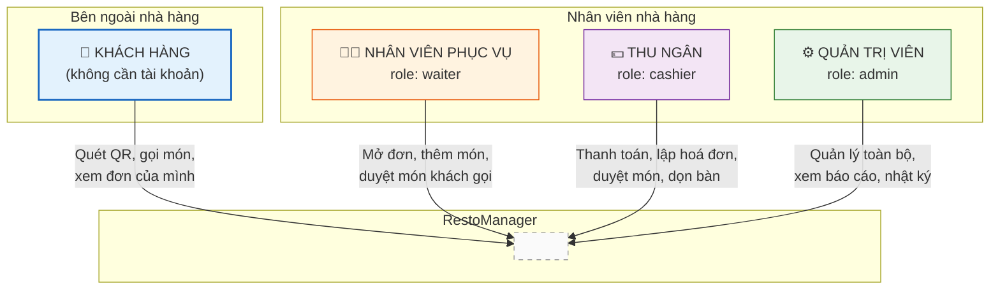

### B.2.1. Mô tả chi tiết từng tác nhân

#### 👤 Khách hàng (Customer)

| Thuộc tính | Mô tả |
|---|---|
| **Định danh** | Không có tài khoản. Được nhận diện bằng **phiên khách** (`guest_sessions`) gắn với một bàn cụ thể và một guest token lưu trong trình duyệt. |
| **Thời gian sống** | Mặc định 6 giờ, hoặc đến khi thanh toán xong / bàn được dọn. |
| **Thiết bị** | Điện thoại cá nhân, trình duyệt web thông thường, không cần cài ứng dụng. |
| **Dữ liệu cá nhân** | **Không bắt buộc**. Tên hiển thị và số điện thoại là tuỳ chọn. |
| **Quyền** | Xem thực đơn của bàn mình · Gửi món · Xem lịch sử gọi món **của chính mình** · Cập nhật tên hiển thị · Kết thúc phiên |
| **Không được phép** | Xem đơn của bàn khác · Xem doanh thu · Xem thông tin nhân viên · Sửa/xoá món đã gửi · Tự thanh toán |

> **Vì sao khách hàng là actor thực thụ từ phiên bản 3?**
> Ở phiên bản trước, khách chỉ là "người gửi POST request vào API công khai" —
> không có định danh, không có trạng thái, không xem lại được gì. Từ phiên bản
> này, khách có phiên riêng, dữ liệu riêng (2 bảng), quyền hạn được định nghĩa
> rõ và giao diện riêng. Đó là định nghĩa của một actor.

#### 🧑‍🍳 Nhân viên phục vụ (Waiter)

| | |
|---|---|
| **Mục tiêu chính** | Ghi món nhanh và chính xác, phục vụ đúng bàn |
| **Quyền** | Xem sơ đồ bàn · Mở đơn mới · Thêm/sửa/xoá món · **Duyệt món khách gọi qua QR** · Đánh dấu món đã phục vụ · Xem thực đơn |
| **Không được phép** | Thanh toán · Xem báo cáo doanh thu · Quản lý nhân viên/thực đơn/bàn |

#### 💵 Thu ngân (Cashier)

| | |
|---|---|
| **Mục tiêu chính** | Thu đúng tiền, hoá đơn chính xác, không giữ khách lâu |
| **Quyền** | Toàn bộ quyền xem đơn · **Thanh toán & lập hoá đơn** · Áp dụng VAT và giảm giá · Duyệt món khách gọi · Chuyển bàn · Dọn bàn · Bật/tắt bàn · Xem thống kê ca |
| **Không được phép** | Mở đơn mới (đó là việc của phục vụ) · Quản lý nhân viên/thực đơn · Xem nhật ký hệ thống |

#### ⚙️ Quản trị viên (Admin)

| | |
|---|---|
| **Mục tiêu chính** | Vận hành, cấu hình, giám sát |
| **Quyền** | Mọi quyền của hai vai trò trên, cộng thêm: quản lý nhân viên · quản lý thực đơn và ảnh món · quản lý bàn và mã QR · xem dashboard · xem nhật ký hoạt động · xem bản đồ kiến trúc hệ thống |
| **Ràng buộc đặc biệt** | Hệ thống **luôn phải còn ít nhất một admin đang hoạt động** — không thể tự xoá mình, không thể khoá/hạ quyền admin cuối cùng (`assertNotLastAdmin`) |

### B.2.2. Ma trận phân quyền

Ma trận này **không phải tài liệu suông** — nó là mã nguồn thật trong
`back-end/src/modules/identity/domain/roles.js`, và mọi endpoint đều kiểm tra
qua `requirePermission(action)`.

| Hành động | Khách | Phục vụ | Thu ngân | Quản trị |
|---|:---:|:---:|:---:|:---:|
| `menu.read` — xem thực đơn | ✅* | ✅ | ✅ | ✅ |
| `menu.write` — thêm/sửa/xoá món | ❌ | ❌ | ❌ | ✅ |
| `table.read` — xem sơ đồ bàn | ❌ | ✅ | ✅ | ✅ |
| `table.write` — thêm/sửa/xoá bàn, cấp lại QR | ❌ | ❌ | ❌ | ✅ |
| `table.operate` — bật/tắt bàn, dọn bàn | ❌ | ❌ | ✅ | ✅ |
| `order.read` — xem đơn | ✅** | ✅ | ✅ | ✅ |
| `order.create` — mở đơn mới | ✅*** | ✅ | ❌ | ✅ |
| `order.modify` — thêm/sửa/xoá món trong đơn | ❌ | ✅ | ✅ | ✅ |
| `order.move` — chuyển bàn | ❌ | ❌ | ✅ | ✅ |
| `order.confirm_guest` — duyệt món khách gọi | ❌ | ✅ | ✅ | ✅ |
| `invoice.checkout` — thanh toán | ❌ | ❌ | ✅ | ✅ |
| `invoice.read` — xem hoá đơn | ❌ | ❌ | ✅ | ✅ |
| `stats.read` — xem báo cáo | ❌ | ❌ | ✅ | ✅ |
| `log.read` — xem nhật ký | ❌ | ❌ | ❌ | ✅ |
| `user.read` / `user.write` — quản lý nhân viên | ❌ | ❌ | ❌ | ✅ |

\* Khách chỉ xem thực đơn các món **đang bán**, qua endpoint riêng không lộ trường quản trị
\*\* Khách chỉ xem **lịch sử gọi món của chính mình**, không xem đơn của bàn
\*\*\* Gián tiếp: gửi món lần đầu sẽ tự mở đơn cho bàn, nhưng món ở trạng thái chờ duyệt

---

## B.3. Yêu cầu chức năng

Ký hiệu: **FR** = Functional Requirement. Mức độ: **Bắt buộc** / **Nên có** / **Tuỳ chọn**.

### FR-1. Quản lý danh tính và phân quyền

| Mã | Yêu cầu | Mức độ | Module |
|---|---|---|---|
| FR-1.1 | Nhân viên đăng nhập bằng tên đăng nhập và mật khẩu; hệ thống cấp cặp access token (ngắn hạn) và refresh token (dài hạn) | Bắt buộc | identity |
| FR-1.2 | Access token hết hạn thì client tự làm mới bằng refresh token, người dùng **không bị đăng xuất giữa ca** | Bắt buộc | identity |
| FR-1.3 | Refresh token được **xoay vòng**: mỗi lần làm mới cấp token mới, token cũ bị thu hồi ngay | Bắt buộc | identity |
| FR-1.4 | Phát hiện tái sử dụng refresh token đã thu hồi → thu hồi **toàn bộ phiên** của tài khoản đó | Nên có | identity |
| FR-1.5 | Đăng xuất một thiết bị hoặc tất cả thiết bị | Bắt buộc | identity |
| FR-1.6 | Người dùng tự đổi mật khẩu; đổi xong mọi thiết bị khác bị đăng xuất | Bắt buộc | identity |
| FR-1.7 | Quản trị viên tạo/sửa/khoá/xoá tài khoản nhân viên, đặt lại mật khẩu | Bắt buộc | identity |
| FR-1.8 | Hệ thống luôn còn ít nhất một quản trị viên đang hoạt động | Bắt buộc | identity |
| FR-1.9 | Phân quyền theo **hành động nghiệp vụ** (không phải theo vai trò cứng), cho phép thêm vai trò mới mà không sửa từng endpoint | Nên có | identity |
| FR-1.10 | Khoá tài khoản → mọi phiên của người đó hết hiệu lực ngay | Bắt buộc | identity |

### FR-2. Quản lý thực đơn

| Mã | Yêu cầu | Mức độ | Module |
|---|---|---|---|
| FR-2.1 | Quản lý danh mục món (khai vị, món chính, đồ uống, tráng miệng) có thứ tự hiển thị | Bắt buộc | catalog |
| FR-2.2 | Thêm/sửa/xoá món với tên, mô tả, giá, danh mục, biểu tượng | Bắt buộc | catalog |
| FR-2.3 | Tải ảnh món lên kho đối tượng (MinIO/S3/R2); thay ảnh thì xoá ảnh cũ | Bắt buộc | catalog |
| FR-2.4 | Bật/tắt trạng thái bán của món; món tắt không hiện trên thực đơn khách | Bắt buộc | catalog |
| FR-2.5 | Tên món là **duy nhất** trong thực đơn | Bắt buộc | catalog |
| FR-2.6 | Tìm kiếm và lọc món theo danh mục, theo trạng thái | Nên có | catalog |
| FR-2.7 | **Giá bán là nguồn chân lý duy nhất**: mọi nơi tính tiền đều lấy giá từ CSDL, không nhận giá từ client | Bắt buộc | catalog |

### FR-3. Quản lý bàn và mã QR

| Mã | Yêu cầu | Mức độ | Module |
|---|---|---|---|
| FR-3.1 | Quản lý khu vực (trong nhà, sân vườn, VIP) dưới dạng **dữ liệu**, thêm khu vực mới không cần sửa mã | Nên có | dining |
| FR-3.2 | Thêm/sửa/xoá bàn với mã bàn, khu vực, sức chứa, ghi chú | Bắt buộc | dining |
| FR-3.3 | Mỗi bàn có **đúng một mã QR** gắn với một chuỗi ngẫu nhiên không đoán được | Bắt buộc | dining |
| FR-3.4 | In mã QR của từng bàn | Bắt buộc | dining |
| FR-3.5 | Cấp lại mã QR mới cho bàn, mã cũ lập tức vô hiệu | Nên có | dining |
| FR-3.6 | Sơ đồ bàn hiển thị trạng thái theo thời gian thực: trống / đang gọi món / đang phục vụ / chờ thanh toán / tạm ngưng | Bắt buộc | dining |
| FR-3.7 | Hiển thị số tiền tạm tính, thời gian khách đã ngồi, số yêu cầu QR chờ duyệt trên từng bàn | Nên có | dining |
| FR-3.8 | Tạm ngưng bàn (sửa chữa); **không cho tạm ngưng bàn đang có khách** | Bắt buộc | dining |

### FR-4. Gọi món tại bàn (nhân viên)

| Mã | Yêu cầu | Mức độ | Module |
|---|---|---|---|
| FR-4.1 | Mở đơn mới cho một bàn trống | Bắt buộc | ordering |
| FR-4.2 | **Mỗi bàn chỉ có tối đa một đơn đang mở** tại một thời điểm | Bắt buộc | ordering |
| FR-4.3 | Thêm món vào đơn đang mở | Bắt buộc | ordering |
| FR-4.4 | Sửa số lượng, sửa ghi chú, xoá món khỏi đơn | Bắt buộc | ordering |
| FR-4.5 | Đơn có vòng đời rõ ràng: chờ xử lý → đang phục vụ → hoàn tất / huỷ | Bắt buộc | ordering |
| FR-4.6 | Chuyển đơn sang bàn khác; bàn đích phải trống và đang hoạt động | Nên có | ordering |
| FR-4.7 | Dọn bàn: huỷ đơn đang mở mà **không lập hoá đơn** (khách bỏ về) | Nên có | ordering |
| FR-4.8 | Nhân viên nhập món ngoài thực đơn (món đặc biệt theo yêu cầu) | Tuỳ chọn | ordering |
| FR-4.9 | Đánh dấu món đã được phục vụ ra bàn | Nên có | ordering |

### FR-5. Khách hàng tự gọi món qua mã QR ⭐

> Nhóm chức năng trọng tâm của phiên bản 3, trả lời nhận xét #3, #4, #5 của giảng viên.

| Mã | Yêu cầu | Mức độ | Module |
|---|---|---|---|
| FR-5.1 | Khách quét mã QR trên bàn, mở được trang gọi món **không cần cài ứng dụng, không cần đăng nhập** | Bắt buộc | guest-access |
| FR-5.2 | Hệ thống tạo **phiên khách** gắn với bàn đó, cấp token lưu trong trình duyệt khách | Bắt buộc | guest-access |
| FR-5.3 | Khách tải lại trang hoặc mở lại link sau đó → **tiếp tục phiên cũ**, thấy lại lịch sử, không mất giỏ hàng | Bắt buộc | guest-access |
| FR-5.4 | Phiên **tự hết hạn** sau 6 giờ (cấu hình được), hoặc khi thanh toán xong / bàn được dọn | Bắt buộc | guest-access |
| FR-5.5 | Khách nhập tên hiển thị để nhân viên gọi đúng người — **không bắt buộc** | Nên có | guest-access |
| FR-5.6 | Khách xem thực đơn gồm **các món đang bán**, có tìm kiếm và lọc theo danh mục | Bắt buộc | guest-access |
| FR-5.7 | Khách chọn món vào giỏ, điều chỉnh số lượng, ghi chú cho bếp, rồi gửi | Bắt buộc | guest-access |
| FR-5.8 | **Giá luôn lấy từ CSDL** — khách không thể can thiệp giá qua request | Bắt buộc | catalog |
| FR-5.9 | Lần gửi đầu tiên tự mở đơn cho bàn; các lần sau thêm vào đơn đang mở | Bắt buộc | ordering |
| FR-5.10 | ⭐ **Món khách gọi ở trạng thái "chờ xác nhận"**, chưa tính vào tổng tiền đơn cho đến khi nhân viên duyệt | Bắt buộc | ordering |
| FR-5.11 | ⭐ **Khách xem được lịch sử đặt món của mình** — từng lần gửi, từng món, trạng thái xác nhận, lý do bị từ chối | Bắt buộc | guest-access |
| FR-5.12 | Khách thấy riêng "tiền đã xác nhận" và "tiền đang chờ duyệt" | Nên có | guest-access |
| FR-5.13 | Khi nhân viên duyệt/từ chối, màn hình khách **tự cập nhật** không cần tải lại trang | Bắt buộc | guest-access |
| FR-5.14 | Món bị từ chối hiển thị rõ **lý do** (hết món, hết nguyên liệu…) | Bắt buộc | guest-access |
| FR-5.15 | Chống spam: giới hạn số món mỗi lần gửi, số lượng mỗi món, số lần gửi trong 10 phút; vượt ngưỡng thì khoá phiên | Bắt buộc | guest-access |
| FR-5.16 | Khách chủ động kết thúc phiên | Tuỳ chọn | guest-access |
| FR-5.17 | Mã QR của bàn dùng chuỗi ngẫu nhiên, **không dùng mã bàn** để khách không đoán được link bàn khác | Bắt buộc | dining |

### FR-6. Xác nhận món khách gọi (nhân viên) ⭐

| Mã | Yêu cầu | Mức độ | Module |
|---|---|---|---|
| FR-6.1 | Nhân viên xem **hàng đợi** các yêu cầu khách gửi đang chờ duyệt, sắp theo thời gian chờ | Bắt buộc | guest-access |
| FR-6.2 | Có yêu cầu mới thì màn hình nhân viên **tự hiện**, không cần bấm làm mới | Bắt buộc | ordering |
| FR-6.3 | Hiển thị thời gian chờ, tô màu cảnh báo khi quá 5 phút / 10 phút | Nên có | guest-access |
| FR-6.4 | Xác nhận **cả lượt gửi** → mọi món vào đơn chính thức và tính tiền | Bắt buộc | ordering |
| FR-6.5 | Từ chối **cả lượt gửi** kèm lý do | Bắt buộc | ordering |
| FR-6.6 | Từ chối **từng món riêng lẻ** — khi chỉ hết đúng một món trong lượt gọi | Bắt buộc | ordering |
| FR-6.7 | Trạng thái tổng hợp của lượt gửi được tính lại: đã duyệt / từ chối / **duyệt một phần** | Bắt buộc | guest-access |
| FR-6.8 | Không thể duyệt lại một yêu cầu đã xử lý | Bắt buộc | ordering |
| FR-6.9 | Có thể cấu hình **tắt chế độ duyệt** cho mô hình tự phục vụ (`GUEST_REQUIRE_CONFIRMATION=false`) | Tuỳ chọn | guest-access |

### FR-7. Thanh toán và hoá đơn

| Mã | Yêu cầu | Mức độ | Module |
|---|---|---|---|
| FR-7.1 | Lập hoá đơn cho một đơn đang mở | Bắt buộc | billing |
| FR-7.2 | Áp dụng VAT (mặc định 8%, sửa được) và giảm giá kèm ghi chú | Bắt buộc | billing |
| FR-7.3 | Ghi nhận số tiền khách đưa và tính tiền thừa | Bắt buộc | billing |
| FR-7.4 | Hỗ trợ nhiều phương thức: tiền mặt, thẻ, chuyển khoản, MoMo, VNPay, ZaloPay, GrabFood… | Bắt buộc | billing |
| FR-7.5 | **Mỗi đơn chỉ xuất đúng một hoá đơn** — chống thu tiền hai lần | Bắt buộc | billing |
| FR-7.6 | ⭐ **Chặn thanh toán khi đơn còn món khách gọi chưa được duyệt** | Bắt buộc | billing |
| FR-7.7 | Hoá đơn chỉ gồm **các món đã được xác nhận** — món bị từ chối không tính tiền | Bắt buộc | billing |
| FR-7.8 | Nội dung hoá đơn **bất biến**: sao chép tên và giá món tại thời điểm xuất, không đổi theo thực đơn sau này | Bắt buộc | billing |
| FR-7.9 | Lập hoá đơn và đóng đơn là **một giao dịch nguyên tử** | Bắt buộc | billing |
| FR-7.10 | Tra cứu lịch sử hoá đơn theo bàn, thu ngân, phương thức, khoảng thời gian | Bắt buộc | billing |
| FR-7.11 | Thanh toán xong → bàn tự về trạng thái trống, phiên khách tự đóng | Bắt buộc | — |

### FR-8. Báo cáo và nhật ký

| Mã | Yêu cầu | Mức độ | Module |
|---|---|---|---|
| FR-8.1 | Dashboard: doanh thu, số hoá đơn, trung bình mỗi hoá đơn trong khoảng thời gian | Bắt buộc | analytics |
| FR-8.2 | Biểu đồ doanh thu theo giờ trong ngày | Bắt buộc | analytics |
| FR-8.3 | Doanh thu theo ngày (tối đa 90 ngày) | Nên có | analytics |
| FR-8.4 | Top món bán chạy theo số lượng | Bắt buộc | analytics |
| FR-8.5 | Tỷ trọng doanh thu theo phương thức thanh toán | Nên có | analytics |
| FR-8.6 | Số liệu báo cáo tự cập nhật khi có hoá đơn mới | Nên có | analytics |
| FR-8.7 | Dựng lại toàn bộ dữ liệu báo cáo từ nguồn gốc khi nghi ngờ sai lệch | Nên có | analytics |
| FR-8.8 | Nhật ký **tự động** ghi lại mọi thao tác quan trọng: ai, làm gì, lúc nào, trên đối tượng nào | Bắt buộc | auditing |
| FR-8.9 | Tra cứu nhật ký theo thời gian, hành động, module, người thực hiện | Bắt buộc | auditing |
| FR-8.10 | Xem **dòng thời gian đầy đủ của một đối tượng** (ví dụ toàn bộ thao tác trên một đơn) phục vụ xử lý khiếu nại | Nên có | auditing |
| FR-8.11 | Nhật ký tự dọn sau 180 ngày | Nên có | auditing |

### FR-9. Đồng bộ thời gian thực

| Mã | Yêu cầu | Mức độ |
|---|---|---|
| FR-9.1 | Trạng thái bàn đổi → mọi màn hình nhân viên cập nhật trong **dưới 1 giây** | Bắt buộc |
| FR-9.2 | Đơn mới / sửa đơn → thu ngân và phục vụ thấy ngay | Bắt buộc |
| FR-9.3 | Khách gửi món → nhân viên nhận thông báo ngay | Bắt buộc |
| FR-9.4 | Nhân viên duyệt/từ chối → **đúng phiên khách đó** nhận kết quả, các khách khác không thấy | Bắt buộc |
| FR-9.5 | Thanh toán xong → dashboard quản trị tự cập nhật | Nên có |
| FR-9.6 | Mất kết nối thì tự kết nối lại và đồng bộ trạng thái mới nhất | Bắt buộc |

**Tổng cộng: 42 chức năng** (tính các mục có mã FR và mức độ Bắt buộc/Nên có).

---

## B.4. Yêu cầu phi chức năng

Mỗi yêu cầu có **tiêu chí đo được** và **cách kiểm chứng** — không phát biểu chung chung.

### NFR-1. Hiệu năng

| Mã | Yêu cầu | Tiêu chí đo | Cách kiểm chứng | Kết quả |
|---|---|---|---|---|
| NFR-1.1 | API đọc phản hồi nhanh | p95 < 200 ms với 50 bàn | Đo thời gian trong `request-context.js`, xem log | ✅ Đa số < 10 ms (đo cục bộ) |
| NFR-1.2 | Sơ đồ bàn tải nhanh | < 300 ms với 50 bàn | Hình chiếu `dining_table_state` phẳng, **không JOIN sang orders** | ✅ ~2 ms |
| NFR-1.3 | Dashboard không quét toàn bảng | Độc lập với số lượng hoá đơn tích luỹ | Hình chiếu `analytics_revenue_hourly` cộng dồn sẵn | ✅ Đọc ≤ 24 dòng/ngày |
| NFR-1.4 | Sự kiện thời gian thực tới nơi nhanh | < 1 giây | Kiểm thử WebSocket đầu-cuối | ✅ Đo được < 900 ms |
| NFR-1.5 | Thời gian khởi động dịch vụ | < 10 giây | Log `boot` ghi lại thời gian | ✅ 234 ms (không kể chờ CSDL) |
| NFR-1.6 | Tránh truy vấn N+1 | Danh sách hoá đơn nạp dòng món bằng 1 truy vấn | `attachItemsBulk` dùng `ANY($1::uuid[])` | ✅ |
| NFR-1.7 | Ảnh món tải nhanh ở mọi vùng | Cache tại biên CDN | Cloudflare proxy + `Cache-Control: immutable` | ✅ |

### NFR-2. Bảo mật

| Mã | Yêu cầu | Tiêu chí | Thực hiện |
|---|---|---|---|
| NFR-2.1 | Mật khẩu không bao giờ lưu dạng rõ | bcrypt, cost ≥ 10 | `bcryptjs`, cấu hình `BCRYPT_ROUNDS` |
| NFR-2.2 | Token truy cập sống ngắn | ≤ 15 phút | `JWT_EXPIRES=15m` |
| NFR-2.3 | Refresh token thu hồi được | Lưu **hash SHA-256**, không lưu token gốc | `refresh_tokens.token_hash` |
| NFR-2.4 | Access token và refresh token dùng **secret khác nhau** | Kiểm tra lúc khởi động, production thì **từ chối chạy** | `shared/config.js` |
| NFR-2.5 | Secret đủ mạnh | ≥ 32 ký tự, không trùng danh sách giá trị mẫu | Kiểm tra 2 lớp: `config.js` + `deploy.sh` |
| NFR-2.6 | Guest token không giả mạo được | HMAC-SHA256, so sánh thời gian hằng định | `guest-session.js`, `crypto.timingSafeEqual` |
| NFR-2.7 | Không lộ tài khoản nào tồn tại | Thông báo đăng nhập sai giống hệt nhau | `auth-service.js` |
| NFR-2.8 | Chống dò mật khẩu | 10 lần sai / 15 phút / (IP + tên đăng nhập) | `authLimiter` |
| NFR-2.9 | Chống spam API công khai | 30 request/phút/IP + giới hạn nghiệp vụ 8 lượt gửi/10 phút | `publicLimiter` + `MAX_REQUESTS_PER_10_MIN` |
| NFR-2.10 | IP khách không giả mạo được sau proxy | Ưu tiên `CF-Connecting-IP`, nếu không thì lấy phần tử **cuối** của `X-Forwarded-For` | `rate-limit.js` |
| NFR-2.11 | CORS theo danh sách trắng | Production bắt buộc `ALLOWED_ORIGINS`, cộng ngoại lệ cùng nguồn | `security.js` |
| NFR-2.12 | Giá không sửa được từ client | Mọi định giá đi qua `catalog.priceBasket()` | Kiểm thử E2E có ca "gửi price=1" |
| NFR-2.13 | Khách không xem được dữ liệu bàn khác | Truy vấn luôn bị giới hạn bởi `guest_session_id` | `guest-order-service.js` |
| NFR-2.14 | Mã QR không đoán được | `qr_slug` 12 ký tự hex ngẫu nhiên | `tables.qr_slug UNIQUE` |
| NFR-2.15 | Container không chạy bằng root | `USER node` | `back-end/Dockerfile` |
| NFR-2.16 | CSDL không phơi ra Internet | Production gỡ toàn bộ `ports` của postgres/minio/backend | `docker-compose.prod.yml` |
| NFR-2.17 | HTTPS bắt buộc, chứng chỉ tự gia hạn | Caddy + Let's Encrypt, HSTS 1 năm | `deploy/Caddyfile` |
| NFR-2.18 | Không ghi log dữ liệu nhạy cảm | Không log thân request, không log mật khẩu/token | `request-context.js` |

### NFR-3. Độ tin cậy và toàn vẹn dữ liệu

| Mã | Yêu cầu | Thực hiện |
|---|---|---|
| NFR-3.1 | Không có hai đơn mở trên cùng một bàn, **kể cả khi hai request đến đồng thời** | Partial unique index `one_open_order_per_table` ở tầng CSDL + advisory lock |
| NFR-3.2 | Thanh toán và đóng đơn là nguyên tử | Cùng một transaction PostgreSQL (`closeOrderWithin`) |
| NFR-3.3 | Tổng tiền đơn luôn đúng | Tính **lại từ các dòng món**, không cộng dồn |
| NFR-3.4 | Tiền VND không sai số | Mọi phép tính qua `shared/money.js`, làm tròn về số nguyên đồng tại một chỗ duy nhất |
| NFR-3.5 | Hình chiếu trạng thái bàn tự chữa lành | Dựng lại từ đơn đang mở mỗi lần khởi động |
| NFR-3.6 | Dữ liệu báo cáo dựng lại được | `POST /api/stats/rebuild` từ bảng hoá đơn |
| NFR-3.7 | Migration chạy đúng một lần, ghi lại checksum | Bảng `schema_migrations` |
| NFR-3.8 | Sao lưu tự động hằng ngày, giữ 14 ngày | Dịch vụ `backup` trong Compose |
| NFR-3.9 | Tắt dịch vụ không cắt ngang giao dịch | Graceful shutdown có giới hạn 15 giây |
| NFR-3.10 | Kho ảnh hỏng không làm sập bán hàng | Khởi tạo kho **không chặn** khởi động; `/api/health` báo `degraded` |

### NFR-4. Khả năng bảo trì và mở rộng

| Mã | Yêu cầu | Tiêu chí đo | Thực hiện |
|---|---|---|---|
| NFR-4.1 | Ranh giới module không bị xói mòn theo thời gian | CI **fail** khi có vi phạm | `npm run check:boundaries` — 5 quy tắc |
| NFR-4.2 | Thêm module mới không sửa mã hiện có | Chỉ tạo thư mục trong `src/modules/` | Module Registry tự khám phá |
| NFR-4.3 | Không có phụ thuộc vòng giữa module | Phát hiện lúc khởi động, **dừng ngay** | Sắp xếp topo trong Registry |
| NFR-4.4 | Tài liệu kiến trúc không lạc hậu | Sinh từ mã nguồn | `GET /api/architecture`, `npm run arch:graph` |
| NFR-4.5 | Quy tắc nghiệp vụ kiểm thử được không cần CSDL | Tầng domain thuần tuý | 24 kiểm thử đơn vị chạy trong 94 ms |
| NFR-4.6 | Đổi nhà cung cấp lưu trữ không sửa mã nghiệp vụ | Chỉ đổi biến môi trường | `StoragePort` + adapter |
| NFR-4.7 | Thêm vai trò mới không sửa từng endpoint | Sửa một ma trận quyền | `domain/roles.js` + `requirePermission` |
| NFR-4.8 | Mỗi bảng CSDL thuộc đúng một module | Khai báo `owns`, kiểm tra tự động | Registry + boundary checker |

### NFR-5. Trải nghiệm người dùng

| Mã | Yêu cầu | Thực hiện |
|---|---|---|
| NFR-5.1 | Khách không phải cài ứng dụng, không phải đăng ký | Web thuần, phiên dựa trên token |
| NFR-5.2 | Giao diện khách tối ưu cho điện thoại | Thiết kế mobile-first, nút bấm ≥ 32 px |
| NFR-5.3 | Thông báo lỗi bằng **tiếng Việt, hướng hành động** | Toàn bộ thông điệp lỗi viết lại theo nguyên tắc "nói rõ phải làm gì tiếp" |
| NFR-5.4 | Khách không mất giỏ hàng khi tải lại trang | Phiên lưu trong `localStorage` theo từng bàn |
| NFR-5.5 | Không phải bấm "Làm mới" để thấy dữ liệu mới | WebSocket đẩy thay đổi |
| NFR-5.6 | Nhân viên biết yêu cầu nào đang chờ lâu | Tô màu theo thời gian chờ |

### NFR-6. Khả năng vận hành

| Mã | Yêu cầu | Thực hiện |
|---|---|---|
| NFR-6.1 | Có endpoint kiểm tra sức khoẻ cho giám sát | `/api/health`, `/api/health/ready`, `/api/health/live` |
| NFR-6.2 | Mỗi request có mã truy vết xuyên suốt | `X-Request-Id` lan sang cả sự kiện bất đồng bộ |
| NFR-6.3 | Log có cấu trúc, phân tích được bằng máy | JSON một dòng ở production |
| NFR-6.4 | Log không làm đầy ổ đĩa | Xoay vòng 3 tệp × 10 MB |
| NFR-6.5 | Một dịch vụ rò rỉ bộ nhớ không kéo sập VPS | Giới hạn RAM/CPU từng container |
| NFR-6.6 | Triển khai có đường lùi | `deploy.sh` sao lưu trước, hướng dẫn khôi phục khi lỗi |
| NFR-6.7 | Cấu hình sai thì **không khởi động**, thay vì chạy sai | Kiểm tra fail-fast trong `config.js` |

**Tổng cộng: 24 nhóm yêu cầu phi chức năng** với 58 tiêu chí cụ thể.

---
---

# Phần C — Sơ đồ phân rã chức năng

Sơ đồ phân rã chức năng (Functional Decomposition Diagram) chia hệ thống thành
các khối chức năng theo nguyên tắc **chia theo năng lực nghiệp vụ**, không chia
theo tầng kỹ thuật. Mỗi chức năng cấp 1 tương ứng với **một module** trong mã
nguồn — đây là điểm then chốt: sơ đồ chức năng và cấu trúc mã nguồn là **một**.

## C.1. Sơ đồ tổng thể (cấp 0 → cấp 1)

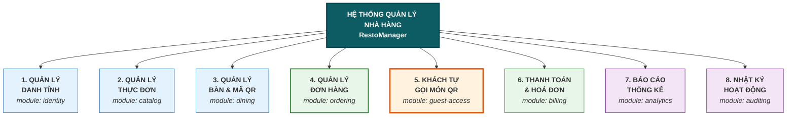

**Chú giải màu:**
🔵 Nền tảng (dữ liệu chủ) · 🟢 Nghiệp vụ lõi · 🟠 Tính năng mới của phiên bản 3 · 🟣 Hỗ trợ (chỉ đọc)

## C.2. Phân rã cấp 2 — nhóm nền tảng

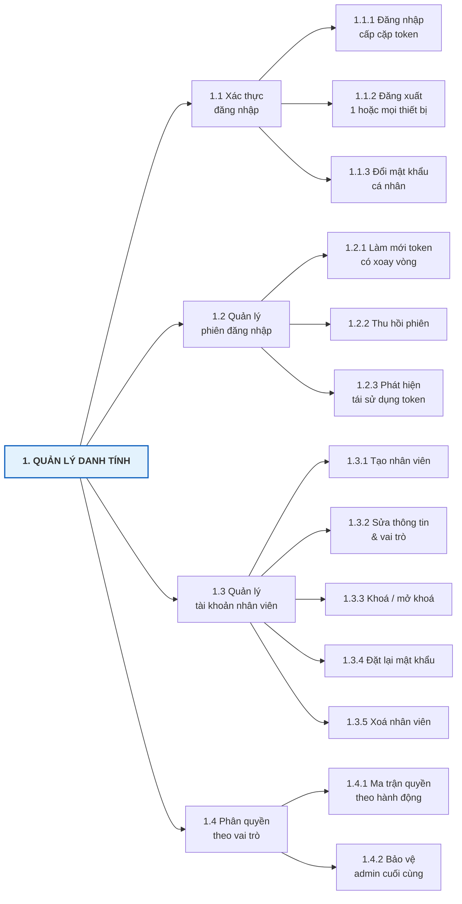

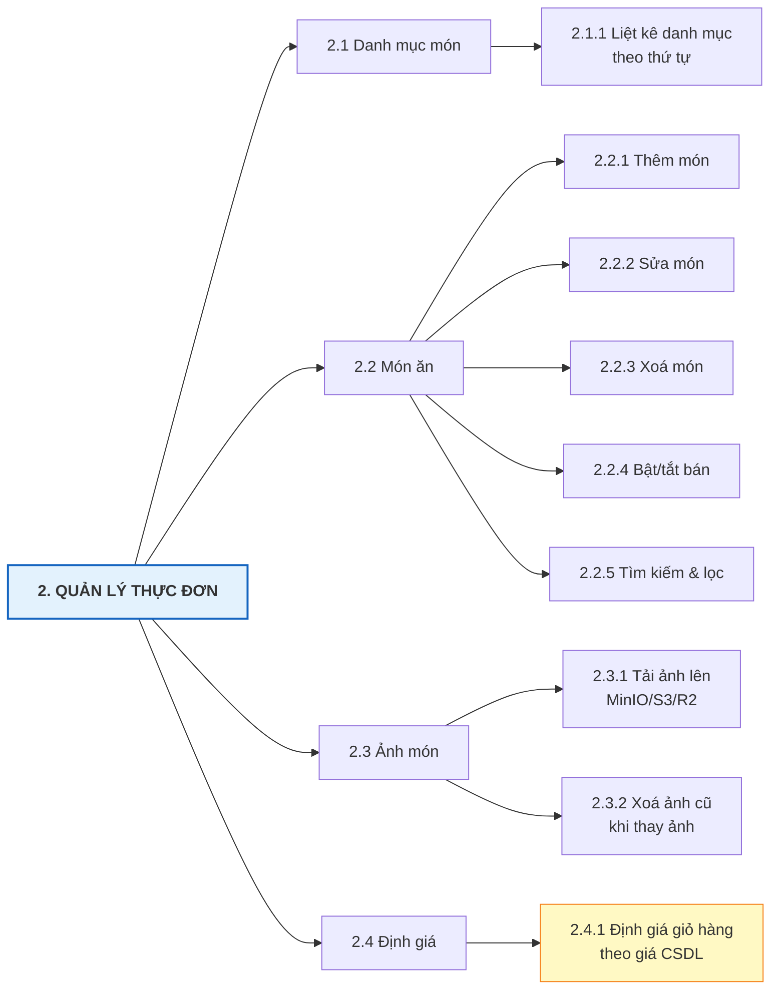

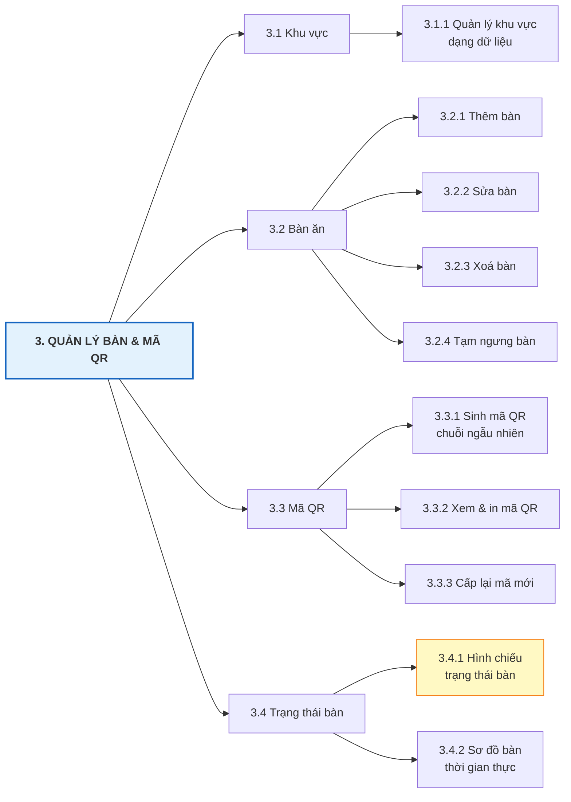

## C.3. Phân rã cấp 2 — nhóm nghiệp vụ lõi

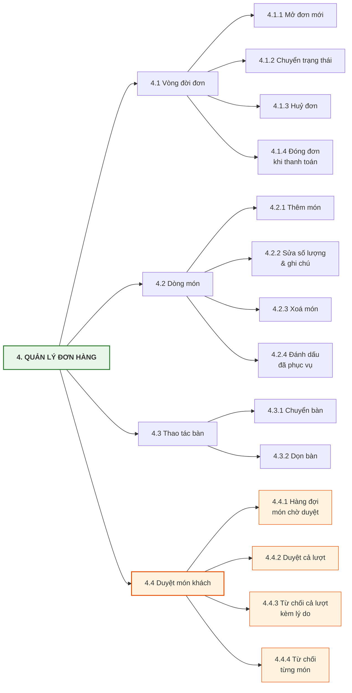

### ⭐ Chức năng 5 — Khách tự gọi món qua mã QR (trọng tâm phiên bản 3)

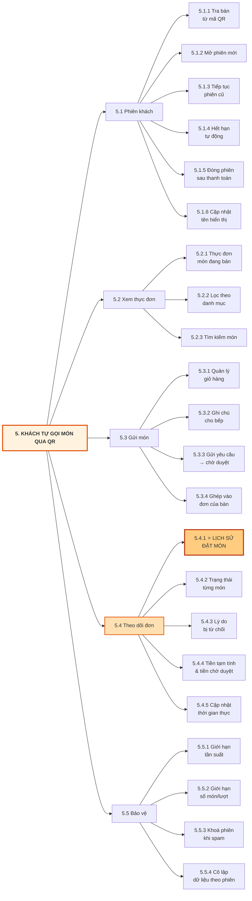

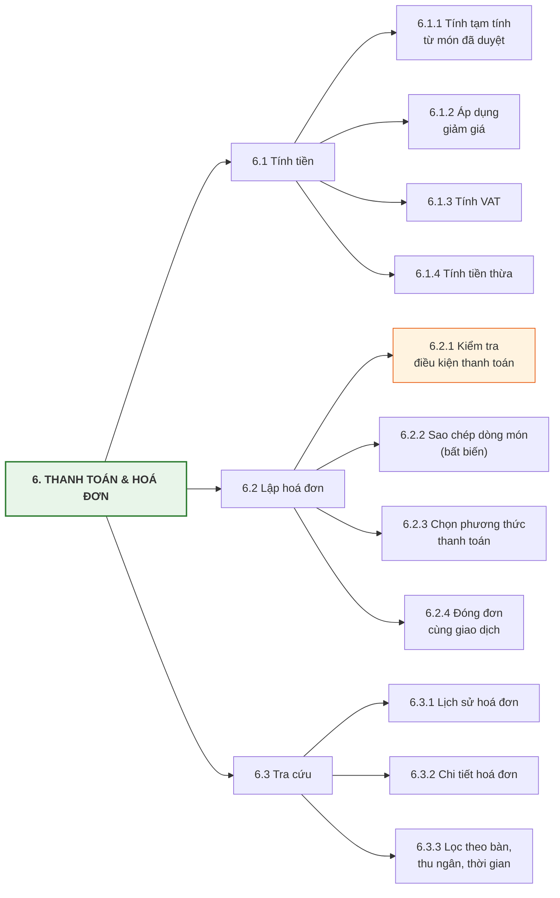

## C.4. Phân rã cấp 2 — nhóm hỗ trợ

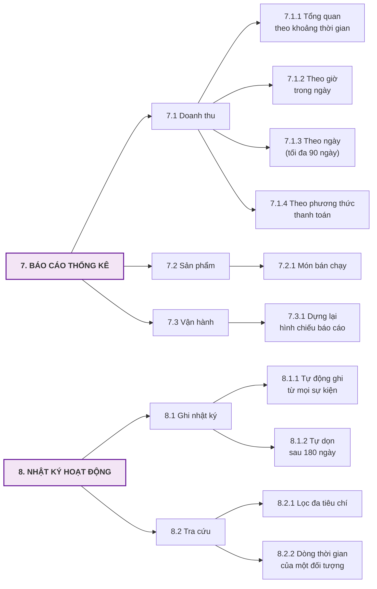

## C.5. Ma trận chức năng × tác nhân

| Chức năng cấp 1 | Khách | Phục vụ | Thu ngân | Quản trị |
|---|:---:|:---:|:---:|:---:|
| 1. Quản lý danh tính | — | Tự đổi mật khẩu | Tự đổi mật khẩu | **Toàn quyền** |
| 2. Quản lý thực đơn | Chỉ xem | Chỉ xem | Chỉ xem | **Toàn quyền** |
| 3. Quản lý bàn & mã QR | — | Xem sơ đồ | Xem + vận hành | **Toàn quyền** |
| 4. Quản lý đơn hàng | — | **Tạo + sửa** | Sửa + duyệt | **Toàn quyền** |
| 5. Khách tự gọi món QR | **Chủ thể** | Duyệt yêu cầu | Duyệt yêu cầu | Duyệt + cấu hình |
| 6. Thanh toán & hoá đơn | — | — | **Chủ thể** | **Toàn quyền** |
| 7. Báo cáo thống kê | — | — | Xem ca của mình | **Toàn quyền** |
| 8. Nhật ký hoạt động | — | — | — | **Toàn quyền** |

---
---

# Phần D — Thiết kế hệ thống

## D.1. Chọn kiến trúc: vì sao Modular Monolith

### D.1.1. Bài toán của phiên bản trước

Phiên bản 2 tổ chức mã nguồn theo **tầng kỹ thuật**:

```
back-end/src/
├── controllers/   ← 10 tệp: authController, orderController, tableController…
├── models/        ← 7 tệp: User, Order, Table, Invoice…
├── routes/        ← 10 tệp
├── middleware/
└── utils/
```

Cách tổ chức này có vẻ gọn gàng, nhưng tạo ra bốn vấn đề cụ thể:

**(1) Muốn hiểu một nghiệp vụ phải mở 4 thư mục.**
Để trả lời câu hỏi "thanh toán hoạt động thế nào?", phải đọc
`routes/orderRoutes.js` → `controllers/orderController.js` →
`models/Invoice.js` → `models/Order.js`, ở bốn thư mục khác nhau.

**(2) Không có ranh giới — mọi thứ chạm được mọi thứ.**
`orderController` import thẳng `TableModel`, `InvoiceModel`, `LogModel`,
`realtime`. `Invoice.js` import `Order.js`. `Order.js` truy vấn thẳng bảng
`tables`. Không có quy tắc nào ngăn cản, và cũng không có công cụ nào phát
hiện khi quy tắc bị phá.

**(3) Phụ thuộc hai chiều.**
`Table.js` truy vấn bảng `orders` (để biết bàn có khách không), đồng thời
`Order.js` truy vấn bảng `tables` (để kiểm tra bàn tồn tại). Hai thực thể
phụ thuộc lẫn nhau → đổi một cái là phải kiểm tra cả hai.

**(4) Ghi nhật ký rải rác 23 chỗ.**
Mỗi controller tự gọi `LogModel.write({...}).catch(() => {})`. Thêm tính
năng mới rất dễ quên; muốn đổi định dạng nhật ký phải sửa cả 23 chỗ.

> Đây chính là điều giảng viên nhận xét: *"mã nguồn mới là demo, chưa phân
> theo modular monolithic"*. Mã chạy được, nhưng chưa phải Modular Monolith.

### D.1.2. Ba lựa chọn kiến trúc đã cân nhắc

| Tiêu chí | Monolith phân tầng<br/>*(phiên bản 2)* | **Modular Monolith**<br/>*(đã chọn)* | Microservices |
|---|---|---|---|
| Ranh giới nghiệp vụ | ❌ Không có | ✅ Rõ ràng, cưỡng chế bằng công cụ | ✅ Cứng (tiến trình riêng) |
| Giao dịch xuyên nghiệp vụ | ✅ ACID | ✅ ACID | ❌ Phải dùng Saga + bù trừ |
| Độ phức tạp vận hành | ✅ Thấp (1 tiến trình) | ✅ Thấp (1 tiến trình) | ❌ Cao (service mesh, tracing…) |
| Chi phí hạ tầng | ✅ 1 VPS 5 USD/tháng | ✅ 1 VPS 5 USD/tháng | ❌ Nhiều máy + broker |
| Gỡ lỗi | ✅ Một stack trace | ✅ Một stack trace | ❌ Lần vết phân tán |
| Triển khai | ✅ Một lệnh | ✅ Một lệnh | ❌ Điều phối nhiều dịch vụ |
| Mở rộng theo từng phần | ❌ Không | ⚠️ Chỉ theo chiều ngang cả khối | ✅ Từng dịch vụ |
| Đội ngũ phù hợp | 1–5 người | **1–15 người** | > 20 người, nhiều đội |
| Khả năng tách ra sau này | ❌ Rất khó | ✅ **Đã sẵn đường cắt** | — |

### D.1.3. Vì sao Modular Monolith là lựa chọn đúng cho bài toán này

**Lý do 1 — Nghiệp vụ nhà hàng cần giao dịch nguyên tử.**

Thanh toán phải làm ba việc cùng lúc: đọc đơn, lập hoá đơn, đóng đơn. Nếu
tách thành ba dịch vụ riêng, tình huống "hoá đơn đã lập nhưng đơn chưa đóng"
là có thật — thu ngân bấm thanh toán lần hai, nhà hàng thu tiền hai lần. Để
tránh, microservices phải triển khai Saga với hành động bù trừ và trạng thái
trung gian.

Với Modular Monolith, ba module dùng chung một kết nối PostgreSQL, nên:

```js
// modules/billing/application/checkout-service.js
await db.transaction(async (client) => {
  const order = await ordering.getOrderRaw(orderId, client);   // module ordering
  ordering.assertReadyForCheckout(order, items);               // quy tắc của ordering
  const invoice = await repo.insert({...}, client);            // module billing
  await repo.insertItems(invoice.id, billable, client);        // module billing
  await ordering.closeOrderWithin(client, orderId);            // module ordering
});
// Hoặc cả năm bước cùng thành công, hoặc cùng bị huỷ. Không có trạng thái lỡ dở.
```

**Lý do 2 — Quy mô bài toán.**

Một nhà hàng 50 bàn, giờ cao điểm khoảng 50 đơn/giờ. Một tiến trình Node.js
trên VPS 2 nhân xử lý thoải mái. Chia thành 8 dịch vụ chỉ làm tăng độ trễ
(mỗi lời gọi nội bộ thành một request mạng) và tăng chi phí vận hành, không
đổi lại được gì.

**Lý do 3 — Vẫn giữ được đường cắt cho tương lai.**

Nếu sau này chuỗi nhà hàng mở rộng và module `analytics` cần tài nguyên riêng,
việc tách nó ra chỉ gồm: (a) chép thư mục `modules/analytics/` sang dự án mới,
(b) thay thân các hàm trong `contract.js` bằng lời gọi HTTP, (c) thay `publish`
của event bus bằng message broker. **Nơi gọi không phải sửa** — vì nơi gọi chỉ
biết contract, không biết bên trong.

> **Kết luận:** Modular Monolith cho ta kỷ luật về ranh giới của microservices
> mà không phải trả giá về độ phức tạp vận hành và tính nhất quán dữ liệu.

---

## D.2. Bản đồ module

### D.2.1. Sơ đồ kiến trúc tổng thể

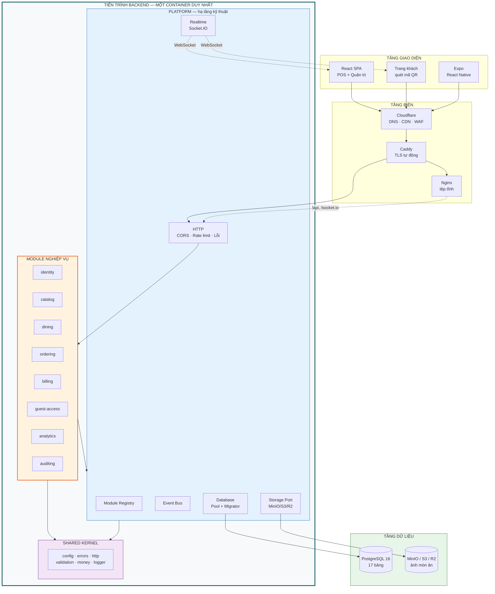

### D.2.2. Bảng tổng hợp module

| Module | Vai trò nghiệp vụ | Phụ thuộc | Bảng sở hữu | REST |
|---|---|---|---|---|
| **identity** | Tài khoản, xác thực, phân quyền | *(không)* | `users`, `refresh_tokens` | `/api/auth`, `/api/users` |
| **catalog** | Thực đơn, giá, ảnh món | identity | `menu_categories`, `menu_items` | `/api/menu`, `/api/files` |
| **dining** | Khu vực, bàn, mã QR, trạng thái bàn | identity | `dining_zones`, `tables`, `dining_table_state` | `/api/tables` |
| **ordering** | Đơn hàng, dòng món, duyệt món khách | identity, dining, catalog | `orders`, `order_items` | `/api/orders` |
| **billing** | Tính tiền, hoá đơn | identity, ordering | `invoices`, `invoice_items` | `/api/invoices` |
| **guest-access** | Phiên khách QR, lịch sử gọi món | identity, dining, catalog, ordering | `guest_sessions`, `guest_order_requests` | `/api/public`, `/api/guest-requests` |
| **analytics** | Báo cáo doanh thu (chỉ đọc) | identity, billing | `analytics_revenue_hourly`, `analytics_item_sales` | `/api/stats` |
| **auditing** | Nhật ký hoạt động | identity | `activity_logs` | `/api/logs` |

### D.2.3. Sơ đồ phụ thuộc (sinh tự động từ mã nguồn)

> Sơ đồ dưới đây được sinh bằng lệnh `npm run arch:graph`, đọc trực tiếp
> manifest của từng module. Tài liệu vì vậy **không thể lạc hậu** so với mã.

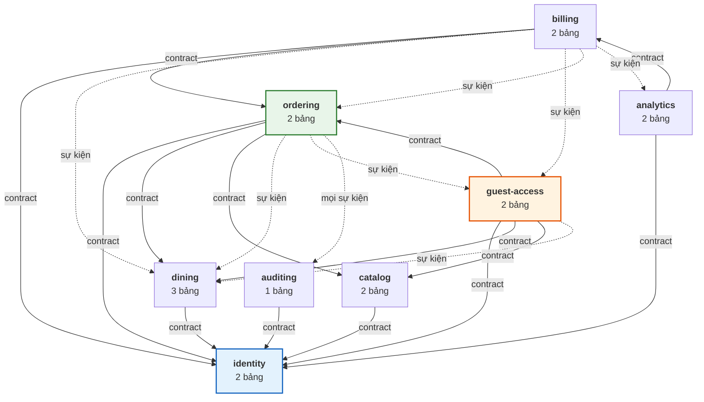

**Nét liền (`-->`)** = phụ thuộc biên dịch, gọi hàm qua contract, **một chiều**.
**Nét đứt (`-.->`)** = quan hệ qua sự kiện, **không phải phụ thuộc** — bên phát
không biết ai đang nghe.

### D.2.4. Điểm đáng chú ý: phá vỡ phụ thuộc vòng dining ↔ ordering

Sơ đồ bàn cần hiển thị thông tin đơn hàng (bàn này có khách chưa, tiền bao
nhiêu). Nếu làm theo cách tự nhiên nhất, `dining` sẽ JOIN sang bảng `orders` —
và vì `ordering` cũng cần tra bảng `tables`, ta có **phụ thuộc hai chiều**.
Module Registry sẽ phát hiện và **từ chối khởi động**:

```
Error: Phát hiện phụ thuộc vòng giữa các module: dining → ordering → dining.
Hãy tách phần dùng chung ra shared kernel hoặc giao tiếp bằng sự kiện.
```

**Giải pháp đã áp dụng — hình chiếu đọc (read model):**

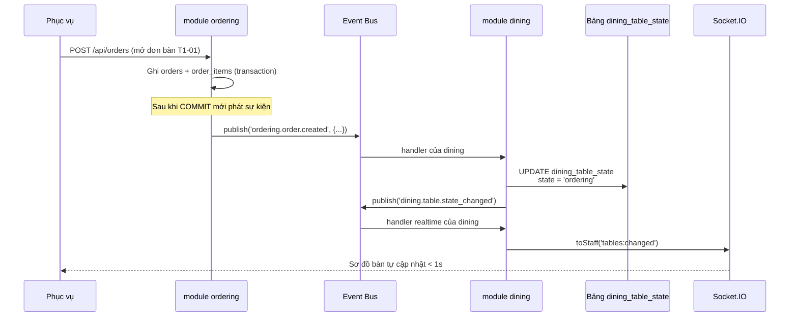

Kết quả:

- `dining` **không phụ thuộc** `ordering` (xem bảng D.2.2 — `dependsOn: ['identity']`)
- Sơ đồ bàn đọc một bảng phẳng, **không JOIN** → nhanh hơn
- `ordering` đổi lược đồ bảng `orders` không làm hỏng sơ đồ bàn
- Hình chiếu **tự chữa lành**: mỗi lần khởi động, `ordering` gọi
  `dining.rebuildOccupancy(snapshotOpenOrders())` để đồng bộ lại nếu có sự kiện
  bị mất khi server tắt đột ngột

---

## D.3. Ba cơ chế giữ ranh giới module

Ranh giới module chỉ có giá trị nếu **không thể vô tình phá**. Hệ thống dùng
ba cơ chế bổ trợ nhau.

### D.3.1. Cơ chế 1 — Contract công khai

Mỗi module có đúng một tệp `contract.js`. Đây là **toàn bộ bề mặt** mà module
khác được phép chạm vào.

```js
// modules/catalog/contract.js  — bề mặt công khai của module thực đơn
module.exports = {
  priceBasket,       // định giá giỏ hàng theo giá trong CSDL
  guestMenu,         // thực đơn rút gọn cho khách quét QR
  getItem,
  findActiveByIds,
  listCategories,
};
```

Module khác dùng như sau:

```js
// modules/ordering/application/order-service.js
const catalog = require('../../catalog/contract');   // ✅ ĐƯỢC PHÉP
const priced  = await catalog.priceBasket(lines);

// ❌ KHÔNG ĐƯỢC PHÉP — chạm vào nội bộ module khác
const repo = require('../../catalog/infrastructure/menu-repository');
```

**Lợi ích cụ thể:** quy tắc "giá luôn lấy từ CSDL, không nhận từ client" chỉ
tồn tại ở **một chỗ duy nhất** là `catalog.priceBasket()`. Không thể có nơi
nào trong hệ thống vô tình nhận giá từ request, vì không nơi nào khác biết
cách đọc bảng `menu_items`.

### D.3.2. Cơ chế 2 — Event Bus (tách rời hoàn toàn)

Khi một module cần **thông báo** chứ không cần **hỏi**, nó phát sự kiện.

Quy ước tên: `<module>.<đối tượng>.<hành động quá khứ>`

```js
// modules/ordering — chỉ phát, không biết ai nghe
bus.publish('ordering.order.created', { order_id, table_id, total_amount, ... });

// modules/dining — tự đăng ký lắng nghe lúc khởi động
eventBus.subscribe('ordering.order.created', occupyTable, 'dining');

// modules/auditing — nghe TẤT CẢ sự kiện bằng một dòng
eventBus.subscribe('*', service.record, 'auditing');
```

**Minh hoạ rõ nhất về lợi ích:** phiên bản 2 có **23 lời gọi
`LogModel.write()` rải rác** trong các controller. Phiên bản 3 có **một dòng
duy nhất** trong `modules/auditing/index.js`. Xoá cả thư mục `auditing` đi,
hệ thống vẫn chạy bình thường — chỉ mất tính năng nhật ký.

**Nguyên tắc quan trọng về giao dịch:** sự kiện chỉ được phát **sau khi
transaction đã commit**. Nếu phát trước, module nghe có thể đọc phải dữ liệu
chưa commit hoặc đã bị rollback.

```js
const result = await db.transaction(async (client) => { /* ghi dữ liệu */ });
bus.publish(EVENTS.ORDER_CREATED, eventPayload(result));   // ← sau COMMIT
```

Handler chạy bất đồng bộ và lỗi của handler **không làm hỏng luồng chính** —
đây là đánh đổi có chủ đích: nhật ký hay realtime hỏng không được phép làm
hỏng việc tạo đơn.

### D.3.3. Cơ chế 3 — Kiểm tra ranh giới tự động ⭐

Hai cơ chế trên là **quy ước**. Quy ước không được kiểm tra thì sẽ bị phá —
chỉ cần một lập trình viên vội vàng. Vì vậy có công cụ
`back-end/tools/check-boundaries.js` với **5 quy tắc**:

| Quy tắc | Nội dung | Vì sao cần |
|---|---|---|
| **R1** | Module A chỉ được `require('modules/B/contract')`, cấm chạm `domain/`, `application/`, `infrastructure/`, `interface/` của B | Giữ bề mặt công khai nhỏ và ổn định |
| **R2** | Mọi import xuyên module phải khai báo trong `dependsOn` | Phụ thuộc ngầm là phụ thuộc không ai thấy |
| **R3** | Module chỉ viết SQL lên bảng mình khai báo `owns` | Ngăn hai module cùng sửa một bảng |
| **R4** | Không có phụ thuộc vòng | Vòng lặp phá vỡ khả năng tách module |
| **R5** | `shared/` và `platform/` không được import `modules/` | Hạ tầng không phụ thuộc nghiệp vụ |

Kết quả chạy thật:

```
$ npm run check:boundaries

Kiểm tra ranh giới của 8 module...

Quyền sở hữu bảng CSDL:
  analytics      → analytics_revenue_hourly, analytics_item_sales
  auditing       → activity_logs
  billing        → invoices, invoice_items
  catalog        → menu_categories, menu_items
  dining         → dining_zones, tables, dining_table_state
  guest-access   → guest_sessions, guest_order_requests
  identity       → users, refresh_tokens
  ordering       → orders, order_items

✓ Không phát hiện vi phạm ranh giới module.
```

Công cụ này chạy trong `deploy/deploy.sh` **trước bước build** — mã vi phạm
ranh giới **không thể lên production**.

> **Một vi phạm thật đã được công cụ phát hiện trong quá trình làm:**
> `ordering` dùng `SELECT ... FROM tables ... FOR NO KEY UPDATE` để khoá bàn
> khi tạo đơn — đúng về kỹ thuật nhưng vi phạm R3. Giải pháp thay thế:
> **advisory lock** của PostgreSQL, khoá theo một con số dẫn xuất từ
> `table_id`, không chạm bảng nào:
>
> ```js
> await r.query("SELECT pg_advisory_xact_lock(hashtext('ordering:table'), hashtext($1))",
>               [String(tableId)]);
> ```
>
> Khoá tự nhả khi transaction kết thúc, nên không có nguy cơ kẹt khoá.

### D.3.4. Module Registry — nơi ba cơ chế gặp nhau

```js
// modules/ordering/index.js — manifest của một module
module.exports = {
  name: 'ordering',
  description: 'Đơn hàng tại bàn: mở đơn, thêm/sửa/xoá món, chuyển bàn, duyệt món khách QR.',

  dependsOn: ['identity', 'dining', 'catalog'],   // ← R2 kiểm tra
  owns: ['orders', 'order_items'],                // ← R3 kiểm tra

  routers: [{ path: '/api/orders', router: orderRoutes }],

  publishes: [EVENTS.ORDER_CREATED, EVENTS.ORDER_CANCELLED, /* … */],
  subscribes: [EVENTS.INVOICE_ISSUED],

  contract,                                        // ← R1 kiểm tra

  async register({ eventBus }) { /* đăng ký lắng nghe, tác vụ nền */ },
  async healthCheck() { return { ok: true, openOrders: await repo.countOpen() }; },
};
```

Registry làm sáu việc khi khởi động:

1. **Tự khám phá** mọi thư mục trong `src/modules/`
2. **Kiểm tra manifest** hợp lệ, không trùng tên / trùng đường dẫn REST / trùng bảng
3. **Kiểm tra `dependsOn`** tồn tại và không có phụ thuộc vòng
4. **Sắp xếp topo** rồi gọi `register()` theo đúng thứ tự phụ thuộc
5. **Gắn router** vào Express theo `path`
6. **Xuất bản đồ kiến trúc** qua `GET /api/architecture`

**Hệ quả quan trọng:** tệp `src/app.js` **không hề biết** nhà hàng có đơn hàng
hay hoá đơn. Thêm một module mới chỉ cần tạo thư mục — không sửa `app.js`.

---

## D.4. Cấu trúc bên trong một module

Mỗi module theo **kiến trúc phân tầng hướng miền** (Domain-Driven Layered
Architecture) với 4 tầng:

```
modules/ordering/
├── index.js                   ← MANIFEST: tên, phụ thuộc, bảng sở hữu, router
├── contract.js                ← BỀ MẶT CÔNG KHAI cho module khác
│
├── domain/                    ← TẦNG MIỀN (thuần tuý, không CSDL, không HTTP)
│   └── order.js                  máy trạng thái, quy tắc tính tiền, bất biến
│
├── application/               ← TẦNG ỨNG DỤNG (use-case, điều phối giao dịch)
│   ├── order-service.js
│   └── guest-items-service.js
│
├── infrastructure/            ← TẦNG HẠ TẦNG (SQL, nơi DUY NHẤT chạm CSDL)
│   └── order-repository.js
│
├── interface/                 ← TẦNG GIAO DIỆN (REST, validate đầu vào)
│   └── order-routes.js
│
└── migrations/                ← LƯỢC ĐỒ BẢNG module này sở hữu
    ├── 004_ordering_orders.sql
    └── 011_ordering_item_confirmation.sql
```

### D.4.1. Quy tắc phụ thuộc giữa các tầng

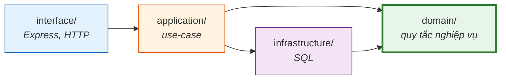

Mũi tên luôn **hướng vào trong**. Tầng `domain` ở trung tâm, **không biết gì
về Express, PostgreSQL hay Socket.IO**.

### D.4.2. Lợi ích đo được của việc tách tầng domain

Toàn bộ quy tắc nghiệp vụ quan trọng nhất kiểm thử được **không cần dựng CSDL**:

```js
// tests/domain.test.js
test('order: CHẶN thanh toán khi còn món khách gọi chờ duyệt', () => {
  const open = { id: 'x', code: 'ORD-1', status: 'serving' };
  const items = [
    { status: 'confirmed',       total_price: 100_000 },
    { status: 'pending_confirm', total_price: 50_000 },
  ];
  assert.throws(() => order.assertReadyForCheckout(open, items), /chờ duyệt/);
});
```

**24 kiểm thử đơn vị chạy trong 94 mili-giây**, không cần Docker, không cần
PostgreSQL, không cần MinIO.

### D.4.3. Ví dụ xuyên suốt bốn tầng — nghiệp vụ "mở đơn mới"

| Tầng | Trách nhiệm | Mã cụ thể |
|---|---|---|
| **interface** | Kiểm tra kiểu dữ liệu, kiểm tra quyền, chuyển cho service | `validateBody({ items: { required: true, type: 'array' } })`, `requirePermission('order.create')` |
| **application** | Điều phối: lấy bàn (dining), lấy giá (catalog), mở transaction, gọi repository, phát sự kiện | `resolveTable()` → `priceLines()` → `db.transaction()` → `bus.publish()` |
| **domain** | Quy tắc: giỏ hàng hợp lệ chưa, bàn còn nhận khách không, tổng tiền tính thế nào | `assertValidBasket()`, `computeTotal()` |
| **infrastructure** | Câu lệnh SQL, khoá tuần tự hoá | `INSERT INTO orders ...`, `pg_advisory_xact_lock(...)` |

---

## D.5. Kiến trúc triển khai

### D.5.1. Sơ đồ triển khai trên VPS

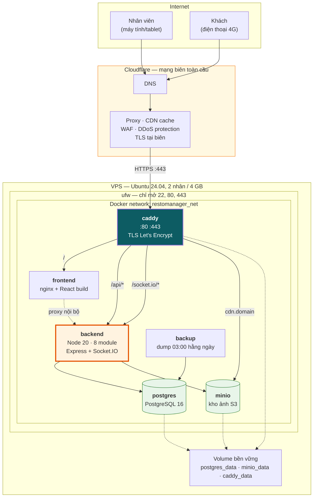

### D.5.2. Vì sao chỉ một container cho backend

Câu hỏi thường gặp: *"Modular Monolith có 8 module, sao không chạy 8
container?"*

Vì nếu chạy 8 container thì **đó là microservices, không phải Modular
Monolith**. Điểm mấu chốt của Modular Monolith là:

> Ranh giới module nằm ở **mã nguồn** (contract + event bus + kiểm tra tự
> động), **không** nằm ở ranh giới tiến trình.

Đổi lại ta được: giao dịch ACID xuyên module, một lần triển khai, một nơi xem
log, một stack trace khi gỡ lỗi — phù hợp quy mô một nhà hàng.

### D.5.3. Bảng dịch vụ Docker Compose

| Dịch vụ | Ảnh | Môi trường PT | Production | Vai trò |
|---|---|---|---|---|
| `postgres` | postgres:16-alpine | cổng 5432 mở | **không mở cổng** | CSDL duy nhất |
| `minio` | minio/minio | cổng 9000/9001 mở | **không mở cổng** | Kho ảnh tương thích S3 |
| `minio-init` | minio/mc | chạy một lần | chạy một lần | Tạo bucket, đặt quyền |
| `backend` | tự build | cổng 3000 mở | **không mở cổng** | Modular Monolith |
| `frontend` | tự build | cổng 8080 mở | **không mở cổng** | React build + Nginx |
| `caddy` | caddy:2.8-alpine | — | **:80, :443** | Reverse proxy, TLS tự động |
| `backup` | postgres:16-alpine | — | ✅ | Sao lưu hằng ngày |
| `cloudflared` | cloudflare/cloudflared | — | tuỳ chọn | Cloudflare Tunnel |

**Thay đổi bảo mật quan trọng nhất ở production:** `docker-compose.prod.yml`
gỡ toàn bộ `ports` của postgres, minio, backend và frontend. **Chỉ Caddy nghe
cổng 80/443.** CSDL không còn phơi ra Internet.

### D.5.4. Phân bổ tài nguyên (VPS 2 nhân / 4 GB)

| Dịch vụ | Giới hạn RAM | Giới hạn CPU | Lý do |
|---|---|---|---|
| postgres | 1 GB | 1.0 | `shared_buffers=256MB`, cần vùng đệm |
| minio | 768 MB | 0.5 | Chủ yếu I/O, ít CPU |
| backend | 512 MB | 1.0 | Node.js một tiến trình |
| frontend | 128 MB | 0.25 | Nginx trả tệp tĩnh |
| caddy | 256 MB | — | Reverse proxy nhẹ |
| backup | 128 MB | — | Chỉ chạy vài phút mỗi ngày |
| **Tổng** | **~2.8 GB** | | Còn ~1.2 GB cho hệ điều hành |

Giới hạn tài nguyên tránh tình huống một dịch vụ rò rỉ bộ nhớ kéo sập cả VPS
(NFR-6.5).

---

## D.6. Lớp lưu trữ đối tượng MinIO/S3/R2

### D.6.1. Vấn đề

Ảnh món ăn không nên lưu trong CSDL (phình backup, khó cache) cũng không nên
lưu trong container (mất khi deploy lại). Cần kho đối tượng. Nhưng chọn nhà
cung cấp nào?

| Phương án | Ưu | Nhược |
|---|---|---|
| **MinIO** tự host | Miễn phí, dữ liệu trong tầm kiểm soát | Tốn RAM VPS, băng thông tính vào VPS |
| **AWS S3** | Bền vững 11 số 9, hạ tầng toàn cầu | Tính phí băng thông đi ra (đắt) |
| **Cloudflare R2** | **Miễn phí băng thông đi ra**, tích hợp sẵn CDN | Phụ thuộc Cloudflare |

### D.6.2. Giải pháp — mẫu Port & Adapter

Thay vì chọn cứng một nhà cung cấp, hệ thống định nghĩa một **cổng
(`StoragePort`)** mà module nghiệp vụ nói chuyện với:

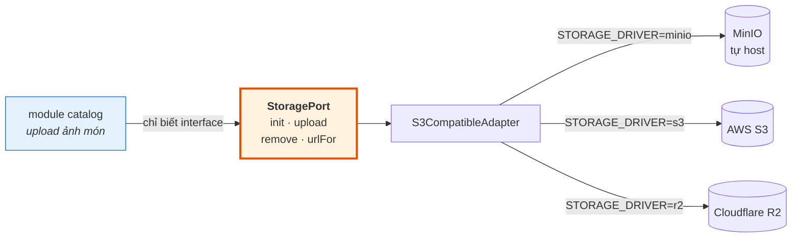

Module `catalog` chỉ gọi:

```js
const storage = require('../../../platform/storage');
const uploaded = await storage.upload(file.buffer, {
  originalName: file.originalname,
  contentType: file.mimetype,
  prefix: 'menu',
});
// → { key, url, size, contentType }
```

**Nó không biết phía sau là MinIO, S3 hay R2.**

### D.6.3. Chuyển đổi nhà cung cấp — chỉ đổi biến môi trường

| Biến | MinIO (mặc định) | AWS S3 | Cloudflare R2 |
|---|---|---|---|
| `STORAGE_DRIVER` | `minio` | `s3` | `r2` |
| `S3_ENDPOINT` | `minio` | `s3.ap-southeast-1.amazonaws.com` | `<account>.r2.cloudflarestorage.com` |
| `S3_PORT` | `9000` | `443` | `443` |
| `S3_USE_SSL` | `false` | `true` | `true` |
| `S3_REGION` | `us-east-1` | `ap-southeast-1` | `auto` |
| `S3_PUBLIC_URL` | `http://localhost:9000` | `https://cdn.domain` | `https://cdn.domain` |
| `S3_SIGNED_URLS` | `false` | `true` | `false`* |

\* R2 gắn tên miền tuỳ chỉnh qua Cloudflare thì nên dùng URL tĩnh để tận dụng CDN.

**Không một dòng mã nghiệp vụ nào phải sửa.** Hướng dẫn chuyển sang R2 kèm
lệnh `rclone sync` để mang dữ liệu cũ sang: xem `DEPLOYMENT.md` mục 8.

### D.6.4. Hai chế độ phát URL ảnh

| Chế độ | Khi dùng | Cách hoạt động |
|---|---|---|
| **Bucket public-read** | MinIO, môi trường phát triển, R2 có tên miền tuỳ chỉnh | URL tĩnh `{S3_PUBLIC_URL}/{bucket}/{key}`, cache vĩnh viễn, CDN cache tốt |
| **URL ký (presigned)** | S3 production, bucket riêng tư | Backend ký URL có thời hạn (mặc định 1 giờ) bằng `presignedGetObject` |

### D.6.5. Thiết kế chịu lỗi

Kho ảnh hỏng **không được làm sập bán hàng**. Vì vậy `storage.init()` thử
nhanh 3 lần (mỗi lần cách 1 giây), nếu chưa được thì **chuyển sang thử lại ở
chế độ nền** và cho server khởi động luôn:

```
WARN [storage] Kho đối tượng chưa sẵn sàng — server vẫn khởi động,
                sẽ thử lại ở chế độ nền.
```

`/api/health` sẽ báo `degraded` để đội vận hành biết, endpoint tải ảnh trả
`503 STORAGE_UNAVAILABLE`, nhưng **toàn bộ nghiệp vụ gọi món và thanh toán vẫn
chạy bình thường**. Mất ảnh món là phiền, không bán được hàng mới là hỏng.

---

## D.7. Lớp thời gian thực

### D.7.1. Phân vùng phòng (room)

Socket.IO được phân vùng để **dữ liệu không rò rỉ giữa các nhóm người dùng**:

| Phòng | Thành viên | Nhận sự kiện |
|---|---|---|
| `staff` | Mọi nhân viên đã đăng nhập | `orders:changed`, `tables:changed`, `order:created`, `invoice:created`… |
| `role:admin` | Chỉ quản trị viên | `stats:changed` |
| `role:cashier` | Chỉ thu ngân | `guest:request-pending` |
| `role:waiter` | Chỉ phục vụ | `guest:request-pending` |
| `guest:<session_id>` | **Một phiên khách duy nhất** | `guest:request-reviewed`, `guest:session-closed`, `invoice:paid` |

Phòng `guest:<session_id>` là điểm quan trọng: khách bàn T1-01 **không bao giờ**
nhận được sự kiện của bàn T1-02, kể cả khi hai người cùng mở trang.

### D.7.2. Hai loại xác thực WebSocket

```js
// platform/realtime/realtime.js
io.use((socket, next) => {
  const guestToken = socket.handshake.auth?.guestToken;
  if (guestToken) {
    const session = verifiers.verifyGuestToken(guestToken);   // module guest-access
    socket.data.kind = 'guest';
    socket.join(`guest:${session.sid}`);
    return next();
  }
  const token = socket.handshake.auth?.token;
  if (!token) return next(new Error('UNAUTHORIZED: thiếu token'));
  socket.data.user = verifiers.verifyStaffToken(token);       // module identity
  return next();
});
```

**Lưu ý kiến trúc:** `platform/realtime` là hạ tầng, nó **không được phụ thuộc
vào module nghiệp vụ** (quy tắc R5). Vì vậy hai hàm xác minh được **tiêm vào
từ ngoài** tại `server.js`:

```js
realtime.init(httpServer, {
  verifyStaffToken: registry.contractOf('identity').verifyAccessToken,
  verifyGuestToken: registry.contractOf('guest-access').verifyTokenForSocket,
});
```

### D.7.3. Kết quả kiểm thử thời gian thực

| Kiểm thử | Kết quả |
|---|---|
| Nhân viên kết nối bằng JWT | ✅ |
| Khách kết nối bằng guest token | ✅ |
| Kết nối không token bị từ chối | ✅ |
| Khách gửi món → nhân viên nhận `guest:request-pending` | ✅ |
| Trạng thái bàn đổi → nhân viên nhận `tables:changed` | ✅ |
| Nhân viên duyệt → **đúng phiên khách đó** nhận `guest:request-reviewed` | ✅ |
| Sự kiện mang đúng trạng thái `confirmed` | ✅ |
| Thanh toán → nhân viên nhận `invoice:created` | ✅ |
| Thanh toán → quản trị nhận `stats:changed` | ✅ |
| Thanh toán → khách nhận `guest:session-closed` | ✅ |

**10/10 đạt** (`back-end/tests/realtime-smoke.js`).

---

## D.8. Bảo mật

### D.8.1. Mô hình phòng thủ nhiều lớp

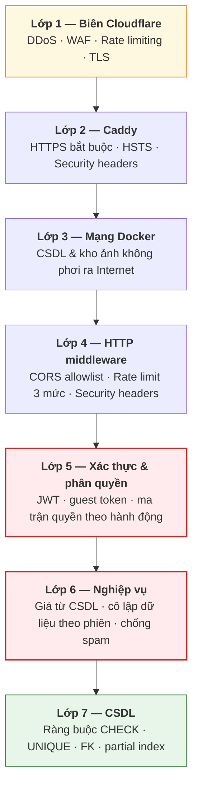

### D.8.2. Vòng đời token nhân viên

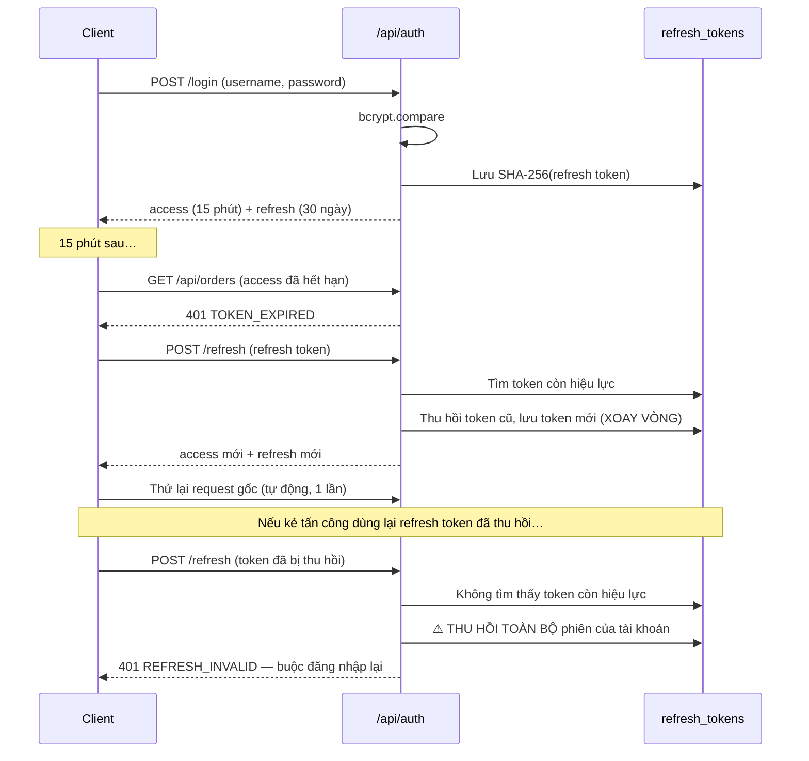

### D.8.3. Vòng đời guest token

Guest token **không phải JWT**. Nó là chuỗi ký HMAC gọn nhẹ:

```
<session_uuid>.<expires_unix>.<HMAC-SHA256 base64url>
```

| Quyết định | Lý do |
|---|---|
| Không dùng JWT | Token nằm trong `localStorage` của trình duyệt khách lạ; JWT có payload đọc được. Càng ít thông tin càng tốt. |
| Không có thư viện | Bề mặt tấn công nhỏ hơn — không có bẫy `alg: none` kinh điển của JWT |
| Lưu SHA-256 trong CSDL | Rò rỉ CSDL không đủ để mạo danh phiên khách |
| So sánh `timingSafeEqual` | Chống tấn công đo thời gian |
| Secret riêng (`GUEST_SECRET`) | Lộ guest secret không ảnh hưởng token nhân viên |
| TTL 6 giờ | Mã QR dán **cố định** trên bàn. Nếu phiên sống mãi, người đi ngang quét một lần có thể gọi món cho bàn đó mãi về sau. |

### D.8.4. Cấu hình fail-fast — từ chối chạy khi cấu hình yếu

`src/shared/config.js` kiểm tra khi khởi động và **ném lỗi dừng tiến trình** ở
production nếu:

| Điều kiện | Ở production | Ở môi trường phát triển |
|---|---|---|
| `JWT_SECRET` chưa đặt | ❌ **Dừng** | ⚠️ Cảnh báo, dùng giá trị dev |
| Secret ngắn hơn 32 ký tự | ❌ **Dừng** | ⚠️ Cảnh báo |
| Secret nằm trong danh sách giá trị mẫu đã biết | ❌ **Dừng** | ⚠️ Cảnh báo |
| `JWT_SECRET` trùng `REFRESH_SECRET` | ❌ **Dừng** | ⚠️ Cảnh báo |
| `ALLOWED_ORIGINS` chưa đặt | ❌ **Dừng** | ⚠️ Cảnh báo, CORS mở |

> **Vì sao chọn "dừng" thay vì "chạy với cảnh báo"?** Cảnh báo trong log sẽ bị
> bỏ qua. Một hệ thống chạy với `JWT_SECRET=secret` nguy hiểm hơn một hệ thống
> không chạy — vì không ai biết nó đang không an toàn.

Lớp kiểm tra thứ hai nằm trong `deploy/deploy.sh`, chạy **trước** khi build.

### D.8.5. Xử lý IP thật sau proxy

Sau Cloudflare + Caddy, header `X-Forwarded-For` có dạng:

```
X-Forwarded-For: <IP khách>, <IP Cloudflare>, <IP Caddy>
```

Nếu lấy phần tử **đầu** (mặc định của `req.ip` khi bật `trust proxy`), khách
chỉ cần tự gửi `X-Forwarded-For: 1.2.3.4` là đổi được IP và né giới hạn tần
suất. Vì vậy với route công khai, hệ thống:

1. Ưu tiên `CF-Connecting-IP` (Cloudflare gắn, khách không ghi đè được)
2. Nếu không có, lấy phần tử **cuối** của `X-Forwarded-For` (do proxy tin cậy gắn)
3. Nếu không có nữa, lấy IP socket

### D.8.6. Danh mục các biện pháp bảo mật đã áp dụng

| Nhóm | Biện pháp |
|---|---|
| **Mật khẩu** | bcrypt cost 10 · độ dài tối thiểu cấu hình được · đổi mật khẩu thu hồi mọi phiên |
| **Token** | access 15 phút · refresh xoay vòng · lưu hash · phát hiện tái sử dụng · secret riêng biệt |
| **Chống dò** | 10 lần sai/15 phút theo (IP + username) · chỉ đếm lần thất bại · thông báo lỗi không lộ tài khoản tồn tại |
| **API công khai** | 30 req/phút/IP · 8 lượt gửi/10 phút/phiên · khoá phiên khi vượt · giới hạn số món và số lượng |
| **Dữ liệu khách** | Token hash · TTL 6 giờ · tên và SĐT không bắt buộc · tự ẩn danh ip/user-agent/SĐT sau 30 ngày |
| **Giá & tiền** | Giá luôn từ CSDL · tính lại tổng từ dòng món · làm tròn tập trung một chỗ |
| **Mã QR** | Chuỗi ngẫu nhiên 12 hex · cấp lại được · không dùng mã bàn |
| **HTTP** | CORS allowlist + ngoại lệ cùng nguồn · HSTS · nosniff · DENY frame · no-referrer |
| **Hạ tầng** | Container không chạy root · CSDL không phơi cổng · ufw 3 cổng · tự động cập nhật bảo mật |
| **Kiểm toán** | Nhật ký tự động mọi thao tác · mã truy vết xuyên request · dòng thời gian theo đối tượng |

---
---

# Phần E — Thiết kế cơ sở dữ liệu

> Phần này trả lời trực tiếp hai nhận xét của giảng viên:
> **"chưa vẽ ERD riêng, đang show bằng diagram"** và
> **"chưa rõ việc lưu thông tin khi khách đặt qua QR (chưa nắm được thiết kế bảng)"**.

Hệ thống dùng **PostgreSQL 16** với **17 bảng**, trong đó 16 bảng nghiệp vụ và
1 bảng hệ thống (`schema_migrations`).

## E.0. Nguyên tắc thiết kế đã áp dụng

| Nguyên tắc | Áp dụng cụ thể |
|---|---|
| **Mỗi bảng thuộc đúng một module** | Khai báo trong manifest (`owns`), kiểm tra tự động bằng `check-boundaries` |
| **Khoá chính là UUID** | Sinh bằng `gen_random_uuid()`. Không dùng số tăng dần — tránh lộ quy mô kinh doanh qua id, và dễ gộp dữ liệu nhiều chi nhánh sau này |
| **Tiền là `NUMERIC(12,2)`** | Không dùng `FLOAT` — số thực nhị phân không biểu diễn chính xác tiền. Mọi phép tính làm tròn về số nguyên đồng tại `shared/money.js` |
| **Thời gian là `TIMESTAMPTZ`** | Lưu kèm múi giờ; báo cáo quy đổi về `Asia/Ho_Chi_Minh` khi truy vấn |
| **Ràng buộc đặt ở CSDL, không chỉ ở ứng dụng** | `CHECK`, `UNIQUE`, `FOREIGN KEY`, partial unique index — tầng cuối cùng bảo vệ dữ liệu khi có lỗi lập trình hoặc truy cập trực tiếp |
| **Chứng từ tài chính bất biến** | Hoá đơn **sao chép** tên và giá món, không tham chiếu — xem [E.3.5](#e35-nhóm-billing) |
| **Hình chiếu đọc tách khỏi nguồn ghi** | `dining_table_state`, `analytics_*` — luôn dựng lại được từ nguồn sự thật |
| **Không đặt khoá ngoại cứng xuyên ranh giới module lỏng** | Ví dụ `guest_order_requests.order_id` không đặt FK — giữ lịch sử khách ngay cả khi đơn bị xoá |
| **Chỉ mục theo truy vấn thật** | Mỗi index đều phục vụ một truy vấn cụ thể trong mã nguồn, có partial index cho các truy vấn nóng |

---

## E.1. Sơ đồ ERD tổng thể

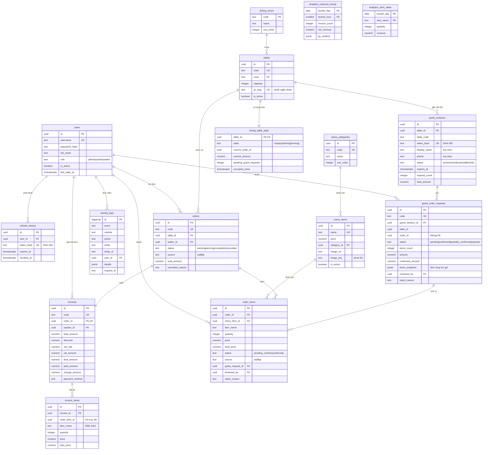

### Chú giải quan hệ

| Quan hệ | Loại | Ý nghĩa nghiệp vụ |
|---|---|---|
| `tables` — `orders` | 1 : N | Một bàn qua thời gian có nhiều đơn, nhưng **chỉ một đơn đang mở** (partial unique index) |
| `tables` — `dining_table_state` | 1 : 1 | Mỗi bàn có đúng một bản ghi trạng thái hiện tại |
| `orders` — `order_items` | 1 : N | Một đơn gồm nhiều dòng món |
| `orders` — `invoices` | 1 : 1 | **Mỗi đơn xuất đúng một hoá đơn** (`order_id UNIQUE`) |
| `guest_sessions` — `guest_order_requests` | 1 : N | Một phiên khách gửi nhiều lượt |
| `guest_order_requests` — `order_items` | 1 : N | Một lượt gửi sinh nhiều dòng món |
| `menu_items` — `order_items` | 1 : N | Một món được gọi trong nhiều đơn |

---

## E.2. ERD theo module

Việc tách ERD theo module cho thấy rõ **ranh giới dữ liệu**: mỗi sơ đồ dưới
đây là "thế giới" mà một module được phép ghi vào.

### E.2.1. Module `identity` — Danh tính

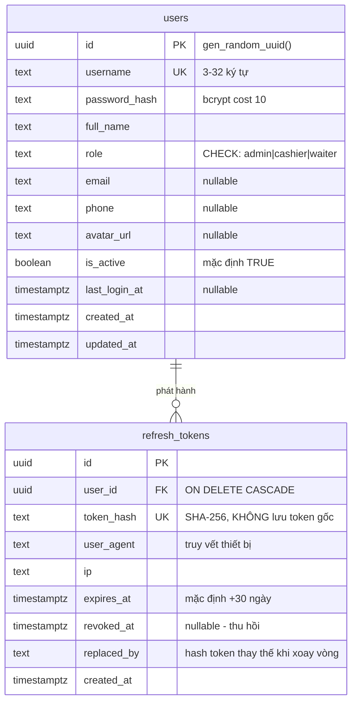

**Quyết định thiết kế:**

- `token_hash` thay vì token gốc: rò rỉ CSDL không đủ để mạo danh người dùng
- `replaced_by`: lần vết được chuỗi xoay vòng token → phát hiện tấn công tái sử dụng
- `ON DELETE CASCADE`: xoá nhân viên thì mọi phiên của họ biến mất ngay

### E.2.2. Module `catalog` — Thực đơn

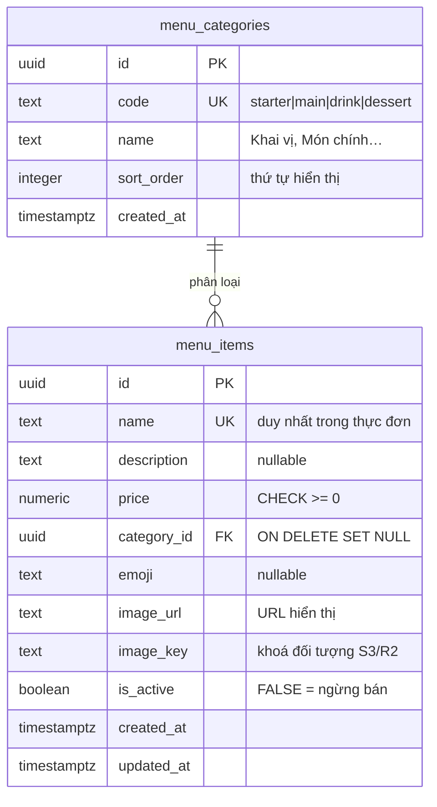

**Quyết định thiết kế:**

- Tách `image_url` và `image_key`: `image_url` để hiển thị, `image_key` để
  **xoá ảnh cũ** khi người dùng thay ảnh. Không có `image_key` thì ảnh cũ nằm
  lại trong bucket mãi mãi, chiếm dung lượng.
- `category_id ON DELETE SET NULL`: xoá danh mục không làm mất món ăn
- `name UNIQUE`: ngăn thực đơn có hai món trùng tên, gây nhầm cho nhân viên

### E.2.3. Module `dining` — Bàn & mã QR

```mermaid
erDiagram
    dining_zones ||--o{ tables : "chứa"
    tables ||--|| dining_table_state : "có trạng thái"

    dining_zones {
        text code PK "indoor|outdoor|vip"
        text name "Trong nhà, Sân vườn…"
        integer sort_order
        boolean is_active
        timestamptz created_at
    }

    tables {
        uuid id PK
        text code UK "T1-01, SV-02, VIP-01"
        text zone FK "→ dining_zones.code"
        integer capacity "CHECK 1..20"
        text qr_slug UK "12 ký tự hex ngẫu nhiên"
        text note "nullable"
        boolean is_active "FALSE = tạm ngưng"
        timestamptz created_at
        timestamptz updated_at
    }

    dining_table_state {
        uuid table_id PK,FK "ON DELETE CASCADE"
        text table_code
        text state "empty|ordering|serving|awaiting_payment|inactive"
        uuid current_order_id "KHÔNG đặt FK"
        text current_order_code
        numeric current_amount
        integer pending_guest_requests "số yêu cầu QR chờ duyệt"
        timestamptz occupied_since
        timestamptz updated_at
    }
```

**Quyết định thiết kế:**

**(1) Khu vực là DỮ LIỆU, không phải hằng số trong mã.**
Phiên bản trước nhúng cứng `const ZONES = ['indoor','outdoor','vip']` trong
controller, trong khi dữ liệu mẫu lại dùng `'t1'` và `'garden'` — **hai nơi
không khớp nhau**, dẫn đến mọi thao tác thêm/sửa bàn đều báo lỗi "zone không
hợp lệ". Nay khu vực nằm trong bảng `dining_zones`, thêm khu vực mới chỉ cần
thêm một dòng dữ liệu. Migration cũng tự chuyển `t1 → indoor`, `garden →
outdoor` để dữ liệu cũ không hỏng.

**(2) `qr_slug` thay vì dùng mã bàn trong URL mã QR.**

| Cách | URL | Rủi ro |
|---|---|---|
| Phiên bản 2 | `/order/T1-01` | Khách bàn T1-01 sửa một ký tự thành `/order/T1-02` là **gọi món sang bàn khác** |
| Phiên bản 3 | `/order/8c03293681c2` | Chuỗi 12 hex ngẫu nhiên, không gian 2⁴⁸ — không đoán được |

Hệ thống vẫn chấp nhận cả mã bàn để **mã QR đã in từ bản cũ không bị vô hiệu**
(`findByQrKey` thử `qr_slug` trước, rồi mới thử `code`).

**(3) `dining_table_state.current_order_id` KHÔNG đặt khoá ngoại.**
Đặt FK sang `orders` sẽ tạo ràng buộc cứng giữa lược đồ của hai module. Vì đây
là **hình chiếu đọc** (luôn dựng lại được từ nguồn), ta chấp nhận không có FK
để đổi lấy sự độc lập.

### E.2.4. Module `ordering` — Đơn hàng

```mermaid
erDiagram
    orders ||--o{ order_items : "gồm"

    orders {
        uuid id PK
        text code UK "ORD-YYMMDDHHMMSS-xxxx"
        uuid table_id FK "→ tables.id"
        text table_code "bản sao để hiển thị nhanh"
        uuid waiter_id FK "→ users.id, NULL nếu đơn QR"
        text waiter_name
        text status "CHECK: pending|serving|completed|cancelled"
        text source "CHECK: staff|qr"
        numeric total_amount "CHECK >= 0, CHỈ tính món đã duyệt"
        timestamptz check_in_time
        timestamptz check_out_time "nullable"
        text cancelled_reason "nullable"
        text notes "nullable"
        timestamptz created_at
        timestamptz updated_at
    }

    order_items {
        uuid id PK
        uuid order_id FK "ON DELETE CASCADE"
        uuid menu_item_id FK "NULL nếu món ngoài thực đơn"
        text item_name "bản sao tên món lúc gọi"
        integer quantity "CHECK > 0"
        numeric price "CHECK >= 0, giá lúc gọi"
        numeric total_price "CHECK >= 0"
        text notes "ghi chú cho bếp"
        text status "pending_confirm|confirmed|rejected|served|cancelled"
        text source "staff|qr"
        uuid guest_request_id "→ guest_order_requests.id"
        uuid reviewed_by FK "→ users.id, ai duyệt"
        timestamptz reviewed_at
        text reject_reason "lý do từ chối"
        timestamptz served_at
        timestamptz created_at
    }
```

**Quyết định thiết kế:**

**(1) Bất biến "mỗi bàn một đơn mở" đặt ở tầng CSDL.**

```sql
CREATE UNIQUE INDEX one_open_order_per_table
  ON orders (table_id) WHERE status IN ('pending', 'serving');
```

Đây là **partial unique index** — chỉ áp dụng cho đơn đang mở. Nhờ vậy một bàn
có lịch sử nhiều đơn đã đóng, nhưng không bao giờ có hai đơn mở cùng lúc, **kể
cả khi hai request đến đồng thời** (một request sẽ nhận lỗi 23505).

**(2) Trạng thái xác nhận đặt ở cấp DÒNG MÓN, không phải cấp đơn.**

Lý do thực tế: khách gọi 4 món, bếp hết 1 món. Nếu trạng thái ở cấp đơn, phải
từ chối cả lượt gọi, khách phải gọi lại 3 món còn lại — trải nghiệm kém. Ở cấp
dòng món, nhân viên chỉ từ chối đúng món hết.

**(3) Tổng tiền CHỈ cộng món `confirmed` và `served`.**

```sql
UPDATE orders SET total_amount = (
  SELECT COALESCE(SUM(total_price), 0) FROM order_items
  WHERE order_id = $1 AND status IN ('confirmed', 'served')
) WHERE id = $1
```

**Tính lại từ nguồn** thay vì cộng dồn (`total = total + x`). Cộng dồn dễ lệch
khi có lỗi hoặc thao tác đồng thời; tính lại luôn cho con số đúng.

**(4) `item_name` và `price` được sao chép vào `order_items`.**
Đổi giá món trong thực đơn **không được** làm đổi tiền của đơn đang mở — khách
đã nhìn thấy giá lúc gọi.

### E.2.5. Module `billing` — Hoá đơn

```mermaid
erDiagram
    invoices ||--o{ invoice_items : "liệt kê"

    invoices {
        uuid id PK
        text code UK "INV-YYMMDDHHMMSS-xxxx"
        uuid order_id FK,UK "UNIQUE - 1 don = 1 hoa don"
        text table_code
        text waiter_name
        uuid cashier_id FK "→ users.id"
        text cashier_name
        numeric total_amount "tiền hàng, CHECK >= 0"
        numeric discount "CHECK >= 0"
        text discount_note
        numeric vat_rate "CHECK 0..100"
        numeric vat_amount
        numeric final_amount "CHECK >= 0, phải trả"
        numeric paid_amount "khách đưa"
        numeric change_amount "tiền thừa"
        timestamptz check_in_time
        timestamptz check_out_time
        text payment_method "CHECK: cash|card|transfer|momo|vnpay|..."
        timestamptz created_at
    }

    invoice_items {
        uuid id PK
        uuid invoice_id FK "ON DELETE CASCADE"
        uuid order_item_id "chỉ để truy vết, KHÔNG FK"
        text item_name "BẢN SAO lúc xuất hoá đơn"
        integer quantity "CHECK > 0"
        numeric price "BẢN SAO"
        numeric total_price
        text notes
    }
```

**Quyết định thiết kế:**

**Vì sao sao chép dòng món sang `invoice_items` thay vì tham chiếu `order_items`?**

Hoá đơn là **chứng từ tài chính** — nội dung phải bất biến. Nếu chỉ tham chiếu:

- Đổi tên món "Phở Bò" thành "Phở Bò Đặc Biệt" → hoá đơn in tháng trước hiển thị tên mới
- Tăng giá món → báo cáo doanh thu quá khứ thay đổi theo
- Xoá món khỏi thực đơn → hoá đơn cũ mất dòng

Đây **không phải dư thừa dữ liệu** mà là yêu cầu kế toán. Nguyên tắc chung:
*"dữ liệu vận hành thì tham chiếu, dữ liệu chứng từ thì sao chép"*.

**`order_id UNIQUE`** là tầng bảo vệ cuối cùng chống thu tiền hai lần: kể cả
khi tầng ứng dụng có lỗi, CSDL vẫn từ chối hoá đơn thứ hai cho cùng một đơn.

### E.2.6. Module `analytics` — Hình chiếu báo cáo

```mermaid
erDiagram
    analytics_revenue_hourly {
        date bucket_day PK "theo giờ Việt Nam"
        smallint bucket_hour PK "CHECK 0..23"
        integer invoice_count
        numeric gross_amount "tiền món trước giảm giá"
        numeric discount_total
        numeric vat_total
        numeric net_revenue "thực thu"
        jsonb by_method "{cash: 500000, momo: 200000}"
        timestamptz updated_at
    }

    analytics_item_sales {
        date bucket_day PK
        text item_name PK
        integer quantity
        numeric revenue
        numeric last_price
        timestamptz updated_at
    }
```

**Quyết định thiết kế — vì sao không truy vấn thẳng bảng `invoices`?**

| Lý do | Giải thích |
|---|---|
| **Ranh giới module** | `invoices` thuộc module `billing`. Nếu `analytics` viết SQL lên bảng đó, mọi thay đổi lược đồ của `billing` sẽ làm hỏng báo cáo |
| **Hiệu năng** | Dashboard gọi liên tục. Quét `invoices JOIN invoice_items` rồi `GROUP BY` mỗi lần tải trang sẽ chậm dần theo thời gian vận hành. Hình chiếu cộng dồn sẵn theo giờ → đọc tối đa 24 dòng cho một ngày |
| **Tái tạo được** | `POST /api/stats/rebuild` dựng lại toàn bộ từ `billing.listInvoices()` — qua **contract**, không đọc bảng trực tiếp |

Cột `by_method` dùng `JSONB` thay vì bảng riêng vì số phương thức thanh toán
nhỏ và luôn được đọc cùng lúc với dòng doanh thu — tách bảng chỉ thêm JOIN.

### E.2.7. Module `auditing` — Nhật ký

```mermaid
erDiagram
    activity_logs {
        bigserial id PK
        text event "ordering.order.created"
        text module "ordering"
        text action "CREATE_ORDER"
        text entity "ORDER|INVOICE|USER|TABLE|..."
        text entity_id
        uuid user_id FK "ON DELETE SET NULL"
        text user_name "bản sao, giữ khi user bị xoá"
        jsonb details "chỉ trường có ý nghĩa kiểm toán"
        text ip
        text request_id "mã truy vết xuyên suốt"
        timestamptz created_at
    }
```

**Quyết định thiết kế:**

- `BIGSERIAL` thay vì UUID: bảng này ghi nhiều, đọc theo thứ tự thời gian —
  khoá tuần tự cho hiệu năng ghi tốt hơn và index nhỏ hơn
- `user_name` sao chép: xoá nhân viên vẫn biết ai đã làm gì (`user_id` thành
  NULL nhưng tên còn)
- `details JSONB` chỉ chứa **trường có ý nghĩa kiểm toán**, không nhồi cả
  payload — tránh phình CSDL và tránh vô tình lưu dữ liệu nhạy cảm
- `request_id`: nối một thao tác HTTP với mọi sự kiện bất đồng bộ nó sinh ra

---

## E.3. Từ điển dữ liệu

### E.3.1. Bảng `users` (module identity)

| Cột | Kiểu | Null | Mặc định | Ràng buộc | Mô tả |
|---|---|:---:|---|---|---|
| `id` | UUID | ✗ | `gen_random_uuid()` | PK | Khoá chính |
| `username` | TEXT | ✗ | | UNIQUE | Tên đăng nhập, 3–32 ký tự chữ/số/`._-` |
| `password_hash` | TEXT | ✗ | | | Băm bcrypt, cost 10 |
| `full_name` | TEXT | ✗ | | | Họ tên hiển thị |
| `role` | TEXT | ✗ | | CHECK | `admin` \| `cashier` \| `waiter` |
| `email` | TEXT | ✓ | | | Thư điện tử |
| `phone` | TEXT | ✓ | | | Số điện thoại |
| `avatar_url` | TEXT | ✓ | | | Ảnh đại diện |
| `is_active` | BOOLEAN | ✗ | `TRUE` | | `FALSE` = khoá tài khoản |
| `last_login_at` | TIMESTAMPTZ | ✓ | | | Lần đăng nhập gần nhất |
| `created_at` / `updated_at` | TIMESTAMPTZ | ✗ | `NOW()` | | |

### E.3.2. Bảng `tables` (module dining)

| Cột | Kiểu | Null | Mặc định | Ràng buộc | Mô tả |
|---|---|:---:|---|---|---|
| `id` | UUID | ✗ | `gen_random_uuid()` | PK | |
| `code` | TEXT | ✗ | | UNIQUE | Mã hiển thị: `T1-01`, `VIP-01` |
| `zone` | TEXT | ✗ | | FK → `dining_zones.code` | Khu vực |
| `capacity` | INTEGER | ✗ | | CHECK 1..20 | Sức chứa |
| `qr_slug` | TEXT | ✓ | *(sinh ngẫu nhiên)* | UNIQUE | **12 ký tự hex dùng trong URL mã QR** |
| `note` | TEXT | ✓ | | | Ghi chú |
| `is_active` | BOOLEAN | ✗ | `TRUE` | | `FALSE` = tạm ngưng |

### E.3.3. Bảng `orders` (module ordering)

| Cột | Kiểu | Null | Mặc định | Ràng buộc | Mô tả |
|---|---|:---:|---|---|---|
| `id` | UUID | ✗ | `gen_random_uuid()` | PK | |
| `code` | TEXT | ✗ | `ORD-YYMMDDHHMMSS-xxxx` | UNIQUE | Mã đơn cho nhân viên đọc |
| `table_id` | UUID | ✓ | | FK → `tables.id` | Bàn |
| `table_code` | TEXT | ✗ | | | Bản sao mã bàn (hiển thị nhanh, không cần JOIN) |
| `waiter_id` | UUID | ✓ | | FK → `users.id` | NULL khi đơn do khách tự gọi |
| `waiter_name` | TEXT | ✗ | | | `Khách (QR) · Anh Minh` nếu đơn QR |
| `status` | TEXT | ✗ | `pending` | CHECK | `pending` → `serving` → `completed` \| `cancelled` |
| `source` | TEXT | ✗ | `staff` | CHECK | `staff` \| `qr` |
| `total_amount` | NUMERIC(12,2) | ✗ | `0` | CHECK ≥ 0 | **Chỉ tính món `confirmed`/`served`** |
| `check_in_time` | TIMESTAMPTZ | ✗ | `NOW()` | | Giờ khách ngồi |
| `check_out_time` | TIMESTAMPTZ | ✓ | | | Giờ đóng đơn |
| `cancelled_reason` | TEXT | ✓ | | | `CLEAR_TABLE`, `Khách bỏ về`… |

### E.3.4. Bảng `order_items` (module ordering)

| Cột | Kiểu | Null | Mặc định | Ràng buộc | Mô tả |
|---|---|:---:|---|---|---|
| `id` | UUID | ✗ | `gen_random_uuid()` | PK | |
| `order_id` | UUID | ✗ | | FK CASCADE | Đơn chứa dòng món |
| `menu_item_id` | UUID | ✓ | | FK → `menu_items.id` | NULL nếu món ngoài thực đơn |
| `item_name` | TEXT | ✗ | | | **Bản sao** tên món lúc gọi |
| `quantity` | INTEGER | ✗ | | CHECK > 0 | Số lượng |
| `price` | NUMERIC(12,2) | ✗ | | CHECK ≥ 0 | **Bản sao** đơn giá lúc gọi |
| `total_price` | NUMERIC(12,2) | ✗ | | CHECK ≥ 0 | `quantity × price` |
| `notes` | TEXT | ✓ | | | Ghi chú cho bếp |
| **`status`** | TEXT | ✗ | `confirmed` | CHECK | **`pending_confirm`** \| `confirmed` \| `rejected` \| `served` \| `cancelled` |
| **`source`** | TEXT | ✗ | `staff` | CHECK | `staff` \| `qr` |
| **`guest_request_id`** | UUID | ✓ | | | → `guest_order_requests.id`, gom món của cùng một lượt gửi |
| `reviewed_by` | UUID | ✓ | | FK → `users.id` | Nhân viên đã duyệt/từ chối |
| `reviewed_at` | TIMESTAMPTZ | ✓ | | | Thời điểm duyệt |
| `reject_reason` | TEXT | ✓ | | | Hiển thị cho khách |
| `served_at` | TIMESTAMPTZ | ✓ | | | Thời điểm mang món ra |

### E.3.5. Nhóm `billing`

**Bảng `invoices`:**

| Cột | Kiểu | Ràng buộc | Mô tả |
|---|---|---|---|
| `id` | UUID | PK | |
| `code` | TEXT | UNIQUE | `INV-YYMMDDHHMMSS-xxxx` |
| `order_id` | UUID | **UNIQUE** + FK | ⭐ Mỗi đơn chỉ xuất một hoá đơn |
| `cashier_id` / `cashier_name` | UUID / TEXT | FK / — | Thu ngân lập |
| `total_amount` | NUMERIC(12,2) | CHECK ≥ 0 | Tiền hàng (các món đã duyệt) |
| `discount` / `discount_note` | NUMERIC / TEXT | CHECK ≥ 0 | Giảm giá và lý do |
| `vat_rate` / `vat_amount` | NUMERIC | CHECK 0..100 | Thuế suất và tiền thuế |
| `final_amount` | NUMERIC(12,2) | CHECK ≥ 0 | **Phải trả** = (tiền hàng − giảm) + VAT |
| `paid_amount` / `change_amount` | NUMERIC | | Khách đưa / tiền thừa |
| `payment_method` | TEXT | CHECK (9 giá trị) | `cash`, `card`, `transfer`, `momo`, `vnpay`, `zalopay`, `banking`, `grab`, `online` |

**Công thức tính tiền (cài đặt tại `billing/domain/invoice.js`):**

```
tạm tính  = Σ total_price của các món có status ∈ {confirmed, served}
sau giảm  = tạm tính − giảm giá
VAT       = làm_tròn(sau giảm × thuế suất / 100)
phải trả  = sau giảm + VAT
tiền thừa = khách đưa − phải trả
```

Mọi phép làm tròn đi qua `shared/money.js` để tổng tiền đơn và tổng tiền hoá
đơn **không bao giờ lệch nhau một đồng** do mỗi nơi làm tròn một kiểu.

---

## E.4. Thiết kế lưu thông tin khách đặt qua QR

> **Đây là phần trả lời trực tiếp nhận xét: "chưa rõ được về việc lưu thông
> tin khi khách đặt qua QR (chưa nắm được thiết kế bảng)".**

### E.4.1. Bài toán đặt ra

Khách quét mã QR **không có tài khoản**. Nhưng hệ thống vẫn cần trả lời được
năm câu hỏi:

| # | Câu hỏi | Vì sao cần |
|---|---|---|
| 1 | Ai đang gọi món ở bàn nào? | Món phải vào đúng đơn của đúng bàn |
| 2 | Khách mở lại trang thì thấy gì? | Phải thấy lại **lịch sử của chính mình**, không thấy của bàn khác |
| 3 | Làm sao chống spam? | Một thiết bị không được tạo vô hạn đơn ảo |
| 4 | Khi nào phiên hết hiệu lực? | Mã QR dán **cố định** trên bàn — nếu phiên sống mãi, người đi ngang quét một lần có thể gọi món cho bàn đó mãi về sau |
| 5 | Lưu bao nhiêu thông tin cá nhân? | Càng ít càng tốt (Nghị định 13/2023/NĐ-CP về bảo vệ dữ liệu cá nhân) |

### E.4.2. Hai bảng và vai trò của chúng

```mermaid
erDiagram
    tables ||--o{ guest_sessions : "mã QR gắn với bàn"
    guest_sessions ||--o{ guest_order_requests : "mỗi lần bấm Gửi"
    guest_order_requests ||--o{ order_items : "sinh ra dòng món"
    orders ||--o{ order_items : "đơn của bàn"

    guest_sessions {
        uuid id PK
        uuid table_id FK "bàn gắn mã QR"
        text table_code
        text token_hash UK "SHA-256 của guest token"
        text display_name "TUỲ CHỌN - khách tự nhập"
        text phone "TUỲ CHỌN"
        text user_agent "chống gian lận"
        text ip "chống gian lận"
        text status "active|closed|expired|blocked"
        timestamptz started_at
        timestamptz last_seen_at
        timestamptz expires_at "mặc định +6 giờ"
        timestamptz closed_at
        text close_reason "CHECKED_OUT|TTL|SPAM_GUARD"
        integer request_count "thống kê nhanh"
        integer total_items_count
        numeric total_amount
    }

    guest_order_requests {
        uuid id PK
        text code UK "REQ-YYMMDDHHMMSS-xxxx"
        uuid guest_session_id FK "CASCADE"
        uuid table_id
        text table_code
        uuid order_id "KHÔNG đặt FK - xem lý do"
        text order_code
        boolean created_new_order
        text status "pending|confirmed|partially_confirmed|rejected|cancelled"
        integer items_count
        numeric amount "tiền lúc gửi"
        numeric confirmed_amount "tiền thực sự được duyệt"
        jsonb items_snapshot "ẢNH CHỤP nội dung lúc gửi"
        text guest_note "ghi chú chung của khách"
        uuid reviewed_by FK "nhân viên duyệt"
        text reviewed_by_name
        timestamptz reviewed_at
        text reject_reason
        text client_ip
        timestamptz submitted_at
    }
```

### E.4.3. Lý giải từng quyết định thiết kế

#### (1) Vì sao chỉ lưu `token_hash`, không lưu token gốc?

Giống nguyên tắc với mật khẩu. Khi khách quét QR, máy chủ cấp một **guest
token** lưu trong `localStorage` của trình duyệt. Token được băm SHA-256 trước
khi lưu CSDL. **Rò rỉ CSDL không đủ để mạo danh phiên của khách.**

```js
// Cấp token
const token = `${sessionId}.${expUnix}.${hmacSha256(...)}`;   // gửi cho khách
await db.query('UPDATE guest_sessions SET token_hash = $1 ...',
               [sha256(token)]);                               // lưu CSDL
```

#### (2) Vì sao `display_name` và `phone` đều cho phép NULL?

**Nguyên tắc tối thiểu hoá dữ liệu cá nhân.** Khách **không bắt buộc** nhập gì
để gọi được món. Hai trường này chỉ dùng khi khách tự nhập để nhân viên gọi
đúng người ("Anh Minh bàn 5"). Dữ liệu không thu thập thì không phải bảo vệ.

#### (3) Vì sao lưu `ip` và `user_agent`?

Chỉ phục vụ **chống gian lận và điều tra sự cố** (một thiết bị spam 50 đơn ảo).
Và có **thời hạn xoá rõ ràng** — tác vụ nền tự ẩn danh sau 30 ngày:

```sql
UPDATE guest_sessions SET ip = NULL, user_agent = NULL, phone = NULL
WHERE status <> 'active' AND closed_at < NOW() - INTERVAL '30 days'
```

#### (4) Vì sao phiên có `expires_at`?

Mã QR **dán cố định** trên bàn, không đổi theo khách. Nếu phiên không hết hạn:

- Người đi ngang quét một lần, ba tháng sau vẫn gọi món được cho bàn đó
- Khách cũ về nhà vẫn thấy được đơn của khách mới đang ngồi bàn đó

TTL mặc định 6 giờ (đủ một bữa ăn dài), cấu hình qua `GUEST_SESSION_TTL_HOURS`.
Ngoài ra phiên **tự đóng sớm** khi thanh toán xong hoặc bàn được dọn.

#### (5) ⭐ Vì sao cần bảng `guest_order_requests` riêng, không dùng luôn `order_items`?

Đây là quyết định thiết kế quan trọng nhất. Lý do: **nhà hàng và khách nhìn
cùng một sự việc theo hai cách khác nhau.**

| Góc nhìn | Đơn vị | Ví dụ |
|---|---|---|
| **Nhà hàng** nhìn theo **đơn của bàn** | `orders` + `order_items` | *Bàn T1-01 · Đơn ORD-xxx · 7 món · 540.000 ₫* |
| **Khách** nhìn theo **lần bấm "Gửi" của mình** | `guest_order_requests` | *14:02 Gửi 3 món · Đã xác nhận*<br/>*14:25 Gửi 2 món · 1 món bị từ chối (hết cá chẽm)*<br/>*14:50 Gửi 2 món · Đang chờ xác nhận* |

Nếu chỉ có `order_items`, **không tái hiện được "lần gửi"**: các dòng món của
nhiều lượt nằm lẫn nhau, không biết lượt nào đã duyệt, lượt nào bị từ chối vì
lý do gì. Khách mở màn hình "Đơn của tôi" sẽ thấy một danh sách phẳng vô nghĩa.

`guest_order_requests` chính là **đơn vị giao tiếp với khách** — mỗi bản ghi
là một lần khách bấm nút "Gửi".

#### (6) Hai thế giới được nối với nhau thế nào?

```
guest_order_requests.id  ───→  order_items.guest_request_id
```

Một yêu cầu sinh ra N dòng món. Nhân viên duyệt/từ chối ở **cấp dòng món**;
trạng thái tổng hợp của yêu cầu được **tính lại** từ các dòng đó:

| Trạng thái các dòng món | → Trạng thái yêu cầu |
|---|---|
| Tất cả `confirmed` | `confirmed` |
| Tất cả `rejected` | `rejected` |
| Vừa có `confirmed` vừa có `rejected` | `partially_confirmed` |
| Còn ít nhất một `pending_confirm` | `pending` |

```js
// guest-access/application/guest-order-service.js — syncRequestStatus()
const items = await ordering.itemsOfGuestRequest(requestId);   // qua CONTRACT
const hasPending = items.some(i => i.status === 'pending_confirm');
const confirmed  = items.filter(i => ['confirmed','served'].includes(i.status));
const rejected   = items.filter(i => i.status === 'rejected');

let status = 'pending';
if (!hasPending) {
  if (confirmed.length && rejected.length) status = 'partially_confirmed';
  else if (rejected.length)                status = 'rejected';
  else if (confirmed.length)               status = 'confirmed';
}
```

#### (7) Vì sao `guest_order_requests.order_id` KHÔNG đặt khoá ngoại?

Hai lý do:

1. **Giữ ranh giới module.** `orders` thuộc module `ordering`,
   `guest_order_requests` thuộc `guest-access`. Khoá ngoại cứng tạo ràng buộc
   lược đồ giữa hai module.
2. **Lịch sử của khách vẫn còn** ngay cả khi đơn bị xoá khỏi hệ thống vận hành
   (ví dụ dọn dữ liệu cũ sau nhiều năm).

#### (8) Vì sao lưu thêm `items_snapshot` dạng JSONB?

Khách phải xem được lịch sử của mình **kể cả khi đơn đã thanh toán và dòng món
đã bị dọn**. Ảnh chụp JSONB giữ đúng tên món, số lượng, giá tại **thời điểm
gửi** — độc lập với mọi thay đổi sau này của thực đơn.

```json
[
  { "menu_item_id": "...", "name": "Chả Giò Hải Sản", "quantity": 2,
    "price": 75000, "total_price": 150000, "notes": null },
  { "menu_item_id": "...", "name": "Gỏi Cuốn Tôm Thịt", "quantity": 1,
    "price": 65000, "total_price": 65000, "notes": null }
]
```

Màn hình "Đơn của tôi" ưu tiên dùng **trạng thái sống** từ `order_items` (để
thấy đúng món nào đã duyệt); nếu dòng món đã bị xoá thì lùi về ảnh chụp.

#### (9) Vì sao có `request_count`, `total_items_count`, `total_amount` trong `guest_sessions`?

Đây là **phi chuẩn hoá có chủ đích** (denormalization). Mỗi lần khách mở màn
hình "Đơn của tôi", nếu phải `COUNT(*)` và `SUM()` trên `guest_order_requests`
sẽ tốn một truy vấn tổng hợp. Ba cột này được cộng dồn khi khách gửi món, cho
phép hiển thị tức thì.

### E.4.4. Vòng đời một phiên khách

```mermaid
stateDiagram-v2
    [*] --> active : Khách quét mã QR<br/>POST /api/public/session/:qrKey

    active --> active : Gửi món<br/>(request_count++)
    active --> active : Tải lại trang<br/>(tiếp tục phiên cũ)

    active --> closed : Thanh toán xong<br/>close_reason = CHECKED_OUT
    active --> closed : Bàn được dọn<br/>close_reason = ORDER_CANCELLED
    active --> closed : Khách bấm "Xong"<br/>close_reason = GUEST_CLOSED
    active --> expired : Quá 6 giờ<br/>close_reason = TTL
    active --> blocked : Gửi > 8 lượt / 10 phút<br/>close_reason = SPAM_GUARD

    closed --> [*]
    expired --> [*]
    blocked --> [*]

    note right of active
        Chỉ ở trạng thái này
        khách mới gọi món được
    end note

    note right of blocked
        Khách phải gọi
        nhân viên hỗ trợ
    end note
```

### E.4.5. Ví dụ dữ liệu thật

Sau một lượt khách thật trong kiểm thử đầu-cuối:

**`guest_sessions`:**

| id | table_code | token_hash | display_name | status | expires_at | request_count | total_amount |
|---|---|---|---|---|---|---|---|
| `a3f2…` | `T1-01` | `9c4e…` (SHA-256) | `Anh Minh` | `closed` | 2026-11-04 18:08 | 3 | 535000 |

**`guest_order_requests`:**

| code | status | items_count | amount | confirmed_amount | reject_reason | reviewed_by_name |
|---|---|---|---|---|---|---|
| `REQ-…-044d` | `confirmed` | 3 | 215000 | 215000 | — | Trần Thị Lan |
| `REQ-…-27fc` | `rejected` | 1 | 320000 | 0 | Hết nguyên liệu | Trần Thị Lan |

**`order_items`** (gắn với yêu cầu đầu tiên):

| item_name | quantity | price | status | source | guest_request_id | reviewed_at |
|---|---|---|---|---|---|---|
| Chả Giò Hải Sản | 2 | 75000 | `confirmed` | `qr` | `…044d` | 12:08:49 |
| Gỏi Cuốn Tôm Thịt | 1 | 65000 | `confirmed` | `qr` | `…044d` | 12:08:49 |
| Bò Bít Tết Sốt Tiêu Xanh | 1 | 320000 | `rejected` | `qr` | `…27fc` | 12:09:12 |

**`orders`** của bàn: `total_amount = 215000` — **món bị từ chối không tính tiền**.

---

## E.5. Ràng buộc toàn vẹn và chỉ mục

### E.5.1. Ràng buộc quan trọng nhất

| Ràng buộc | Bảng | Loại | Bảo vệ điều gì |
|---|---|---|---|
| `one_open_order_per_table` | `orders` | **Partial UNIQUE INDEX** | Một bàn không bao giờ có hai đơn mở, **kể cả khi hai request đến đồng thời** |
| `invoices.order_id` | `invoices` | UNIQUE | Chống thu tiền hai lần cho cùng một đơn |
| `menu_items.name` | `menu_items` | UNIQUE | Thực đơn không có hai món trùng tên |
| `tables.qr_slug` | `tables` | UNIQUE | Hai bàn không chung một mã QR |
| `guest_sessions.token_hash` | `guest_sessions` | UNIQUE | Hai phiên không chung một token |
| `order_items_status_check` | `order_items` | CHECK | Trạng thái dòng món chỉ nhận 5 giá trị hợp lệ |
| `orders_status_check` | `orders` | CHECK | Trạng thái đơn chỉ nhận 4 giá trị hợp lệ |
| `quantity > 0` | `order_items` | CHECK | Không có dòng món số lượng 0 hoặc âm |
| `price >= 0`, `total_amount >= 0` | nhiều bảng | CHECK | Không có tiền âm |
| `vat_rate BETWEEN 0 AND 100` | `invoices` | CHECK | Thuế suất hợp lệ |
| `tables.zone` | `tables` | FK → `dining_zones` | Không có bàn ở khu vực không tồn tại |

### E.5.2. Minh hoạ: partial unique index bảo vệ ra sao

```sql
CREATE UNIQUE INDEX one_open_order_per_table
  ON orders (table_id) WHERE status IN ('pending', 'serving');
```

**Kịch bản đua (race condition):** hai nhân viên cùng bấm "Mở đơn" cho bàn
T1-01 trong cùng một phần nghìn giây.

```
Thời điểm   Request A                         Request B
─────────────────────────────────────────────────────────────────────
t0          BEGIN
t0          pg_advisory_xact_lock(T1-01)      BEGIN
t1          SELECT đơn mở → không có          pg_advisory_xact_lock(T1-01) ⏸ CHỜ
t2          INSERT INTO orders ✓
t3          COMMIT                            ▶ được cấp khoá
t4                                            SELECT đơn mở → THẤY đơn của A
t5                                            → Báo lỗi 409 rõ ràng cho người dùng
```

Advisory lock xử lý ở tầng ứng dụng cho **thông báo lỗi dễ hiểu**. Partial
unique index là **lớp bảo vệ cuối cùng** — nếu vì lý do nào đó khoá không hoạt
động (ví dụ truy cập CSDL trực tiếp), PostgreSQL vẫn trả `23505` và ứng dụng
chuyển thành `409 CONFLICT`.

### E.5.3. Danh mục chỉ mục

| Chỉ mục | Bảng | Phục vụ truy vấn |
|---|---|---|
| `users_role_active_idx` | `users` | Lọc nhân viên theo vai trò + trạng thái |
| `refresh_tokens_user_idx` | `refresh_tokens` | Thu hồi mọi phiên của một người |
| `refresh_tokens_expires_idx` | `refresh_tokens` | Tác vụ dọn token hết hạn |
| `menu_items_active_idx` | `menu_items` | Thực đơn khách (chỉ món đang bán) |
| `menu_items_category_idx` | `menu_items` | Lọc theo danh mục |
| `tables_zone_idx` | `tables` | Sơ đồ bàn lọc theo khu vực |
| `dining_table_state_state_idx` | `dining_table_state` | Đếm bàn trống / bàn đang phục vụ |
| `orders_open_idx` *(partial)* | `orders` | ⭐ Truy vấn nóng nhất: "đơn đang mở của bàn X" |
| `orders_status_idx` | `orders` | Lọc theo trạng thái |
| `orders_created_idx` | `orders` | Danh sách đơn mới nhất |
| `order_items_order_idx` | `order_items` | Nạp dòng món của một đơn |
| `order_items_pending_idx` *(partial)* | `order_items` | ⭐ Hàng đợi món chờ duyệt |
| `order_items_guest_request_idx` *(partial)* | `order_items` | Món của một lượt khách gửi |
| `invoices_created_idx` | `invoices` | Báo cáo theo khoảng thời gian |
| `invoices_cashier_idx` | `invoices` | Thống kê theo thu ngân |
| `invoice_items_invoice_idx` | `invoice_items` | Nạp dòng món của hoá đơn |
| `guest_sessions_table_active_idx` | `guest_sessions` | Phiên đang mở của một bàn |
| `guest_sessions_expires_idx` | `guest_sessions` | Tác vụ dọn phiên hết hạn |
| `guest_requests_session_idx` | `guest_order_requests` | ⭐ Lịch sử của một phiên khách |
| `guest_requests_pending_idx` *(partial)* | `guest_order_requests` | ⭐ Hàng đợi yêu cầu chờ duyệt |
| `logs_created_idx` | `activity_logs` | Nhật ký mới nhất |
| `logs_entity_idx` | `activity_logs` | Dòng thời gian của một đối tượng |

**Ghi chú về partial index:** những chỉ mục có mệnh đề `WHERE` chỉ lập chỉ mục
cho phần dữ liệu thực sự được truy vấn. Ví dụ `order_items_pending_idx` chỉ
chứa các dòng `status = 'pending_confirm'` — thường chỉ vài chục dòng trong
hàng trăm nghìn. Index nhỏ hơn nhiều lần, tra cứu nhanh hơn, và ghi vào bảng
cũng ít tốn kém hơn.

### E.5.4. Quản lý lược đồ — migration theo module

Điểm khác biệt so với cách làm thông thường: **migration không gom vào một thư
mục chung** mà nằm trong chính module sở hữu bảng.

```
src/modules/
├── identity/migrations/
│   ├── 001_identity_users.sql
│   └── 007_identity_refresh_tokens.sql
├── catalog/migrations/
│   ├── 002_catalog_menu.sql
│   └── 013_catalog_dedupe.sql
├── dining/migrations/
│   ├── 003_dining_tables.sql
│   └── 008_dining_table_state.sql
├── ordering/migrations/
│   ├── 004_ordering_orders.sql
│   └── 011_ordering_item_confirmation.sql
├── billing/migrations/005_billing_invoices.sql
├── auditing/migrations/006_auditing_logs.sql
├── guest-access/migrations/
│   ├── 009_guest_sessions.sql
│   └── 010_guest_order_requests.sql
└── analytics/migrations/012_analytics_read_models.sql
```

**Lợi ích:**

- Nhìn thư mục module là biết module đó sở hữu bảng nào
- Tách module thành dịch vụ riêng thì mang luôn migration đi theo
- Review code: thay đổi lược đồ nằm cùng chỗ với thay đổi mã dùng nó

**Thứ tự chạy:** sắp theo tiền tố số trên toàn hệ thống (`001` → `013`), vì một
số module có khoá ngoại trỏ tới bảng của module nền (`orders.waiter_id` →
`users.id`).

**Bảng theo dõi:** mỗi tệp chạy đúng một lần, ghi lại trong `schema_migrations`
kèm checksum. Nếu nội dung tệp đã chạy bị sửa, trình chạy cảnh báo (thay vì
chạy lại gây lỗi) và nhắc tạo tệp migration mới.

```
INFO [migrator] ✓ identity/001_identity_users.sql (9ms)
INFO [migrator] ✓ catalog/002_catalog_menu.sql (6ms)
INFO [migrator] ✓ dining/003_dining_tables.sql (8ms)
...
INFO [migrator] Đã áp dụng 13 migration.
```

---
---

# Phần F — Luồng nghiệp vụ

## F.1. Luồng khách quét QR gọi món và xác nhận ⭐

> **Luồng trọng tâm của phiên bản 3**, viết lại hoàn toàn theo nhận xét của
> giảng viên: *"viết lại luồng hoạt động khách hàng tự order trên QR code"* và
> *"cần có xác nhận đơn"*.

### F.1.1. Tổng quan năm giai đoạn

```mermaid
graph LR
    G1["<b>1. QUÉT MÃ</b><br/>Khách quét QR<br/>trên bàn"]
    G2["<b>2. MỞ PHIÊN</b><br/>Hệ thống cấp<br/>guest token"]
    G3["<b>3. GỌI MÓN</b><br/>Chọn món<br/>và gửi"]
    G4["<b>4. CHỜ DUYỆT</b><br/>Nhân viên xác nhận<br/>hoặc từ chối"]
    G5["<b>5. THEO DÕI</b><br/>Xem lịch sử<br/>thời gian thực"]

    G1 --> G2 --> G3 --> G4 --> G5
    G5 -.->|"gọi thêm món"| G3

    style G4 fill:#fff3e0,stroke:#e65100,stroke-width:3px
    style G5 fill:#ffe0b2,stroke:#bf360c,stroke-width:3px
```

### F.1.2. Sơ đồ tuần tự đầy đủ

```mermaid
sequenceDiagram
    autonumber
    actor K as 👤 Khách
    participant W as Trang web khách
    participant GA as module guest-access
    participant CAT as module catalog
    participant ORD as module ordering
    participant BUS as Event Bus
    participant RT as Socket.IO
    actor NV as 🧑‍🍳 Nhân viên

    rect rgb(240, 248, 255)
    Note over K,NV: GIAI ĐOẠN 1–2 — Quét mã và mở phiên
    K->>W: Quét mã QR → mở /order/8c03293681c2
    W->>GA: GET /api/public/table/8c03293681c2
    GA->>GA: Tra bàn theo qr_slug<br/>Kiểm tra bàn còn nhận khách
    GA-->>W: { code: "T1-01", zone_name: "Trong nhà", capacity: 4 }
    W-->>K: Màn hình chào "Bàn T1-01"

    K->>W: Nhập tên (tuỳ chọn) → "Bắt đầu gọi món"
    W->>GA: POST /api/public/session/8c03293681c2
    GA->>GA: Tạo guest_sessions<br/>Ký token HMAC, lưu SHA-256<br/>expires_at = +6 giờ
    GA->>BUS: guest.session.started
    GA-->>W: { token, session }
    W->>W: Lưu token vào localStorage
    W->>RT: Kết nối WebSocket (auth.guestToken)
    RT->>RT: Vào phòng riêng guest:<session_id>
    end

    rect rgb(255, 250, 240)
    Note over K,NV: GIAI ĐOẠN 3 — Gọi món
    W->>GA: GET /api/public/menu (X-Guest-Token)
    GA->>CAT: catalog.guestMenu()
    CAT-->>GA: Chỉ món đang bán, không lộ trường quản trị
    GA-->>W: { categories, items }
    K->>W: Chọn 2× Chả Giò, 1× Gỏi Cuốn → "Gửi"

    W->>GA: POST /api/public/orders<br/>{ items: [{menu_item_id, quantity}] }
    GA->>GA: Kiểm tra phiên còn sống<br/>Chống spam: ≤ 8 lượt / 10 phút<br/>Gộp dòng trùng món
    GA->>CAT: catalog.priceBasket(lines)
    Note over CAT: ⚠ GIÁ LẤY TỪ CSDL<br/>Client không gửi giá
    CAT-->>GA: { lines có giá thật, total: 215.000₫ }
    GA->>GA: INSERT guest_order_requests<br/>status = 'pending'<br/>items_snapshot = JSONB

    GA->>ORD: ordering.submitGuestItems({table, items, guestRequestId})
    ORD->>ORD: pg_advisory_xact_lock(table_id)
    alt Bàn chưa có đơn mở
        ORD->>ORD: INSERT orders (source='qr')
    else Bàn đã có đơn mở
        ORD->>ORD: Dùng lại đơn đó
    end
    ORD->>ORD: INSERT order_items<br/>status = 'pending_confirm'<br/>guest_request_id = <id>
    ORD->>ORD: Tính lại total_amount<br/>(KHÔNG cộng món chờ duyệt)
    ORD-->>GA: { order, addedItems, createdNewOrder }

    GA->>GA: Cập nhật order_id vào yêu cầu<br/>Cộng dồn chỉ số phiên
    GA->>BUS: guest.request.submitted
    GA-->>W: 201 { request_id, status: 'pending', items }
    W-->>K: "Đã gửi! Nhà hàng sẽ xác nhận trong giây lát"
    end

    rect rgb(255, 243, 224)
    Note over K,NV: GIAI ĐOẠN 4 — Nhân viên xác nhận
    BUS->>RT: toRole('cashier'/'waiter', 'guest:request-pending')
    RT-->>NV: 🔔 Màn hình "Khách gọi" tự hiện yêu cầu mới
    BUS->>RT: tables:changed (huy hiệu chờ duyệt trên sơ đồ bàn)

    NV->>NV: Xem yêu cầu: Bàn T1-01 · Anh Minh<br/>2× Chả Giò · 1× Gỏi Cuốn · chờ 1′
    NV->>ORD: POST /api/orders/guest-requests/:id/review<br/>{ approve: true }
    ORD->>ORD: UPDATE order_items SET status='confirmed'<br/>reviewed_by, reviewed_at
    ORD->>ORD: Tính lại total_amount<br/>→ 215.000₫ (giờ mới tính tiền)
    ORD->>BUS: ordering.order_item.confirmed
    ORD-->>NV: 200 { order, reviewed }
    end

    rect rgb(240, 255, 244)
    Note over K,NV: GIAI ĐOẠN 5 — Khách theo dõi
    BUS->>GA: handler của guest-access
    GA->>ORD: ordering.itemsOfGuestRequest(requestId)
    ORD-->>GA: Trạng thái từng dòng món
    GA->>GA: Tính trạng thái tổng hợp<br/>→ 'confirmed'
    GA->>GA: UPDATE guest_order_requests
    GA->>BUS: guest.request.reviewed
    BUS->>RT: toGuest(session_id, 'guest:request-reviewed')
    RT-->>W: Sự kiện tới ĐÚNG phiên khách đó
    W->>GA: GET /api/public/orders (tải lại lịch sử)
    GA-->>W: { summary, requests[] }
    W-->>K: ✅ "Nhà hàng đã xác nhận món của bạn"<br/>Đã xác nhận: 215.000₫
    end
```

### F.1.3. Màn hình thực tế

| Giai đoạn | Giao diện |
|---|---|
| **1–2. Quét mã và mở phiên** | 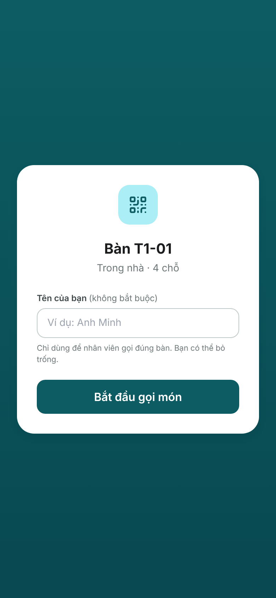 |
| **3. Chọn món** | 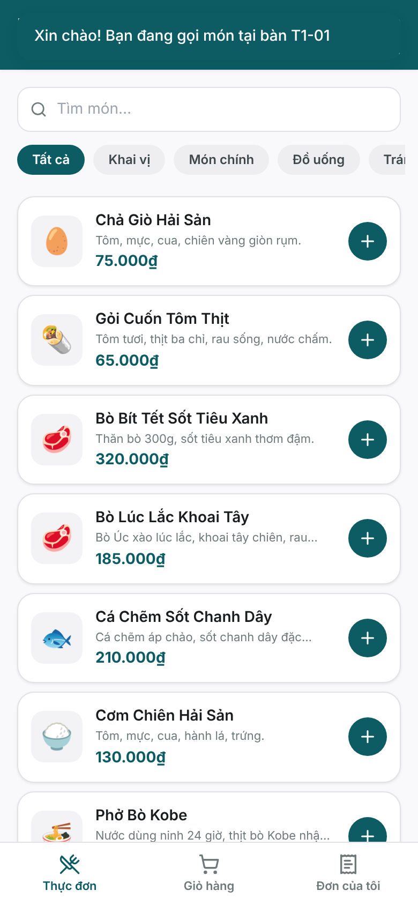 |
| **3. Giỏ hàng** | 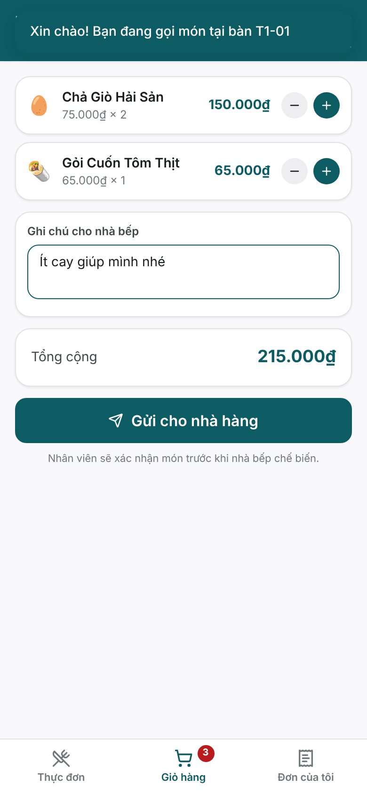 |
| **4. Hàng đợi của nhân viên** | 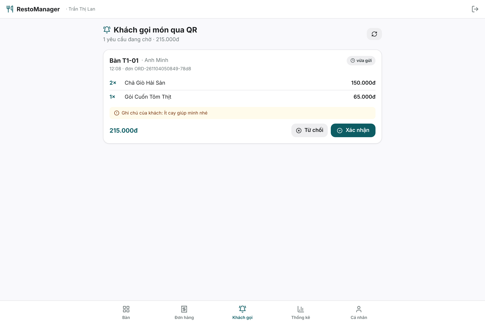 |
| **4. Từ chối kèm lý do** | 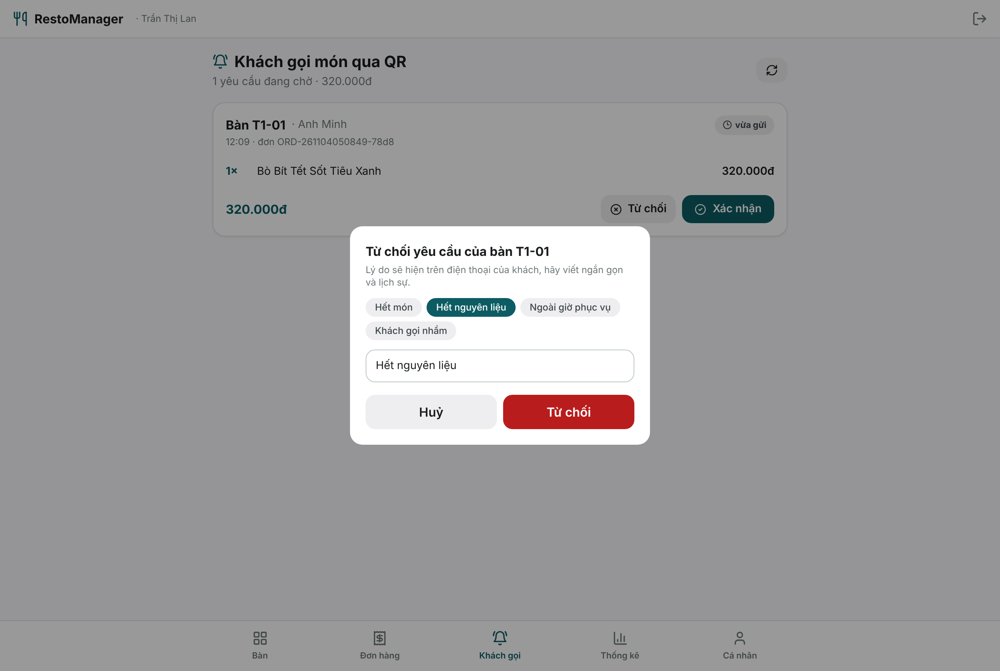 |
| **5. ⭐ Lịch sử đặt món của khách** | 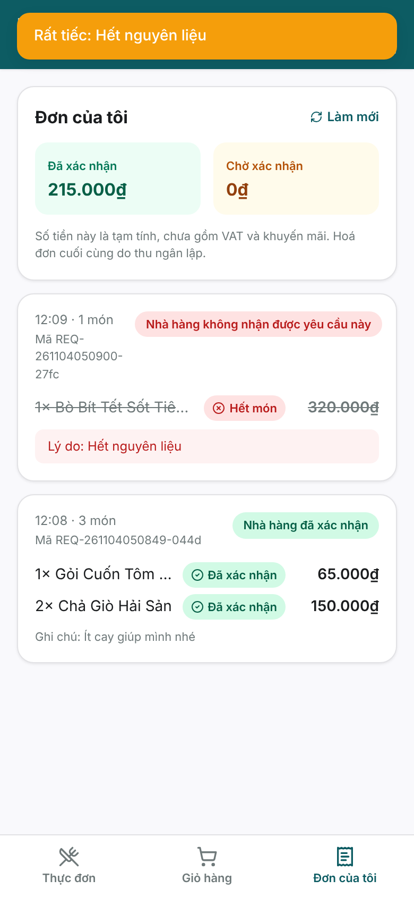 |

### F.1.4. Máy trạng thái của một dòng món

```mermaid
stateDiagram-v2
    [*] --> pending_confirm : Khách gọi qua QR<br/>(GUEST_REQUIRE_CONFIRMATION=true)
    [*] --> confirmed : Nhân viên nhập trực tiếp<br/>hoặc chế độ tự duyệt

    pending_confirm --> confirmed : Nhân viên xác nhận<br/>→ TÍNH TIỀN
    pending_confirm --> rejected : Nhân viên từ chối<br/>+ lý do → KHÔNG tính tiền

    confirmed --> served : Mang món ra bàn
    confirmed --> cancelled : Khách đổi ý<br/>(nhân viên xoá)

    served --> [*] : Thanh toán
    confirmed --> [*] : Thanh toán
    rejected --> [*]
    cancelled --> [*]

    note right of pending_confirm
        ⚠ Món ở trạng thái này
        KHÔNG tính vào total_amount
        và CHẶN thanh toán
    end note
```

### F.1.5. Xử lý tình huống ngoại lệ

| Tình huống | Hệ thống xử lý | Khách / nhân viên thấy gì |
|---|---|---|
| Khách tải lại trang | Token trong `localStorage` còn hiệu lực → **tiếp tục phiên cũ** | Thấy lại lịch sử, không mất gì |
| Khách quét mã QR lần hai | Phát hiện phiên đang hoạt động cùng bàn → dùng lại | Không tạo phiên trùng |
| Phiên quá 6 giờ | `parseToken` trả `GUEST_SESSION_EXPIRED` | "Phiên đã hết hạn, vui lòng quét lại mã QR" |
| Món vừa bị tắt bán giữa lúc khách chọn | `priceBasket` trả `unavailable` | "Vừa hết: Phở Bò Kobe. Vui lòng chọn món khác" — món tự bị gỡ khỏi giỏ |
| Nhân viên vừa mở đơn cho bàn đó | Advisory lock + thử lại 3 lần | Món vào đúng đơn nhân viên vừa mở |
| Hai khách cùng bàn, hai điện thoại | Hai phiên riêng, **cùng một đơn của bàn** | Mỗi người thấy lịch sử **của mình**; nhà hàng thấy một đơn chung |
| Khách gửi > 8 lượt trong 10 phút | Khoá phiên (`status = 'blocked'`) | "Bạn đã gửi quá nhiều yêu cầu. Vui lòng gọi nhân viên hỗ trợ" |
| Khách sửa `price` trong request | Bị bỏ qua, giá lấy từ CSDL | Số tiền đúng giá thật |
| Khách đổi `menu_item_id` thành UUID bịa | `findActiveByIds` không tìm thấy | `422 ITEM_UNAVAILABLE` |
| Khách sửa URL sang bàn khác | `qr_slug` ngẫu nhiên không đoán được | `404 Không tìm thấy bàn` |
| Thu ngân thanh toán khi còn món chờ duyệt | `assertReadyForCheckout` chặn | `409` — "Đơn còn 2 món khách gọi đang chờ duyệt" |
| Thanh toán xong | Sự kiện `invoice.issued` → đóng mọi phiên của bàn | Khách: "Cảm ơn quý khách! Phiên gọi món đã kết thúc" |
| Mất mạng giữa chừng | Socket.IO tự kết nối lại | Tải lại lịch sử, đồng bộ trạng thái mới nhất |

---

## F.2. Luồng thanh toán — giao dịch xuyên module

```mermaid
sequenceDiagram
    autonumber
    actor TN as 💵 Thu ngân
    participant BIL as module billing
    participant ORD as module ordering
    participant PG as PostgreSQL
    participant BUS as Event Bus
    participant DIN as module dining
    participant ANA as module analytics
    participant GA as module guest-access
    participant AUD as module auditing

    TN->>BIL: POST /api/invoices<br/>{ order_id, vat_rate: 8, paid_amount: 1.000.000 }

    rect rgb(255, 245, 230)
    Note over BIL,PG: MỘT TRANSACTION DUY NHẤT — tất cả hoặc không gì cả
    BIL->>PG: BEGIN
    BIL->>ORD: getOrderRaw(orderId, client)
    ORD->>PG: SELECT * FROM orders WHERE id = $1
    BIL->>BIL: Kiểm tra chưa có hoá đơn cho đơn này
    BIL->>ORD: getOrderItems(orderId, client)
    BIL->>ORD: assertReadyForCheckout(order, items)
    Note over ORD: ⚠ Ném lỗi 409 nếu còn món<br/>pending_confirm
    BIL->>BIL: computeTotals()<br/>tạm tính → giảm giá → VAT → phải trả → tiền thừa
    BIL->>PG: INSERT INTO invoices
    BIL->>PG: INSERT INTO invoice_items<br/>(SAO CHÉP tên + giá, bất biến)
    BIL->>ORD: closeOrderWithin(client, orderId)
    ORD->>PG: UPDATE orders SET status='completed'
    BIL->>PG: COMMIT
    end

    BIL->>BUS: billing.invoice.issued
    BIL-->>TN: 201 { invoice }

    par Các module phản ứng song song, bất đồng bộ
        BUS->>DIN: Giải phóng bàn → state='empty'
        DIN->>TN: realtime: tables:changed
    and
        BUS->>ANA: Cộng dồn hình chiếu doanh thu
        ANA->>TN: realtime: stats:changed (dashboard tự cập nhật)
    and
        BUS->>GA: Đóng mọi phiên khách của bàn
        GA->>GA: realtime: guest:session-closed (báo khách)
    and
        BUS->>AUD: Ghi nhật ký CHECKOUT
    end
```

**Điểm then chốt — vì sao `closeOrderWithin` phải nằm trong cùng transaction:**

Nếu đóng đơn bằng sự kiện (bất đồng bộ), sẽ tồn tại một khoảnh khắc **hoá đơn
đã có nhưng đơn vẫn "đang mở"**. Trong khoảnh khắc đó, thu ngân bấm thanh toán
lần hai sẽ tạo hoá đơn thứ hai → nhà hàng thu tiền hai lần.

Với Modular Monolith, hai module dùng chung một `client` của PostgreSQL nên
giải quyết trong một dòng:

```js
await ordering.closeOrderWithin(client, orderId);   // cùng transaction
```

Với microservices, cùng kịch bản này phải triển khai **Saga pattern** với hành
động bù trừ (`CancelInvoice`), trạng thái trung gian (`PAYMENT_PENDING`), và
xử lý trường hợp bù trừ cũng thất bại. **Đây là lý do chính chọn Modular
Monolith cho bài toán POS nhà hàng.**

---

## F.3. Luồng nhân viên phục vụ (không qua QR)

```mermaid
sequenceDiagram
    autonumber
    actor PV as 🧑‍🍳 Phục vụ
    participant ORD as module ordering
    participant DIN as module dining
    participant CAT as module catalog
    participant BUS as Event Bus

    PV->>DIN: GET /api/tables?with_status=true
    DIN-->>PV: Sơ đồ bàn (đọc hình chiếu, KHÔNG JOIN orders)
    Note over PV: Thấy bàn T1-03 màu xanh = trống

    PV->>ORD: POST /api/orders<br/>{ table_id, items: [3× Chả Giò] }
    ORD->>DIN: dining.getTableById(table_id)
    DIN-->>ORD: { code: 'T1-03', is_active: true }
    ORD->>CAT: catalog.priceBasket(items)
    CAT-->>ORD: Giá từ CSDL

    ORD->>ORD: BEGIN<br/>advisory lock theo bàn<br/>Kiểm tra chưa có đơn mở<br/>INSERT orders + order_items (status='confirmed')<br/>COMMIT
    ORD->>BUS: ordering.order.created
    ORD-->>PV: 201 { order, total_amount: 225.000₫ }

    BUS->>DIN: Chiếm bàn → state='ordering'
    DIN-->>PV: realtime: sơ đồ bàn T1-03 chuyển màu

    Note over PV: Món nhân viên nhập ở trạng thái 'confirmed' ngay —<br/>không cần duyệt, vì chính nhân viên đã xác nhận với khách
```

---

## F.4. Luồng dọn bàn

```mermaid
sequenceDiagram
    actor TN as 💵 Thu ngân
    participant ORD as module ordering
    participant BUS as Event Bus
    participant DIN as module dining
    participant GA as module guest-access

    Note over TN: Khách bỏ về không thanh toán
    TN->>ORD: POST /api/orders/clear-table/:tableId<br/>{ reason: "Khách bỏ về" }
    ORD->>ORD: Tìm đơn đang mở của bàn
    ORD->>ORD: UPDATE orders SET status='cancelled',<br/>cancelled_reason = 'Khách bỏ về'
    ORD->>BUS: ordering.order.cancelled
    ORD-->>TN: 200 "Đã dọn bàn T1-03 (huỷ đơn ORD-xxx)"

    BUS->>DIN: Giải phóng bàn → state='empty'
    BUS->>GA: Đóng phiên khách của bàn đó
    Note over GA: Khách cũ không gọi tiếp vào đơn đã huỷ
```

> **Ghi chú về vị trí endpoint:** thao tác "dọn bàn" thuộc **module ordering**
> (`/api/orders/clear-table/:tableId`) chứ không phải module dining
> (`/api/tables/:id/clear` như phiên bản trước), vì bản chất nó **ghi vào bảng
> `orders`**. Endpoint được đặt theo **quyền sở hữu dữ liệu**, không theo cách
> gom nhóm của giao diện. Đây là một ví dụ nhỏ nhưng điển hình của tư duy
> Modular Monolith.

---
---

# Phần G — Đặc tả API

## G.1. Quy ước chung

### Envelope phản hồi

Mọi endpoint trả về cùng một cấu trúc — client chỉ cần xử lý một dạng:

```jsonc
// Thành công
{ "success": true, "data": … , "message": "", "meta": { "total": 14, "page": 1 } }

// Thất bại
{ "success": false, "message": "Dữ liệu không hợp lệ",
  "error": { "code": "VALIDATION_ERROR",
             "details": ["items[0].quantity: số nguyên từ 1 đến 50"],
             "request_id": "4410936c-ef06-…" } }
```

### Hai loại xác thực

| Loại | Header | Dành cho |
|---|---|---|
| `bearerAuth` | `Authorization: Bearer <access token>` | Nhân viên |
| `guestToken` | `X-Guest-Token: <guest token>` | Khách quét mã QR |

### Mã lỗi

| Mã | HTTP | Ý nghĩa |
|---|---|---|
| `VALIDATION_ERROR` | 422 | Dữ liệu đầu vào sai định dạng |
| `UNAUTHORIZED` / `INVALID_TOKEN` / `TOKEN_EXPIRED` | 401 | Chưa xác thực hoặc token hỏng |
| `REFRESH_INVALID` | 401 | Refresh token bị thu hồi → đăng nhập lại |
| `GUEST_SESSION_EXPIRED` / `GUEST_SESSION_CLOSED` | 401 | Phiên khách hết hiệu lực → quét lại QR |
| `FORBIDDEN` | 403 | Không đủ quyền |
| `NOT_FOUND` | 404 | Không tìm thấy tài nguyên |
| `CONFLICT` / `DUPLICATE` | 409 | Xung đột (bàn có đơn mở, đơn đã thanh toán…) |
| `ITEM_UNAVAILABLE` | 422 | Món vừa hết, tải lại thực đơn |
| `RATE_LIMITED` | 429 | Quá nhiều yêu cầu |
| `STORAGE_UNAVAILABLE` | 503 | Kho ảnh đang bảo trì |

### Quy ước tiền tệ

**Mọi số tiền là số nguyên đồng VND.** Không có phần thập phân.

---

## G.2. Danh mục endpoint theo module

### Module `identity` — `/api/auth`, `/api/users`

| Method | Đường dẫn | Quyền | Mô tả |
|---|---|---|---|
| POST | `/api/auth/login` | công khai | Đăng nhập, trả access + refresh token |
| POST | `/api/auth/refresh` | công khai | Làm mới phiên (xoay vòng refresh token) |
| POST | `/api/auth/logout` | đã đăng nhập | Đăng xuất 1 hoặc mọi thiết bị |
| GET | `/api/auth/me` | đã đăng nhập | Thông tin tài khoản hiện tại |
| GET | `/api/auth/sessions` | đã đăng nhập | Danh sách phiên đang hoạt động |
| PUT | `/api/auth/password` | đã đăng nhập | Đổi mật khẩu cá nhân |
| GET | `/api/users` | `user.read` | Danh sách nhân viên |
| POST | `/api/users` | `user.write` | Tạo nhân viên |
| PUT | `/api/users/:id` | `user.write` | Sửa thông tin / vai trò / khoá |
| PUT | `/api/users/:id/password` | `user.write` | Đặt lại mật khẩu |
| DELETE | `/api/users/:id` | `user.write` | Xoá nhân viên |

### Module `catalog` — `/api/menu`, `/api/files`

| Method | Đường dẫn | Quyền | Mô tả |
|---|---|---|---|
| GET | `/api/menu/categories` | đã đăng nhập | Danh mục món |
| GET | `/api/menu` | đã đăng nhập | Thực đơn (lọc `?active`, `?category`, `?search`) |
| GET | `/api/menu/:id` | đã đăng nhập | Chi tiết món |
| POST | `/api/menu` | `menu.write` | Thêm món *(multipart, có ảnh)* |
| PUT | `/api/menu/:id` | `menu.write` | Sửa món *(multipart)* |
| DELETE | `/api/menu/:id` | `menu.write` | Xoá món (xoá cả ảnh trên S3) |
| POST | `/api/files/upload` | `menu.write` | Tải tệp lên MinIO/S3/R2 |
| GET | `/api/files/storage-info` | admin | Trạng thái kho đối tượng |

### Module `dining` — `/api/tables`

| Method | Đường dẫn | Quyền | Mô tả |
|---|---|---|---|
| GET | `/api/tables/zones` | đã đăng nhập | Danh sách khu vực |
| GET | `/api/tables` | `table.read` | Sơ đồ bàn (`?with_status=true` để kèm trạng thái) |
| GET | `/api/tables/:id` | `table.read` | Chi tiết bàn |
| GET | `/api/tables/:id/qr` | `table.read` | Dữ liệu in mã QR |
| POST | `/api/tables` | `table.write` | Thêm bàn |
| PUT | `/api/tables/:id` | `table.write` | Sửa bàn |
| PATCH | `/api/tables/:id/active` | `table.operate` | Bật/tắt bàn |
| POST | `/api/tables/:id/rotate-qr` | `table.write` | **Cấp mã QR mới** |
| DELETE | `/api/tables/:id` | `table.write` | Xoá bàn |

### Module `ordering` — `/api/orders`

| Method | Đường dẫn | Quyền | Mô tả |
|---|---|---|---|
| GET | `/api/orders` | `order.read` | Danh sách đơn (lọc `?status`, `?source`, `?from`, `?to`) |
| GET | `/api/orders/pending-items` | `order.read` | **Món khách gọi đang chờ duyệt** |
| GET | `/api/orders/by-table/:tableId` | `order.read` | Đơn đang mở của một bàn |
| GET | `/api/orders/:id` | `order.read` | Chi tiết đơn |
| POST | `/api/orders` | `order.create` | Mở đơn mới |
| PUT | `/api/orders/:id/status` | `order.modify` | Chuyển trạng thái đơn |
| DELETE | `/api/orders/:id` | `order.modify` | Huỷ đơn |
| POST | `/api/orders/:id/move` | `order.move` | Chuyển sang bàn khác |
| POST | `/api/orders/clear-table/:tableId` | `table.operate` | **Dọn bàn** |
| POST | `/api/orders/:id/items` | `order.modify` | Thêm món |
| PUT | `/api/orders/:id/items/:itemId` | `order.modify` | Sửa số lượng / ghi chú |
| DELETE | `/api/orders/:id/items/:itemId` | `order.modify` | Xoá món |
| POST | `/api/orders/:id/items/:itemId/confirm` | `order.confirm_guest` | ⭐ **Xác nhận một món** |
| POST | `/api/orders/:id/items/:itemId/reject` | `order.confirm_guest` | ⭐ **Từ chối một món** |
| POST | `/api/orders/:id/items/:itemId/served` | `order.modify` | Đánh dấu đã phục vụ |
| POST | `/api/orders/guest-requests/:requestId/review` | `order.confirm_guest` | ⭐ **Duyệt/từ chối cả lượt** |

### Module `billing` — `/api/invoices`

| Method | Đường dẫn | Quyền | Mô tả |
|---|---|---|---|
| POST | `/api/invoices` | `invoice.checkout` | **Thanh toán & lập hoá đơn** |
| GET | `/api/invoices` | `invoice.read` | Lịch sử hoá đơn |
| GET | `/api/invoices/:id` | `invoice.read` | Chi tiết hoá đơn |
| POST | `/api/orders/:id/checkout` | `invoice.checkout` | *(đã lỗi thời)* Tương thích ứng dụng di động bản cũ |

> **Thay đổi so với phiên bản 2:** endpoint thanh toán chuyển từ
> `POST /api/orders/:id/checkout` sang `POST /api/invoices`, vì hoá đơn thuộc
> module `billing` — endpoint đặt theo **quyền sở hữu dữ liệu**. Endpoint cũ
> vẫn hoạt động, có header `Deprecation: true` và ghi cảnh báo vào log mỗi lần
> được gọi, để theo dõi còn client nào chưa cập nhật.

### Module `guest-access` — `/api/public` (công khai), `/api/guest-requests`

| Method | Đường dẫn | Xác thực | Mô tả |
|---|---|---|---|
| GET | `/api/public/table/:qrKey` | *không* | Thông tin bàn từ mã QR |
| POST | `/api/public/session/:qrKey` | *không* | **Mở phiên gọi món**, trả guest token |
| GET | `/api/public/menu` | guest | Thực đơn cho khách |
| GET | `/api/public/session` | guest | Thông tin phiên + lịch sử |
| PUT | `/api/public/session` | guest | Cập nhật tên hiển thị |
| POST | `/api/public/orders` | guest | **Gửi món** |
| GET | `/api/public/orders` | guest | ⭐ **LỊCH SỬ ĐẶT MÓN ("Đơn của tôi")** |
| POST | `/api/public/session/close` | guest | Kết thúc phiên |
| GET | `/api/guest-requests/pending` | `guest_session.read` | Hàng đợi yêu cầu chờ duyệt |
| GET | `/api/guest-requests/by-table/:tableId` | `guest_session.read` | Lịch sử yêu cầu của một bàn |
| GET | `/api/guest-requests/sessions/by-table/:tableId` | `guest_session.read` | Phiên khách của một bàn |

### Module `analytics` — `/api/stats` · Module `auditing` — `/api/logs`

| Method | Đường dẫn | Quyền | Mô tả |
|---|---|---|---|
| GET | `/api/stats/overview` | `stats.read` | Tổng quan doanh thu (`?from`, `?to`) |
| GET | `/api/stats/daily` | `stats.read` | Doanh thu theo ngày (`?days=14`) |
| POST | `/api/stats/rebuild` | admin | Dựng lại hình chiếu báo cáo |
| GET | `/api/logs` | `log.read` | Nhật ký hoạt động |
| GET | `/api/logs/timeline/:entity/:entityId` | `log.read` | Dòng thời gian của một đối tượng |

### Endpoint vận hành

| Method | Đường dẫn | Mô tả |
|---|---|---|
| GET | `/api/health` | Sức khoẻ tổng thể (CSDL, kho ảnh, realtime, từng module) |
| GET | `/api/health/ready` | Readiness probe |
| GET | `/api/health/live` | Liveness probe (Docker healthcheck dùng) |
| GET | `/api/architecture` | **Bản đồ module & phụ thuộc, sinh từ mã nguồn** |
| GET | `/api/docs` | Swagger UI |
| GET | `/api/openapi.json` | Đặc tả OpenAPI 3.0 |

**Tổng cộng: 46 endpoint REST.**

## G.3. Ví dụ gọi API — luồng khách QR đầy đủ

```bash
BASE=https://nhahang.example.com
QR=8c03293681c2      # qr_slug lấy từ mã QR dán trên bàn

# 1. Xem thông tin bàn (không cần gì cả)
curl -s $BASE/api/public/table/$QR | jq .data
# → { "code": "T1-01", "zone_name": "Trong nhà", "capacity": 4 }

# 2. Mở phiên — lưu token lại
TOKEN=$(curl -s -X POST $BASE/api/public/session/$QR \
  -H 'Content-Type: application/json' \
  -d '{"display_name":"Anh Minh"}' | jq -r .data.token)

# 3. Xem thực đơn
curl -s $BASE/api/public/menu -H "X-Guest-Token: $TOKEN" | jq '.data.items[0:2]'

# 4. Gửi món (chỉ gửi id và số lượng — KHÔNG gửi giá)
ITEM=$(curl -s $BASE/api/public/menu -H "X-Guest-Token: $TOKEN" | jq -r '.data.items[0].id')
curl -s -X POST $BASE/api/public/orders \
  -H "X-Guest-Token: $TOKEN" -H 'Content-Type: application/json' \
  -d "{\"items\":[{\"menu_item_id\":\"$ITEM\",\"quantity\":2}],\"note\":\"Ít cay\"}" | jq .data
# → { "request_id": "...", "status": "pending",
#     "status_label": "Đang chờ nhà hàng xác nhận", "amount": 150000 }

# 5. ⭐ Xem lịch sử đặt món của mình
curl -s $BASE/api/public/orders -H "X-Guest-Token: $TOKEN" | jq .data.summary
# → { "request_count": 1, "confirmed_amount": 0, "pending_amount": 150000,
#     "estimated_total": 150000, "has_pending": true }
```

Phía nhân viên:

```bash
STAFF=$(curl -s -X POST $BASE/api/auth/login -H 'Content-Type: application/json' \
  -d '{"username":"cashier","password":"***"}' | jq -r .data.token)

# Xem hàng đợi
REQ=$(curl -s $BASE/api/guest-requests/pending -H "Authorization: Bearer $STAFF" \
  | jq -r '.data[0].request_id')

# Xác nhận
curl -s -X POST $BASE/api/orders/guest-requests/$REQ/review \
  -H "Authorization: Bearer $STAFF" -H 'Content-Type: application/json' \
  -d '{"approve":true}' | jq .data.order.total_amount
# → 150000   (giờ mới tính tiền)

# Hoặc từ chối kèm lý do
# -d '{"approve":false,"reason":"Hết nguyên liệu"}'
```

---
---

# Phần H — Triển khai

> Hướng dẫn thao tác chi tiết nằm ở tệp **[`DEPLOYMENT.md`](DEPLOYMENT.md)**.
> Phần này trình bày **thiết kế** của hệ thống triển khai.

## H.1. Docker Compose — môi trường phát triển

```bash
cp .env.example .env
docker compose up -d --build
```

Năm dịch vụ khởi động theo thứ tự phụ thuộc:

```mermaid
graph LR
    PG[("postgres<br/>healthcheck: pg_isready")]
    MIO[("minio<br/>healthcheck: mc ready")]
    INIT["minio-init<br/>tạo bucket"]
    BE["backend"]
    FE["frontend"]

    PG -->|"service_healthy"| BE
    MIO -->|"service_healthy"| BE
    MIO -->|"service_healthy"| INIT
    BE -->|"service_healthy"| FE

    style BE fill:#fff3e0,stroke:#e65100,stroke-width:2px
```

**`depends_on` với `condition: service_healthy`** là chi tiết quan trọng: nếu
chỉ dùng `depends_on` thường, Docker chỉ chờ container **khởi động**, không
chờ dịch vụ **sẵn sàng**. Backend sẽ cố nối PostgreSQL khi nó chưa nhận kết
nối và lỗi ngay. (Backend còn có thêm vòng chờ riêng 30×2 giây để chắc chắn.)

| Dịch vụ | Cổng | Truy cập |
|---|---|---|
| frontend | 8080 | http://localhost:8080 |
| backend | 3000 | http://localhost:3000/api |
| Swagger UI | 3000 | http://localhost:3000/api/docs |
| Bản đồ kiến trúc | 3000 | http://localhost:3000/api/architecture |
| MinIO API | 9000 | http://localhost:9000 |
| MinIO Console | 9001 | http://localhost:9001 |
| PostgreSQL | 5432 | `psql -h localhost -U postgres restaurant_db` |

## H.2. Docker Compose — production

```bash
docker compose -f docker-compose.yml -f docker-compose.prod.yml up -d --build
```

Lớp phủ production thay đổi **sáu điểm**:

| # | Thay đổi | Lý do |
|---|---|---|
| 1 | **Thêm Caddy** nghe 80/443 | Reverse proxy duy nhất ra Internet, tự xin và tự gia hạn chứng chỉ Let's Encrypt |
| 2 | **Gỡ toàn bộ `ports`** của postgres, minio, backend, frontend | ⭐ Thay đổi bảo mật quan trọng nhất — CSDL không còn phơi ra Internet |
| 3 | **Giới hạn tài nguyên** từng container | Một dịch vụ rò rỉ bộ nhớ không kéo sập VPS |
| 4 | **Xoay vòng log** 3 tệp × 10 MB | Tránh đầy ổ đĩa sau vài tháng |
| 5 | **Thêm dịch vụ `backup`** | Dump PostgreSQL hằng ngày lúc 03:00 giờ Việt Nam, giữ 14 ngày |
| 6 | **Thêm `cloudflared`** *(profile `tunnel`)* | Phương án cho VPS không có IP công khai |

Kiểm chứng điểm 2 bằng chính `docker compose config`:

```
$ docker compose -f docker-compose.yml -f docker-compose.prod.yml config | grep published
        published: "80"      ← chỉ Caddy
        published: "443"
        published: "443"     ← HTTP/3 (UDP)
```

## H.3. Caddy — HTTPS tự động

### Vì sao Caddy thay vì Nginx + Certbot?

| Tiêu chí | Nginx + Certbot | **Caddy** |
|---|---|---|
| Cấp chứng chỉ | Chạy certbot thủ công | **Tự động khi khởi động** |
| Gia hạn | Phải đặt cron, dễ quên | **Tự động** |
| HTTP/2, HTTP/3 | Cấu hình thêm | **Mặc định bật** |
| HSTS, chuyển hướng HTTPS | Viết tay | **Mặc định** |
| Số dòng cấu hình | ~80 dòng | ~25 dòng |

Với một nhà hàng không có đội vận hành chuyên trách, **ít chỗ sai hơn là tiêu
chí quan trọng nhất**.

### Ba tên miền con

```
nhahang.example.com       → frontend (React SPA) + /api + /socket.io
cdn.nhahang.example.com   → MinIO (ảnh món ăn), chỉ cho phép đọc
minio.nhahang.example.com → Giao diện quản trị MinIO (tuỳ chọn, nên giới hạn IP)
```

Tách `cdn` thành tên miền riêng để:
- Bật proxy Cloudflare riêng cho ảnh → cache tại biên, giảm tải VPS
- Không phơi cổng 9000 của MinIO ra Internet
- **Dễ chuyển sang Cloudflare R2 sau này**: chỉ đổi bản ghi DNS, URL ảnh đã
  lưu trong CSDL vẫn đúng

### Cấu hình chú ý

```caddyfile
# WebSocket đặt TRƯỚC /api/* vì cần giữ kết nối rất lâu
handle /socket.io/* {
    reverse_proxy backend:3000 {
        transport http { read_timeout 1h  write_timeout 1h }
    }
}

# CDN ảnh: chỉ cho đọc, mọi phương thức ghi bị chặn
cdn.{$DOMAIN} {
    header /restaurant/* Cache-Control "public, max-age=31536000, immutable"
    @write method POST PUT DELETE PATCH
    respond @write 405
    reverse_proxy minio:9000
}
```

Khối `trusted_proxies` liệt kê dải IP của Cloudflare để backend nhận đúng IP
khách thay vì IP của Cloudflare.

## H.4. Cloudflare

### H.4.1. Kiến trúc đường đi của request

```mermaid
graph LR
    U["Người dùng"] --> CF["Cloudflare<br/>biên gần nhất"]
    CF -->|"cache hit (ảnh)"| U
    CF -->|"cache miss / API"| CADDY["Caddy trên VPS<br/>TLS Full strict"]
    CADDY --> APP["backend / frontend / minio"]

    style CF fill:#fff8e1,stroke:#f57f17,stroke-width:2px
```

### H.4.2. Cấu hình bắt buộc

| Mục | Giá trị | Hậu quả nếu sai |
|---|---|---|
| **SSL/TLS mode** | **Full (strict)** | Để `Flexible` → **ERR_TOO_MANY_REDIRECTS**. Đây là lỗi phổ biến nhất khi dùng Cloudflare với reverse proxy ép HTTPS |
| **Network → WebSockets** | **On** | Socket.IO không kết nối được → nhân viên phải F5 mới thấy đơn mới |
| **Cache Rule: `/api/*`** | **Bypass cache** | Cloudflare có thể cache phản hồi API → thu ngân thấy dữ liệu cũ |
| **Cache Rule: `/socket.io/*`** | **Bypass cache** | Hỏng handshake WebSocket |
| **Cache Rule: `cdn.*`** | Edge TTL 1 tháng | Không cache → mất lợi ích CDN |

### H.4.3. Bản ghi DNS

| Type | Name | Content | Proxy |
|---|---|---|---|
| A | `@` | IP VPS | 🟠 Proxied |
| A | `cdn` | IP VPS | 🟠 Proxied |
| A | `minio` | IP VPS | ⚪ DNS only |

`minio` để **DNS only** vì giao diện quản trị MinIO dùng WebSocket và tải tệp
lớn; qua proxy Cloudflare gói Free bị giới hạn 100 MB mỗi request.

### H.4.4. Hai phương án triển khai

| | **Phương án A — DNS Proxy** | **Phương án B — Cloudflare Tunnel** |
|---|---|---|
| Khi dùng | VPS có IP công khai (đa số) | VPS sau NAT, hoặc muốn **không mở cổng nào** |
| Cổng mở | 80, 443 | **Không mở cổng nào** |
| Chứng chỉ | Caddy xin Let's Encrypt | Cloudflare cung cấp ở biên |
| Cấu hình | Bản ghi DNS | Token tunnel trong `.env` |
| Lệnh chạy | `docker compose … up -d` | `docker compose … --profile tunnel up -d` |

### H.4.5. Lợi ích thu được từ Cloudflare

| Lợi ích | Chi tiết |
|---|---|
| **Chống DDoS** | Miễn phí, không giới hạn, lọc tại biên trước khi tới VPS |
| **CDN cho ảnh món** | Khách ở Đà Nẵng tải ảnh từ điểm biên Đà Nẵng, không phải từ VPS |
| **Giảm tải VPS** | Ảnh được cache tại biên → VPS chỉ phục vụ API |
| **Ẩn IP máy chủ** | Kẻ tấn công thấy IP Cloudflare, không thấy IP VPS |
| **WAF** | Chặn SQL injection, XSS ở tầng biên |
| **Rate limiting tại biên** | Chặn lạm dụng `/api/public/*` trước khi chạm VPS |
| **Thống kê truy cập** | Biết lượng truy cập, quốc gia, loại thiết bị |

## H.5. Kịch bản triển khai tự động

`deploy/deploy.sh` thực hiện 5 bước, **tự kiểm chứng và có đường lùi**:

```mermaid
graph TD
    S1["<b>1. Kiểm tra điều kiện</b><br/>Docker · .env · độ mạnh secret"]
    S2["<b>2. Sao lưu CSDL</b><br/>pre-deploy-{timestamp}.sql.gz"]
    S3["<b>3. Kiểm tra ranh giới module</b><br/>npm run check:boundaries"]
    S4["<b>4. Build & khởi động</b><br/>chờ /api/health/ready"]
    S5["<b>5. Kiểm chứng</b><br/>health · architecture · HTTPS"]

    S1 -->|"✓"| S2 --> S3
    S1 -->|"✗ secret yếu"| FAIL1["❌ Dừng, không triển khai"]
    S3 -->|"✓"| S4
    S3 -->|"✗ vi phạm ranh giới"| FAIL2["❌ Dừng, không triển khai"]
    S4 -->|"✓"| S5
    S4 -->|"✗ quá 60s"| ROLLBACK["⚠ In log + hướng dẫn khôi phục"]

    style FAIL1 fill:#ffebee,stroke:#c62828
    style FAIL2 fill:#ffebee,stroke:#c62828
    style ROLLBACK fill:#fff8e1,stroke:#f57f17
    style S3 fill:#fff3e0,stroke:#e65100,stroke-width:2px
```

**Điểm đáng chú ý — bước 3:** kịch bản chạy `check-boundaries` **trước khi
build**. Mã vi phạm ranh giới module **không thể lên production**. Đây là cách
biến nguyên tắc kiến trúc thành ràng buộc kỹ thuật thực sự, thay vì chỉ là
thoả thuận giữa các lập trình viên.

Các kiểm tra ở bước 1:

```bash
[ "${NODE_ENV}" = "production" ] || fail "NODE_ENV phải là 'production'"
[ "${#JWT_SECRET}" -ge 32 ]      || fail "JWT_SECRET phải dài ≥ 32 ký tự"
[ "$JWT_SECRET" != "$REFRESH_SECRET" ] || fail "Hai secret phải khác nhau"
[ "${DB_PASSWORD}" != "postgres" ]     || fail "DB_PASSWORD vẫn là mặc định"
case "$value" in *doi-gia-tri-nay*|*REPLACE_ME*) fail "vẫn là giá trị mẫu" ;; esac
```

## H.6. Sao lưu

| Khía cạnh | Thiết kế |
|---|---|
| **Lịch** | 03:00 giờ Việt Nam hằng ngày (giờ vắng khách nhất) + một lần ngay khi container khởi động |
| **Nội dung** | `pg_dump --clean --if-exists`, nén gzip-9 |
| **Giữ lại** | 14 ngày (cấu hình `BACKUP_RETENTION_DAYS`) |
| **Trước mỗi lần triển khai** | `deploy.sh` tự dump `pre-deploy-{timestamp}.sql.gz` |
| **Cách chạy** | Dịch vụ thường trú trong Compose, **không dùng cron của host** — chuyển sang VPS khác là mang theo luôn |

> ⚠ **Cảnh báo được ghi rõ trong tài liệu:** bản sao lưu nằm **cùng ổ đĩa** với
> CSDL. Ổ hỏng là mất cả hai. `DEPLOYMENT.md` mục 7 hướng dẫn đồng bộ ra ngoài
> bằng `rsync` hoặc `rclone` lên Cloudflare R2.

---
---

# Phần I — Kiểm thử

## I.1. Chiến lược kiểm thử

```mermaid
graph TD
    L1["<b>Kiểm thử đơn vị — tầng domain</b><br/>24 ca · 94 ms · không cần CSDL<br/><i>tests/domain.test.js</i>"]
    L2["<b>Kiểm thử ranh giới kiến trúc</b><br/>5 quy tắc trên 78 tệp<br/><i>tools/check-boundaries.js</i>"]
    L3["<b>Kiểm thử đầu-cuối API</b><br/>75 ca · hệ thống chạy thật<br/><i>tests/e2e-smoke.js</i>"]
    L4["<b>Kiểm thử thời gian thực</b><br/>10 ca · WebSocket thật<br/><i>tests/realtime-smoke.js</i>"]
    L5["<b>Kiểm thử giao diện</b><br/>Playwright · 2 thiết bị song song"]

    L1 --> L2 --> L3 --> L4 --> L5

    style L1 fill:#e8f5e9,stroke:#2e7d32
    style L2 fill:#fff3e0,stroke:#e65100,stroke-width:2px
    style L3 fill:#e3f2fd,stroke:#1565c0,stroke-width:2px
    style L5 fill:#f3e5f5,stroke:#6a1b9a
```

## I.2. Kiểm thử đơn vị — tầng domain

**24/24 đạt trong 94 mili-giây**, không cần PostgreSQL, MinIO hay Docker.

```
$ npm test

✓ money: VND luôn làm tròn về số nguyên đồng
✓ money: VAT tính trên số đã làm tròn, không tích luỹ sai số
✓ order: chỉ cho phép chuyển trạng thái hợp lệ
✓ order: tổng tiền CHỈ cộng món đã xác nhận hoặc đã phục vụ
✓ order: CHẶN thanh toán khi còn món khách gọi chờ duyệt
✓ order: không thanh toán được đơn rỗng hoặc toàn món bị từ chối
✓ order: giỏ món sai định dạng bị chặn ngay ở domain
✓ invoice: công thức tính tiền đầy đủ
✓ invoice: VAT 0% hợp lệ (hộ kinh doanh không chịu thuế)
✓ invoice: chặn giảm giá vượt tiền hàng
✓ invoice: chặn khách trả thiếu
✓ invoice: không truyền paid_amount → coi như trả đúng, tiền thừa 0
✓ invoice: chặn phương thức thanh toán lạ
✓ guest: token hợp lệ giải mã được đúng mã phiên
✓ guest: token bị sửa chữ ký → từ chối
✓ guest: đổi mã phiên trong token → chữ ký không khớp, từ chối
✓ guest: token hết hạn → từ chối với mã riêng
✓ guest: tên hiển thị bị làm sạch ký tự nguy hiểm
✓ guest: số điện thoại Việt Nam được kiểm tra định dạng
✓ guest: phiên đã đóng hoặc hết hạn không dùng được
✓ roles: ma trận quyền đúng với từng vai trò
✓ roles: hành động chưa khai báo thì mặc định TỪ CHỐI
✓ table: không tạm ngưng được bàn đang có khách
✓ table: mã bàn phải đúng quy ước

# tests 24   # pass 24   # fail 0   # duration_ms 93.8
```

**Đây là lợi ích đo được của việc tách tầng domain.** Nếu quy tắc tính tiền
nằm lẫn trong controller, mỗi lần kiểm thử phải dựng Docker, tạo CSDL, chèn
dữ liệu mẫu — mất hàng chục giây và dễ hỏng.

## I.3. Kiểm thử ranh giới kiến trúc

```
$ npm run check:boundaries

Kiểm tra ranh giới của 8 module...

Quyền sở hữu bảng CSDL:
  analytics      → analytics_revenue_hourly, analytics_item_sales
  auditing       → activity_logs
  billing        → invoices, invoice_items
  catalog        → menu_categories, menu_items
  dining         → dining_zones, tables, dining_table_state
  guest-access   → guest_sessions, guest_order_requests
  identity       → users, refresh_tokens
  ordering       → orders, order_items

✓ Không phát hiện vi phạm ranh giới module.
```

**Một vi phạm thật đã được công cụ phát hiện và sửa trong quá trình làm:**

```
[R3] 1 vi phạm
  modules/ordering/infrastructure/order-repository.js
    truy vấn bảng 'tables' do module 'dining' sở hữu.
    Hãy gọi qua modules/dining/contract.
```

Đoạn mã vi phạm dùng `SELECT ... FROM tables ... FOR NO KEY UPDATE` để khoá
bàn — đúng về kỹ thuật nhưng phá ranh giới. Đã thay bằng **advisory lock** của
PostgreSQL (khoá theo con số dẫn xuất từ `table_id`, không chạm bảng nào).

> Đây chính là giá trị thực tế của công cụ: nó bắt được một lỗi kiến trúc mà
> code review bằng mắt rất dễ bỏ qua, vì câu SQL đó trông hoàn toàn hợp lý.

## I.4. Kiểm thử đầu-cuối API

**75/75 đạt** trên hệ thống chạy thật (PostgreSQL 16 + kho đối tượng tương
thích S3 + backend đầy đủ 8 module).

| Nhóm | Số ca | Nội dung kiểm thử |
|---|:---:|---|
| **A. Xác thực & phân quyền** | 10 | Đăng nhập 3 vai trò · sai mật khẩu → 401 · không lộ tài khoản tồn tại · không token → 401 · waiter xem danh sách nhân viên → 403 · nạp đủ 8 module · thứ tự nạp tôn trọng phụ thuộc |
| **B. Sơ đồ bàn** | 5 | Lấy được sơ đồ · mỗi bàn có trạng thái · **mỗi bàn có mã QR riêng** · mã QR không trùng |
| **C. Khách quét QR** | 13 | Tra bàn không cần đăng nhập · mã QR sai → 404 · mở phiên · phiên gắn đúng bàn · **xem thực đơn không có phiên → 401** · thực đơn không lộ trường quản trị · gửi món · **giá lấy từ CSDL** · ⭐ **khách gửi `price=1` nhưng hệ thống tính giá thật** · UUID sai → 422 |
| **D. ⭐ Lịch sử đặt món** | 5 | Khách xem được lịch sử của mình · ghi nhận còn món chờ duyệt · tiền chờ duyệt đúng · tiền xác nhận = 0 khi chưa duyệt · nhãn trạng thái tiếng Việt |
| **E. Xác nhận món** | 11 | Nhân viên thấy hàng đợi · hiển thị phút chờ · món vào đơn của bàn · đơn đánh dấu nguồn `qr` · **tổng tiền = 0 khi chưa duyệt** · đơn hiển thị riêng tiền chờ · duyệt → tổng tiền cập nhật · từ chối → không tính tiền · **duyệt lại → 409** |
| **F. Khách thấy kết quả** | 5 | Lượt được duyệt hiện "đã xác nhận" · lượt bị từ chối hiện đúng · **khách thấy lý do từ chối** · tổng tiền khớp đơn · hết món chờ duyệt |
| **G. Thanh toán** | 10 | ⭐ **CHẶN thanh toán khi còn món chờ duyệt → 409** · thanh toán thành công · tiền hàng đúng · **VAT 8% đúng** · thành tiền = hàng + VAT · tiền thừa đúng · **hoá đơn chỉ gồm món đã duyệt** · thanh toán lần hai → 409 · waiter thanh toán → 403 |
| **H. Sự kiện lan toả** | 10 | Bàn về trống · không còn mã đơn · **phiên khách đã đóng → 401** · báo cáo ghi nhận hoá đơn · doanh thu khớp · có món bán chạy · **nhật ký tự ghi CHECKOUT, QR_SUBMIT_ORDER, CONFIRM_GUEST_ITEMS** · cashier xem nhật ký → 403 |
| **I. Luồng nhân viên** | 6 | Mở đơn mới · món nhân viên nhập duyệt ngay · tổng tiền tính ngay · **mở đơn thứ hai cùng bàn → 409** · dọn bàn · bàn trống lại |

```
────────────────────────────────────────────────────────────
✓ TẤT CẢ 75 KIỂM THỬ ĐỀU ĐẠT
```

### Ba ca kiểm thử đáng chú ý nhất

**(1) Khách không thể sửa giá**

```js
const cheat = await api('POST', '/api/public/orders', {
  guestToken,
  body: { items: [{ menu_item_id: dish3.id, quantity: 1, price: 1 }] },  // ← gian lận
});
check('Khách KHÔNG sửa được giá (giá luôn từ CSDL)',
      cheat.body?.data?.amount === dish3.price);   // → 320.000₫, không phải 1₫
```

**(2) Chặn thanh toán khi còn món chờ duyệt**

```js
const blocked = await api('POST', '/api/invoices', {
  token: cashier.token, body: { order_id: order.id, cashier_name: 'Thu ngân' },
});
check('CHẶN thanh toán khi còn món chờ duyệt → 409', blocked.status === 409);
// message: "Đơn ORD-xxx còn 1 món khách gọi đang chờ duyệt.
//           Hãy duyệt hoặc từ chối các món đó trước khi thanh toán."
```

**(3) Món bị từ chối không tính tiền**

```js
const reject = await api('POST', `/api/orders/guest-requests/${req2.request_id}/review`,
  { token: cashier.token, body: { approve: false, reason: 'Hết nguyên liệu' } });
check('Món bị từ chối không tính tiền',
      reject.body?.data?.order?.total_amount === expected1);  // không đổi
```

## I.5. Kiểm thử thời gian thực

**10/10 đạt** với WebSocket thật, hai client song song (nhân viên + khách).

```
✓ Nhân viên kết nối WebSocket bằng JWT
✓ Khách kết nối WebSocket bằng guest token
✓ Kết nối WebSocket không token bị từ chối
✓ Nhân viên nhận sự kiện khách gọi món (guest:request-pending)
✓ Nhân viên nhận sự kiện bàn đổi trạng thái (tables:changed)
✓ Khách nhận được kết quả duyệt theo thời gian thực
✓ Sự kiện mang đúng trạng thái "confirmed"
✓ Nhân viên nhận sự kiện hoá đơn mới
✓ Dashboard nhận sự kiện cập nhật thống kê
✓ Khách được báo phiên đã kết thúc

✓ Tất cả 10 kiểm thử realtime đạt
```

Ca quan trọng nhất là ca thứ 6: **sự kiện duyệt món phải tới đúng phiên khách
đó**, không phải mọi khách. Điều này được bảo đảm bằng phòng riêng
`guest:<session_id>` trong Socket.IO.

## I.6. Kiểm thử giao diện

Dùng Playwright mô phỏng **hai thiết bị chạy song song**: một điện thoại
(390×844, khách) và một máy tính (1280×860, thu ngân).

| Bước kiểm thử | Kết quả |
|---|---|
| Khách mở `/order/<qr_slug>` → màn hình chào đúng bàn | ✅ |
| Nhập tên → mở phiên → thực đơn hiện 14 món | ✅ |
| Thêm món vào giỏ → nút nổi hiện "3 món · 215.000₫" | ✅ |
| Gửi món → chuyển sang tab "Đơn của tôi", hiện **"Chờ xác nhận"** | ✅ |
| Thu ngân đăng nhập → vào "Khách gọi" → **thấy đúng yêu cầu của bàn đó** | ✅ |
| Thu ngân bấm "Xác nhận" → toast "Đã xác nhận · 3 món cho bàn T1-01" | ✅ |
| **Màn hình khách tự đổi sang "Đã xác nhận"** (không F5) | ✅ |
| Khách gửi lượt thứ hai → thu ngân bấm "Từ chối" → chọn "Hết nguyên liệu" | ✅ |
| **Khách thấy toast "Rất tiếc: Hết nguyên liệu"**, món gạch ngang, chip "Hết món" | ✅ |
| Tiền tạm tính cập nhật đúng: xác nhận 215.000₫, chờ duyệt 0₫ | ✅ |

Ảnh chụp màn hình thực tế: xem [Mục F.1.3](#f13-màn-hình-thực-tế).

## I.7. Những lỗi thật đã phát hiện và sửa trong quá trình kiểm thử

| # | Lỗi | Phát hiện bởi | Cách sửa |
|---|---|---|---|
| 1 | `ordering` truy vấn bảng `tables` của `dining` | `check-boundaries` (R3) | Thay bằng `pg_advisory_xact_lock` |
| 2 | CORS từ chối cả request **cùng nguồn** khi truy cập bằng IP thay vì tên miền | Kiểm thử giao diện | Thêm ngoại lệ cùng nguồn vào `security.js` và `realtime.js` |
| 3 | `storage.init()` chặn khởi động 60 giây khi kho ảnh chưa sẵn sàng | Chạy thử không có MinIO | Thử nhanh 3 lần rồi chuyển sang thử lại ở chế độ nền |
| 4 | `docker compose config` lỗi do dấu `:` trong thông báo của `${VAR:?...}` | `docker compose config` | Bọc giá trị trong dấu nháy kép |
| 5 | Profile `tunnel` làm `docker compose config` lỗi dù không bật | `docker compose config` | Chuyển kiểm tra token từ lúc nội suy biến sang lúc chạy container |
| 6 | Công cụ ranh giới báo nhầm khi tên bảng xuất hiện trong **chú thích** | Chạy công cụ | Loại bỏ chú thích trước khi quét SQL |

> Mục này được giữ lại trong báo cáo một cách có chủ đích: nó cho thấy các lớp
> kiểm thử **thực sự bắt được lỗi**, chứ không phải chỉ để trang trí.

## I.8. Giới hạn của việc kiểm thử trong báo cáo này

Cần nêu rõ để tránh hiểu nhầm:

| Đã kiểm chứng thật | Chưa kiểm chứng |
|---|---|
| ✅ Backend chạy với PostgreSQL 16 thật, 13 migration áp dụng thành công | ❌ Chưa chạy `docker compose up` hoàn chỉnh (môi trường làm báo cáo chặn truy cập Docker Hub) |
| ✅ 75 kiểm thử API đầu-cuối trên hệ thống chạy thật | ❌ Chưa kiểm thử tải với nhiều người dùng đồng thời |
| ✅ 10 kiểm thử WebSocket với client thật | ❌ Chưa chạy trên VPS thật với tên miền thật |
| ✅ Giao diện kiểm thử bằng trình duyệt thật, 2 thiết bị | ❌ Chưa kiểm thử trên điện thoại thật (dùng giả lập) |
| ✅ `docker compose config` và lớp phủ production đều hợp lệ | ❌ Chưa đo hiệu năng dưới tải cao |
| ✅ Lưu trữ kiểm thử với endpoint tương thích S3 thật | ❌ Chưa kiểm thử với Cloudflare R2 thật |

**Phần cần người triển khai kiểm chứng trên VPS:** danh mục kiểm tra đầy đủ
nằm ở cuối `DEPLOYMENT.md`, gồm 13 mục từ "đã đổi mật khẩu mẫu" đến "quét thử
mã QR bằng 4G".

---
---

# Phần J — Đánh giá và hướng phát triển

## J.1. So sánh phiên bản 2 và phiên bản 3

### J.1.1. Kiến trúc

| Tiêu chí | Phiên bản 2 | **Phiên bản 3** |
|---|---|---|
| Cách tổ chức mã | Theo **tầng kỹ thuật** (controllers/models/routes) | Theo **năng lực nghiệp vụ** (8 module) |
| Ranh giới module | Không có | Contract + event bus + **kiểm tra tự động** |
| Quyền sở hữu bảng | Không xác định, ai cũng truy vấn được mọi bảng | **1 bảng ↔ 1 module**, cưỡng chế bằng công cụ |
| Phụ thuộc vòng | Có (`Table` ↔ `Order`) | **Không**, phát hiện lúc khởi động |
| Ghi nhật ký | **23 lời gọi rải rác** trong controller | **1 dòng** đăng ký `subscribe('*')` |
| Thêm module mới | Phải sửa `app.js` | **Tạo thư mục là xong** |
| Tài liệu kiến trúc | Viết tay, dễ lạc hậu | **Sinh từ mã nguồn** (`/api/architecture`) |
| Kiểm thử quy tắc nghiệp vụ | Phải dựng CSDL | **Tầng domain thuần tuý**, 94 ms |
| Migration | Một thư mục chung | **Theo từng module** |

### J.1.2. Nghiệp vụ

| Tính năng | Phiên bản 2 | **Phiên bản 3** |
|---|---|---|
| Khách quét QR | Gửi món ẩn danh, không lưu vết | **Phiên khách có định danh, TTL, 2 bảng dữ liệu** |
| Khách xem lại đơn | ❌ Không có | ✅ **Màn hình "Đơn của tôi"** đầy đủ |
| Xác nhận món khách gọi | ❌ Món vào đơn ngay | ✅ **Quy trình duyệt/từ chối có lý do** |
| Thanh toán khi còn món chờ duyệt | — | ✅ **Bị chặn** |
| Món bị từ chối | — | ✅ **Không tính tiền**, khách thấy lý do |
| URL mã QR | `/order/T1-01` — **đoán được bàn khác** | `/order/8c03293681c2` — **chuỗi ngẫu nhiên** |
| Cấp lại mã QR | ❌ Không có | ✅ Có, mã cũ vô hiệu ngay |
| Khu vực bàn | **Nhúng cứng trong mã**, lệch với dữ liệu mẫu | ✅ **Bảng `dining_zones`** |
| Trạng thái bàn | JOIN sang `orders` mỗi lần tải | ✅ **Hình chiếu phẳng**, cập nhật bằng sự kiện |
| Báo cáo doanh thu | Quét `invoices` + `GROUP BY` mỗi lần | ✅ **Hình chiếu cộng dồn theo giờ** |
| Lưu trữ ảnh | MinIO cố định | ✅ **MinIO / S3 / R2 đổi bằng biến môi trường** |

### J.1.3. Lỗi của phiên bản trước đã được sửa

| # | Lỗi | Hậu quả | Đã sửa |
|---|---|---|---|
| 1 | `ZONES = ['indoor','outdoor','vip']` nhúng cứng, nhưng dữ liệu mẫu dùng `'t1'`/`'garden'` | **Mọi thao tác thêm/sửa bàn đều báo lỗi** "zone không hợp lệ" | Bảng `dining_zones` + migration chuyển `t1→indoor`, `garden→outdoor` |
| 2 | `statController` kiểm tra `cashier_id` bằng `isNaN(Number(...))` nhưng `cashier_id` là **UUID** | **Lọc báo cáo theo thu ngân luôn trả 400** | Bỏ kiểm tra sai, dùng `validateQuery` đúng kiểu |
| 3 | Tổng tiền đơn cộng dồn (`total = total + x`) | Lệch khi có lỗi hoặc thao tác đồng thời | **Tính lại từ các dòng món** |
| 4 | Danh sách hoá đơn nạp dòng món bằng vòng lặp (**N+1 query**) | Chậm dần theo số hoá đơn | `attachItemsBulk` dùng `ANY($1::uuid[])` |
| 5 | URL mã QR dùng mã bàn | Khách sửa URL gọi món sang bàn khác | `qr_slug` ngẫu nhiên |
| 6 | `GET /api/menu` không yêu cầu đăng nhập | Thực đơn đầy đủ (kèm trường quản trị) lộ công khai | Yêu cầu đăng nhập; khách dùng endpoint riêng đã lọc |
| 7 | Kho ảnh chưa sẵn sàng → chặn khởi động 60 giây | Deploy chậm, dễ bị coi là treo | Thử nhanh 3 lần rồi chuyển nền |
| 8 | `multer@1.x` có lỗ hổng bảo mật đã công bố | Rủi ro bảo mật | Nâng lên `multer@2.5` |
| 9 | Thư viện ghi log không có cấu trúc, lẫn `console.log` | Khó phân tích log ở production | Logger có ngữ cảnh module, JSON ở production |

### J.1.4. Số liệu

| Chỉ số | Phiên bản 2 | Phiên bản 3 |
|---|---|---|
| Số module nghiệp vụ | 0 | **8** |
| Số bảng CSDL | 9 | **17** |
| Số tệp mã backend | 46 | **78** |
| Dòng mã backend (`src/`) | ~3.400 | **7.973** |
| Số endpoint REST | ~32 | **46** |
| Kiểm thử tự động | 0 | **109** (24 đơn vị + 75 E2E + 10 realtime) |
| Công cụ kiểm tra kiến trúc | 0 | **2** (`check-boundaries`, `arch:graph`) |
| Tệp cấu hình triển khai | 1 | **5** (compose dev/prod, Caddyfile, backup, deploy) |

---

## J.2. Đánh giá trung thực — điểm mạnh và hạn chế

### J.2.1. Điểm mạnh

| Điểm mạnh | Bằng chứng |
|---|---|
| **Ranh giới kiến trúc được cưỡng chế, không chỉ là thoả thuận** | `check-boundaries` chạy trong `deploy.sh`, đã bắt được 1 vi phạm thật |
| **Tài liệu không thể lạc hậu** | Sơ đồ phụ thuộc sinh từ manifest; `/api/architecture` trả bản đồ thật đang chạy |
| **Quy tắc nghiệp vụ kiểm thử được độc lập** | 24 ca domain chạy trong 94 ms không cần hạ tầng |
| **Giao dịch xuyên module vẫn ACID** | `closeOrderWithin(client, orderId)` — điều microservices phải dùng Saga mới làm được |
| **Bảo mật fail-fast** | Cấu hình yếu thì **không khởi động**, hai lớp kiểm tra |
| **Đổi nhà cung cấp lưu trữ không sửa mã** | `StoragePort` + adapter, chuyển MinIO ↔ R2 bằng biến môi trường |
| **Luồng khách QR hoàn chỉnh, có lý giải thiết kế** | 2 bảng mới, mỗi quyết định đều giải thích được "vì sao" |

### J.2.2. Hạn chế hiện tại

| Hạn chế | Ảnh hưởng | Hướng khắc phục |
|---|---|---|
| **Event bus nội tiến trình, không bền vững** | Server tắt đột ngột giữa lúc xử lý sự kiện → sự kiện đó mất | Đã có cơ chế bù: hình chiếu tự dựng lại lúc khởi động. Nếu cần chắc chắn hơn: triển khai **Transactional Outbox** |
| **Rate limiter lưu trong bộ nhớ tiến trình** | Chạy nhiều instance (PM2 cluster, Kubernetes) thì giới hạn tính riêng từng instance | Thay bằng `rate-limit-redis` khi mở rộng |
| **Chưa có màn hình bếp (KDS)** | Bếp vẫn nhận phiếu giấy | Nền tảng đã sẵn — xem [J.3](#j3-hướng-phát-triển) |
| **Chưa tích hợp cổng thanh toán thật** | MoMo/VNPay mới ở mức **ghi nhận phương thức**, không gọi API | Thêm module `payment-gateway` |
| **Một instance backend** | Không chịu lỗi nếu container chết (Docker tự khởi động lại, nhưng có gián đoạn vài giây) | Chạy 2 instance sau Caddy; cần chuyển rate limiter sang Redis trước |
| **Chưa kiểm thử tải** | Chưa biết giới hạn thực tế | Dùng `k6` hoặc `autocannon` mô phỏng giờ cao điểm |
| **Sao lưu nằm cùng VPS** | Ổ hỏng mất cả hai | Đã ghi rõ cảnh báo + hướng dẫn trong `DEPLOYMENT.md` mục 7 |
| **Chưa có giám sát chủ động** | Phải tự vào xem log | Thêm Prometheus + Grafana, hoặc đơn giản là Uptime Kuma |

### J.2.3. Những đánh đổi có chủ đích

Một số quyết định **cố tình** không chọn phương án "chuẩn sách vở", vì xét
theo bối cảnh thực tế của bài toán:

| Quyết định | Phương án "chuẩn" | Vì sao chọn khác |
|---|---|---|
| Một container backend | Mỗi module một dịch vụ | Quy mô 50 bàn không cần; đổi lại được giao dịch ACID |
| Event bus nội tiến trình | RabbitMQ/Kafka | Thêm một thành phần phải vận hành, trong khi sự kiện mất có thể bù bằng dựng lại hình chiếu |
| Hoá đơn sao chép dòng món | Chuẩn hoá, chỉ tham chiếu | Yêu cầu kế toán: chứng từ phải bất biến |
| `guest_sessions` có cột cộng dồn | Chuẩn hoá hoàn toàn | Tránh `COUNT`/`SUM` mỗi lần khách mở màn hình |
| Guest token không dùng JWT | Dùng JWT cho nhất quán | Token nằm trong trình duyệt khách lạ — ít thông tin và ít bề mặt tấn công hơn |
| Không đặt FK cho `guest_order_requests.order_id` | Đặt FK đầy đủ | Giữ ranh giới module và giữ lịch sử khách khi đơn bị xoá |

---

## J.3. Hướng phát triển

### J.3.1. Ngắn hạn — Module `kitchen` (Màn hình bếp)

Giảng viên có nhắc tới actor **Bếp**. Hệ thống hiện tại **đã có sẵn toàn bộ
nền tảng kỹ thuật** để thêm module này:

| Thành phần đã có | Còn phải làm |
|---|---|
| ✅ Trạng thái `served` và `served_at` trong `order_items` | Thêm trạng thái `cooking` |
| ✅ Endpoint `POST /api/orders/:id/items/:itemId/served` | Thêm endpoint `/cooking` |
| ✅ Sự kiện `ordering.order.items_added` để bếp lắng nghe | Đăng ký `subscribe` trong module mới |
| ✅ Ma trận quyền mở rộng được (`domain/roles.js`) | Thêm vai trò `kitchen` + các quyền tương ứng |
| ✅ Phân phòng realtime theo vai trò (`role:kitchen`) | Dùng sẵn |
| ✅ Module Registry tự khám phá module mới | Chỉ cần tạo thư mục |

Ước tính công việc:

```
src/modules/kitchen/
├── index.js                      ← manifest: dependsOn ['identity','ordering']
├── contract.js
├── domain/ticket.js              ← quy tắc: ưu tiên món, thời gian chuẩn bị
├── application/kitchen-service.js
├── infrastructure/
└── interface/kitchen-routes.js   ← GET /api/kitchen/tickets, POST .../cooking
```

**Không phải sửa một dòng nào** trong 8 module hiện có — đây chính là mục đích
của kiến trúc Modular Monolith.

### J.3.2. Trung hạn

| Hạng mục | Mô tả | Module liên quan |
|---|---|---|
| **Tích hợp thanh toán thật** | Gọi API VNPay/MoMo, nhận webhook xác nhận | Module mới `payment-gateway` |
| **Transactional Outbox** | Ghi sự kiện vào bảng trong cùng transaction, worker đọc và phát → không bao giờ mất sự kiện | `platform/events` |
| **Rate limiter dùng Redis** | Cho phép chạy nhiều instance | `platform/http` |
| **Quản lý kho nguyên liệu** | Trừ kho khi món được duyệt, cảnh báo sắp hết | Module mới `inventory` |
| **Đặt bàn trước** | Khách đặt bàn qua web, nhận mã xác nhận | Mở rộng `dining` |
| **Khách hàng thân thiết** | Tích điểm theo số điện thoại đã lưu trong `guest_sessions` | Module mới `loyalty` |
| **Báo cáo nâng cao** | So sánh kỳ, dự báo, phân tích giỏ hàng | Mở rộng `analytics` |

### J.3.3. Dài hạn — khi mở rộng thành chuỗi

Nếu nhà hàng phát triển thành chuỗi nhiều chi nhánh, kiến trúc hiện tại cho
phép tiến hoá theo ba bước, **không phải viết lại**:

```mermaid
graph LR
    S1["<b>Bước 1 — hiện tại</b><br/>1 nhà hàng<br/>1 Modular Monolith<br/>1 VPS"]
    S2["<b>Bước 2 — chuỗi nhỏ</b><br/>Thêm module tenancy<br/>Mỗi chi nhánh 1 schema<br/>Vẫn 1 ứng dụng"]
    S3["<b>Bước 3 — chuỗi lớn</b><br/>Tách analytics thành<br/>dịch vụ riêng"]

    S1 --> S2 --> S3

    style S1 fill:#e8f5e9,stroke:#2e7d32,stroke-width:2px
    style S3 fill:#f3e5f5,stroke:#6a1b9a
```

**Vì sao bước 3 khả thi mà không phải viết lại?**

Module `analytics` hiện tại:
- Chỉ phụ thuộc `billing` **qua contract**
- Chỉ nhận dữ liệu **qua sự kiện**
- Sở hữu bảng riêng, migration riêng

Việc tách ra gồm ba thao tác:

1. Chép thư mục `modules/analytics/` sang dự án mới
2. Thay thân các hàm trong `billing/contract.js` mà analytics dùng (`getInvoice`,
   `listInvoices`) bằng lời gọi HTTP
3. Thay `bus.publish` bằng một message broker

**Nơi gọi không phải sửa** — vì nơi gọi chỉ biết contract.

Đây chính là lợi ích lớn nhất của Modular Monolith: **hôm nay đơn giản như
monolith, ngày mai tách được như microservices.**

---

## J.4. Kết luận

Dự án đã hoàn thành đầy đủ yêu cầu của chuẩn đầu ra **CLO1**:

✅ **Backend hoàn chỉnh theo kiến trúc Modular Monolith** — 8 module nghiệp vụ
với ranh giới được cưỡng chế bằng công cụ tự động, không chỉ bằng quy ước.

✅ **Docker Compose đầy đủ** — 5 dịch vụ cho môi trường phát triển, thêm 3 dịch
vụ cho production (reverse proxy TLS, sao lưu, tunnel), có healthcheck, giới
hạn tài nguyên, xoay vòng log.

✅ **Lưu trữ MinIO/S3/R2** — qua lớp trừu tượng cho phép chuyển nhà cung cấp
chỉ bằng biến môi trường.

✅ **Sẵn sàng triển khai VPS với tên miền qua Cloudflare** — Caddy tự động
HTTPS, hướng dẫn cấu hình Cloudflare chi tiết, kịch bản triển khai tự kiểm
chứng và có đường lùi.

✅ **Có giao diện** — React SPA cho ba vai trò nhân viên, trang khách quét QR
tối ưu cho điện thoại, ứng dụng di động Expo.

Đồng thời đã giải quyết **toàn bộ bảy nhận xét** của giảng viên, trong đó ba
nhận xét trọng tâm:

- **Modular Monolith**: từ 0 lên 8 module có ranh giới kiểm tra tự động
- **ERD riêng**: 1 sơ đồ tổng thể + 5 sơ đồ theo module + từ điển dữ liệu 17 bảng
- **Thiết kế bảng cho khách QR**: 2 bảng mới với lý giải đầy đủ từng quyết định

Và bổ sung hai tính năng nghiệp vụ còn thiếu:

- **Lịch sử đặt món phía khách** — màn hình "Đơn của tôi"
- **Quy trình xác nhận đơn** — duyệt/từ chối có lý do, chặn thanh toán khi còn
  món chưa duyệt

Toàn bộ được kiểm chứng bằng **109 kiểm thử tự động** chạy trên hệ thống thật,
tất cả đều đạt.

---
---

# PHỤ LỤC

## PL.1. Cấu trúc thư mục dự án

```
restomanager/
├── BAO_CAO_DU_AN.md              ← báo cáo này
├── DEPLOYMENT.md                 ← hướng dẫn triển khai VPS + Cloudflare
├── README.md
├── docker-compose.yml            ← 5 dịch vụ (môi trường phát triển)
├── docker-compose.prod.yml       ← lớp phủ production
├── .env.example
│
├── deploy/
│   ├── Caddyfile                 ← reverse proxy + HTTPS tự động
│   ├── deploy.sh                 ← triển khai có tự kiểm chứng
│   └── backup.sh                 ← sao lưu hằng ngày
│
├── back-end/                     ← MODULAR MONOLITH
│   ├── Dockerfile                ← multi-stage, chạy bằng user `node`
│   ├── server.js                 ← điểm vào, 9 bước khởi động
│   ├── package.json
│   │
│   ├── tools/
│   │   ├── check-boundaries.js   ← ⭐ kiểm tra 5 quy tắc ranh giới
│   │   └── architecture-graph.js ← sinh sơ đồ kiến trúc từ mã nguồn
│   │
│   ├── tests/
│   │   ├── domain.test.js        ← 24 kiểm thử đơn vị
│   │   ├── e2e-smoke.js          ← 75 kiểm thử đầu-cuối
│   │   └── realtime-smoke.js     ← 10 kiểm thử WebSocket
│   │
│   └── src/
│       ├── app.js                ← dựng Express, KHÔNG biết gì về nghiệp vụ
│       ├── openapi.js            ← đặc tả API sinh tại khởi động
│       │
│       ├── shared/               ← SHARED KERNEL
│       │   ├── config.js         ← cấu hình tập trung, fail-fast
│       │   ├── errors.js         ← AppError, DomainError
│       │   ├── http.js           ← envelope phản hồi
│       │   ├── validation.js     ← kiểm tra dữ liệu đầu vào
│       │   ├── money.js          ← tiền VND, làm tròn tập trung
│       │   └── logger.js         ← log có ngữ cảnh module
│       │
│       ├── platform/             ← HẠ TẦNG KỸ THUẬT
│       │   ├── database/         ← pool, migrator theo module
│       │   ├── events/           ← ⭐ event bus + danh mục tên sự kiện
│       │   ├── storage/          ← ⭐ StoragePort + adapter S3
│       │   ├── realtime/         ← Socket.IO, phân phòng
│       │   └── http/             ← ⭐ module registry, CORS, rate limit, lỗi
│       │
│       └── modules/              ← 8 MODULE NGHIỆP VỤ
│           ├── identity/
│           ├── catalog/
│           ├── dining/
│           ├── ordering/
│           ├── billing/
│           ├── guest-access/     ← ⭐ mới ở phiên bản 3
│           ├── analytics/
│           └── auditing/
│               ├── index.js           ← manifest
│               ├── contract.js        ← bề mặt công khai
│               ├── domain/            ← quy tắc nghiệp vụ thuần tuý
│               ├── application/       ← use-case
│               ├── infrastructure/    ← SQL
│               ├── interface/         ← REST
│               └── migrations/        ← lược đồ bảng module sở hữu
│
├── front-end/                    ← React 18 + Vite + Tailwind
│   ├── Dockerfile                ← multi-stage → Nginx
│   ├── nginx.conf
│   └── src/
│       ├── api/
│       │   ├── client.js         ← API nhân viên (có auto-refresh token)
│       │   └── public.js         ← ⭐ API khách QR (guest token)
│       └── pages/
│           ├── PublicOrder.jsx   ← ⭐ trang khách: thực đơn, giỏ, LỊCH SỬ
│           ├── GuestRequests.jsx ← ⭐ màn hình duyệt món của nhân viên
│           └── …
│
├── mobile/                       ← Expo / React Native
└── docs/screenshots/             ← ảnh chụp màn hình trong báo cáo
```

## PL.2. Lệnh thường dùng

```bash
# ─── Phát triển ──────────────────────────────────────────────────────
docker compose up -d --build         # chạy toàn bộ stack
docker compose logs -f backend       # theo dõi log

cd back-end
npm run dev                          # chạy backend với tự động tải lại
npm test                             # 24 kiểm thử đơn vị (94 ms)
npm run check:boundaries             # ⭐ kiểm tra ranh giới module
npm run arch:graph                   # sinh sơ đồ kiến trúc
npm run verify                       # ranh giới + kiểm thử đơn vị
node tests/e2e-smoke.js              # 75 kiểm thử đầu-cuối
node tests/realtime-smoke.js         # 10 kiểm thử WebSocket

cd front-end
npm run dev                          # Vite dev server (cổng 5173)
npm run build                        # build production

# ─── Production ──────────────────────────────────────────────────────
./deploy/deploy.sh                   # triển khai (tự kiểm chứng + đường lùi)
docker compose -f docker-compose.yml -f docker-compose.prod.yml ps
docker compose -f docker-compose.yml -f docker-compose.prod.yml logs -f backend

# ─── Chẩn đoán ───────────────────────────────────────────────────────
curl -s localhost:3000/api/health | jq
curl -s localhost:3000/api/architecture | jq '.data.modules[] | {name, owns}'
```

## PL.3. Tài khoản mặc định

| Tên đăng nhập | Vai trò | Mật khẩu |
|---|---|---|
| `admin` | Quản trị viên | `123` |
| `cashier` | Thu ngân | `123` |
| `waiter` | Nhân viên phục vụ | `123` |

> ⚠ Chỉ tạo khi CSDL còn trống và `SEED_ON_BOOT=true`.
> **Bắt buộc đổi mật khẩu và đặt `SEED_ON_BOOT=false` trước khi dùng thật.**

## PL.4. Danh mục biến môi trường

| Biến | Mặc định | Bắt buộc ở production | Mô tả |
|---|---|:---:|---|
| `NODE_ENV` | `development` | ✅ | Phải là `production` |
| `JWT_SECRET` | *(dev)* | ✅ | ≥ 32 ký tự ngẫu nhiên |
| `REFRESH_SECRET` | *(dev)* | ✅ | ≥ 32 ký tự, **khác** `JWT_SECRET` |
| `GUEST_SECRET` | *(dev)* | ✅ | ≥ 24 ký tự, ký token phiên khách |
| `ALLOWED_ORIGINS` | *(rỗng)* | ✅ | Danh sách domain, cách nhau bởi dấu phẩy |
| `DB_PASSWORD` | `postgres` | ✅ | Mật khẩu PostgreSQL |
| `DOMAIN` | — | ✅ | Tên miền chính (cho Caddy) |
| `ACME_EMAIL` | — | ✅ | Email nhận cảnh báo Let's Encrypt |
| `JWT_EXPIRES` | `15m` | | Hạn access token |
| `REFRESH_EXPIRES` | `30d` | | Hạn refresh token |
| `STORAGE_DRIVER` | `minio` | | `minio` \| `s3` \| `r2` |
| `S3_ENDPOINT` | `minio` | | Địa chỉ kho đối tượng |
| `S3_PUBLIC_URL` | `http://localhost:9000` | ✅ | URL công khai của ảnh |
| `S3_SIGNED_URLS` | `false` | | `true` khi bucket riêng tư |
| `GUEST_SESSION_TTL_HOURS` | `6` | | Thời gian sống phiên khách |
| `GUEST_REQUIRE_CONFIRMATION` | `true` | | `false` = tự duyệt (tự phục vụ) |
| `SEED_ON_BOOT` | `true` *(dev)* | ✅ `false` | Tạo dữ liệu mẫu |
| `RL_PUBLIC_MAX` | `30` | | Giới hạn API công khai (req/phút/IP) |
| `DEFAULT_VAT_RATE` | `8` | | Thuế suất mặc định |

## PL.5. Danh mục sự kiện

| Sự kiện | Module phát | Module nghe |
|---|---|---|
| `identity.user.logged_in` | identity | auditing |
| `identity.user.created/updated/deleted` | identity | auditing |
| `catalog.menu_item.created/updated/deleted` | catalog | auditing |
| `dining.table.created/updated/deleted` | dining | auditing |
| `dining.table.state_changed` | dining | dining *(realtime)* |
| `ordering.order.created` | ordering | **dining**, auditing |
| `ordering.order.items_added` | ordering | **dining**, auditing |
| `ordering.order.updated` | ordering | dining, auditing |
| `ordering.order.cancelled` | ordering | **dining**, **guest-access**, auditing |
| `ordering.order.completed` | ordering | dining, auditing |
| `ordering.order.moved` | ordering | **dining**, auditing |
| `ordering.order_item.confirmed` | ordering | **guest-access**, auditing |
| `ordering.order_item.rejected` | ordering | **guest-access**, auditing |
| `billing.invoice.issued` | billing | **dining**, **analytics**, **guest-access**, ordering, auditing |
| `guest.session.started/closed` | guest-access | auditing |
| `guest.request.submitted` | guest-access | **dining**, **ordering** *(realtime)*, auditing |
| `guest.request.reviewed` | guest-access | **dining**, auditing |

*(In đậm = module phản ứng bằng cách thay đổi dữ liệu của mình)*

---

**— Hết báo cáo —**
